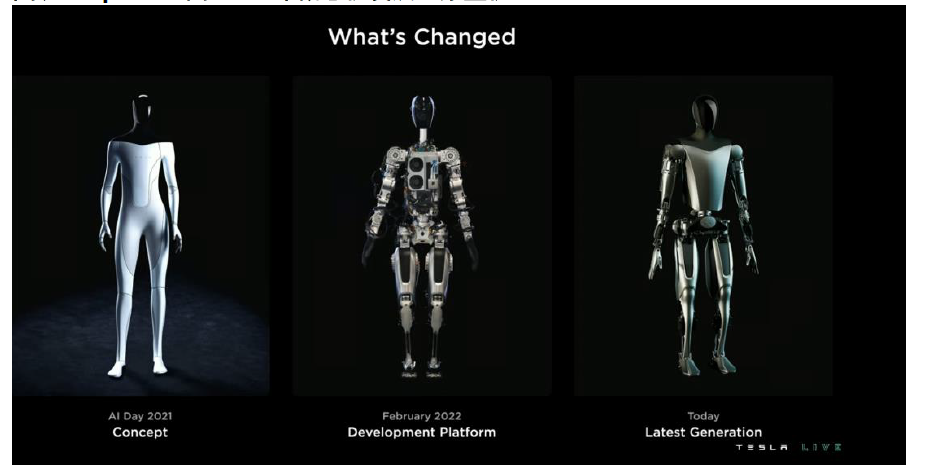
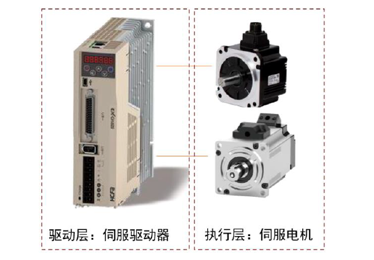
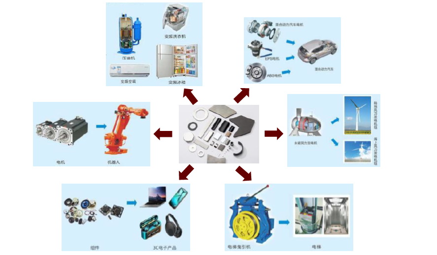

# 中金 • 联合研究 | 电动车：从特斯拉AI Day看投资机遇

> **原文链接**：https://mp.weixin.qq.com/s/1NB17K0M9Ofnt38Abe86oQ

- **公众号**：中金点睛
- **作者**：陈显帆邓学曾韬等
- **发布时间**：2022-10-11 00:00:00
- **抓取时间**：2026-11-11 12:12:30
- **正文长度**：10697 字 | **图片**：5 张（已本地化）

---

**联合研究**

北京时间10月1日，特斯拉举行AI Day活动，展示了人形机器人产品Optimus，此外也发布了自动驾驶最新进展。本期将解读相关投资机遇。

**摘要**

**机械：仿生机器人或步入加速发展阶段。** 人形机器人较工业机器人更具人类情感交互及非结构场景自适应两类能力，目前在技术和商业场景方面处于早期阶段，建议关注未来3-5年国内硬件参与企业和仿人机器人进展。

**汽车：关注智能驾驶解决方案和机器人赛道转型。** 复盘特斯拉FSD发展路径，我们认为硬件预埋+软件迭代升级或成为自动驾驶较优方案。人形机器人处于早期阶段，我们看好汽车零部件企业基于能力横向迁移进军机器人市场。

**电新：关注人形机器人动力输出和动力存储单元器件。** 从动力输出来看，生物模拟关节设计，四肢运动更为灵活，运控部件是人形机器人灵活度的关键环节。从动力存储来看，随着4680、快充、高镍等电池技术的持续升级进步，我们认为人形机器人电池能量密度和快充速度有望进一步提升。

**化工：看好机器人发展带动材料需求。** 机器人主要由本体、减速器、伺服系统及感知系统等组成。随着机器人市场逐渐扩大，我们认为相关材料需求逐渐提升，同时随着技术进步，对材料性能也有望提出进一步的要求。

**有色：人形机器人有望打开稀土永磁成长空间。** 我们认为稀土永磁电机满足体积小型化，高功率、高稳定性等需求，有望成为人形机器人用主流驱动电机，这也展示了稀土永磁在电能与动能相互转换需求场景下的更广阔应用潜力。最后，人形机器人的电池需求有望提升锂需求。

**家电：关注家庭端非人形机器人技术外溢。** 特斯拉发布的Optimus在家庭端普及还不具备条件，但我们认为发展中的前沿技术进步将形成技术漏斗，促进家庭端非人形机器人的发展。我们认为高性能机械手、仿真设计等前沿技术积累，或将带来家庭中非人形机器人的功能丰富和体验提升。

**风险**

技术迭代不及预期。

**正文**

**机械：产业巨头入局，仿生机器人或步入产业加速**

**Optimus原型机亮相，机器人设计属早期阶段** 。本次展示Optimus第一个版本，现场演示为原型机行走打招呼，视频演示为办公室浇植、工厂拿取结构件、识别周围物体渲染图等。

围绕最新一代原型机技术，本次展示围绕几方面：

**► 总体目标：** 减少元件数量和功耗。Optimus采用特斯拉SoC芯片，从传感—融合—充电管理，采用流线型电池设计及高效冷却，电池组带电量2.3kwh，可维持一天工作；控制系统基于同款自动驾驶系统FSD，融合视觉、通讯、音频等功能，支撑WiFi及LTE。

**► 结构基础：** 通过对人体动作模态、关节等模拟，团队对机器人平稳行走、上楼梯、下蹲等动作优化控制。特斯拉着重展示了机器人关节设计，类比汽车防撞及人类膝关节力学模拟，团队将压力参数放入优化程序，提升步态。

**► 执行关节：** 团队展示了应对高速及低速场景的执行关节设计，由于机器人关节有多种自由度和扭矩要求，特斯拉展示了6种可选的执行关节，含定制谐波减速器、丝杠结构。末端手指方面，公司计划单手实现11个自由度，从生物学优化手指强度和柔韧性。

**► 软件层面：** 特斯拉仍以机器视觉做为主导感知方式，团队认为FSD已具备较强机器视觉功能，使用完全相同的网络技术迁移至机器人上。目前特斯拉在不断训练神经网络的高频率数据识别，适应工厂路径规划，希望打造的机器人更加具备实用性功能。

**► 远期规划：** 马斯克认为Optimus虽处于早期阶段，目标市场并不明确，但后续优化工作会持续推进，希冀3-5年面向大众销售，远期销量达到百万台，终端售价不到2万美元/台[1]。

过往人形机器人属于仿生机器人的小众分支，相比于成熟工业机器人，人形机器人绝对优势或体现在人类情感交互及非结构场景自适应两类能力，需有高算力运控、复杂步态规划、多维感知、机械本体共同支撑。

类比汽车，人形机器人从L3/4至完全自主，从样机走向量产，技术深水区主要在于“从感知到自主决策的实时系统工程，高算力、通用AI能力”，商业化深水区在于“安全、伦理、刚需”，从1到N值得长期观察。

**汽车：关注智能驾驶解决方案和机器人赛道转型**

**自动驾驶：复盘特斯拉FSD发展路径，我们认为硬件预埋+软件迭代升级或成为自动驾驶较优方案。** 目前来看，头部造车新势力的自动驾驶开发路径为：提前进行硬件深度预埋，由软件端初步导入高级别自动驾驶功能，后续通过OTA逐步实现用户体验升级和多场景落地。硬件上采用多传感器+大算力芯片+大算力计算平台，并推进核心硬件自研；软件上覆盖操作系统+中间件+应用层，并逐步实现全面自研。我们认为随着硬件能力趋同、成本下降，软件或软硬件一体化能力或成为智能车企提供差异化体验的核心竞争力。

**关注智能驾驶软硬件赛道：** 1）域控制器：我们认为国内域控制器集成商凭借客户与产能布局先发优势，有望在集成化方向获得更高市占率；2）高算力芯片：大算力芯片适配智能车算力需求，成为芯片厂商的角力场。3）线控底盘：自动驾驶技术的落地有赖于更智能的执行层，线控底盘具备机电一体化、控制集成化的特点，国内自主供应商及主机厂加快推动线控底盘量产落地，并带来自主供应商国产替代机会；4）感知与定位系统。

**人形机器人：Optimus产品处于早期阶段，产业链有望迎行业机会重塑，看好汽车零部件企业基于能力横向迁移进军机器人市场。** 马斯克指出本次发布的Optimus原型机只是第一个版本，有信心远期量产达数百万台；同时希望快则3年、慢则5年，人形机器人实现商用购买[2]。我们认为人形机器人的落地应用尚需时日，但相关上游核心零部件的技术和格局有望迎行业机会重塑，具体而言包括传感器、AI芯片、伺服电机、减速器、视觉系统等。我们认为，汽车零部件与人形机器人零部件存在部分重合或相似之处，供应商及潜在供应商亦存在一定程度的重合。

**关注汽车零部件中与人形机器人零部件相关赛道** ：1）热管理：新能源汽车渗透以及高价值量的热泵系统装配率提升驱动行业成长，长期来看模块化集成化程度提升推动热管理回路技术升级。热管理系统同样在人形机器人中发挥重要作用。2）轻量化：汽车排放要求提升驱动新能源整车厂通过降低车身自重以减少百公里碳排放，支撑铝合金压铸行业景气度。人形机器人考虑到电池续航问题，在传动机构上同样会选择轻量化材料。3）齿轮：电动车减速器提高了车用齿轮的精度要求，进一步加深技术壁垒。减速器也是人形机器人中成本最高的部件之一，包括谐波/行星/RV减速器等种类，齿轮是其中的核心零件。汽车高精度齿轮供应商有望发挥精密机加工、规模效应等优势打入机器人产业链。

**电新：动力输出和动力存储单元核心部件亮点突出**

**根据本次特斯拉的发布会视频，Optimus已经可以基本完成行进打招呼、工厂重物搬运、办公室浇水等功能，此外也展示了关节执行器的承压能力和指关节的高精度和高灵敏度。此外本次Optimus还发布了相关的电池参数，工作时长在同类人形机器人中位列前列。**

**从动力存储单元来看：电池性能直接决定人形机器人的单次最大工作范围和工作连续性，本次Optimus的续航时长较为领先。** 特斯拉本次发布的Optimus搭配2.3Kwh，5V输出电压的电池，公司预计可以支撑Optimus一整天的工作时长。而Optimus为了减少四肢传感线路将电气系统集中在胸口的主躯干部分，并借鉴汽车产品的设计将Optimus相关的电池电子进行集成，进而使得各类电源管理过程都集中在一个系统上。与市面已有的人形机器人进行对比来看，优必选的Walker机器人采用磷酸铁锂电池（54.6V/10Ah）充电时长和工作时间均为2小时；NAO的57cm人形机器人则配备一个55Wh的电池可连续使用1.5小时左右，Pepper的电池规格约为29.2V/8.0A，充电4小时左右即可达到80%容量（8小时充满），可连续使用7~20小时。考虑到人形机器人空间、受重有限，我们认为电池性能是决定人形机器人商业化的核心指标之一，随着4680、快充、高镍等电池技术的持续升级进步，人形机器人电池的能量密度和快充速度有望进一步提升。

**从动力输出单元来看：生物模拟关节设计，四肢运动更为灵活，运控部件是人形机器人灵活度的关键环节。** 人形机器人应用场景多元化、运动控制较为复杂，我们看到本次发布会中人形机器人的关节和手指均表现出较高的灵活度和运控能力。

**► 关节：** Optimus加入仿生学设计参考人体关节模拟关节和肌腱形态，Optimus共有28个关节执行器，且从视频展示来看其关节执行器可以承受一架半吨重钢琴的拉力。

**► 手部：** 手部搭配6个执行器和11个自由度大幅提升手机的灵活性和柔韧性进而实现小且薄的物品抓取功能适应工厂的复杂应用环境，Optimus手部设计抓取重量约为20lb（约9kg）。

**► 运动控制环节：** 机器人的驱动方式主要为电动驱动、液压驱动等，其中电动驱动主要沿袭工业机器人的主流运控方式，依靠伺服系统等为主。考虑到伺服系统在工业机器人的主导地位，我们认为人形机器人的不同部位仍然有望持续以伺服系统为主（100-150W 伺服电机用于腿部、腰部，50-100W 伺服电机用于大关节， 50w 以内用于手臂等）。此外空心杯电机相比于传统有刷直流电机而言，体积更小，且不会在转动过程中产生感应电动势存在较高的涡流损耗进而使得转速较高、能效更高（空心杯电机约为80%，多数有刷直流电机多在50%左右）、响应速度更快（机械时间约为10几毫秒，有刷直流电机约为100毫秒），更适应于频繁启停、对空间、便捷性要求较高的场景。由于虑到人形机器人手指关节处空间较小，且需要输出较大的力矩，空心杯电机的特点也更契合人形机器人的指节模组。

**► 锂电池环节：** 从Optimus的发布会视频来看，我们预计Optimus的外壳或采用4680设计，进而进一步提升电池能量密度。考虑到人形机器人的受重和空间更为有限，我们认为人形机器人对于能量密度的要求或更高。

**化工：看好机器人发展带动材料需求**

**看好机器人蓬勃发展下对相关材料的需求。** 机器人主要由机器本体、减速器、伺服系统及感知控制系统等组成。随着机器人市场逐渐扩大，我们认为相关材料需求逐渐提升，同时随着技术进步，对材料的性能也有望提出进一步的要求[3]。

► 机器人本体用材料。机器人本体是主要的直接受力构件，其材料应具备：1）强度高、刚度大，可以提升机器人安全性；2）质量轻，机器人手臂构建的变形主要由惯性力引起，轻量化有助于提升机器人性能同时也有助于降低能耗；3）阻尼大，为降低终止运动带来的惯性力与构件弹性带来的残余振动的影响，采用大阻尼材料有助于提升执行的精度与平稳性；4）较大的弹性模量，避免使用过程中机器人的变形是实现精确控制的基础。机器人本体常用材料主要是钢、铸铁以及镁铝合金等。

► 减速器用材料。高精密减速器是机器人的关节，较重要的减速器主要有RV减速器与谐波减速器。这种高精密机械零部件对材料以及工艺要求较高，包括高强度、高韧性以及高耐磨性。常用的材料包括30CrMnSi/40Cr等。

► 伺服系统用材料。伺服电机驱动系统是通过电机产生力矩驱动机器人关节运动的执行机构，要求电机具有高功率质量比、较宽广且平滑的调速范围等，末端执行器（手爪）更是要求质量与体积小，同时具有较大的短时过载能力。稀土永磁电机体积小、损耗低、可靠性强，是伺服系统的较优选择。而金属钕铁硼等材料是其中的关键材料。

► 感知系统用材料。随着机器人产业发展，机器人操作逐渐复杂，传感需求逐渐增加。而传感器是其中的关键零部件。传感器材料众多，主要包括1）硅、碳化硅等半导体材料，2）压电与热电材料，3）塑料等。

**轻量化成为重要发展方向，看好碳纤维的需求提升。** 机器人轻量化是人机协作、整体力学性能提升以及节能减排等问题的重要解决方案。碳纤维是由聚丙烯腈在高温环境下裂解碳化形成的含碳量高于90%的碳主链结构无机纤维，且具备许多优异性能，主要优点在于强度和模量高，密度低，耐疲劳性良好等。据《机器人轻量化材料应用的研究进展》[4]，使用碳纤维复合材料做的机械臂，质量较铝合金材料低30%，精准度由0.03mm提升至0.01mm，安全稳定性与效率均可以得到提升。我们看好碳纤维在机器人领域的应用。

**有色金属：从人形机器人角度再看“万物电驱”，有望进一步打开稀土永磁需求的成长空间**

**Optimus原型机全身含34个驱动器，较2021年概念机减少6个。** 2022特斯拉AI Day于北京时间10月1日成功举办，擎天柱Optimus原型机首次亮相，现场演示原型机行走打招呼，视频演示办公室浇植、工厂拿取结构件、识别周围物体渲染图等。此次原型机展示相较于2021年的概念机减少了6个驱动器，目前Optimus全身共34个执行器，其中身体上有28个结构执行器（肩部6个，肘部2个，腕部6个，腰部2个，髋部6个，膝部2个，踝部4个），手部6个执行器对应11个自由度，大幅提升的灵活性和柔韧性进而实现小且薄的物品抓取功能适应工厂复杂的应用环境。

**趋势一：贯彻“第一性原理”，拟人形态要求下对于驱动器数量有要求，稀土永磁同步电机有望成为驱动器的主流电机。** 此次Optimus原型机的亮相，展现出了人形机器人对于特斯拉电动汽车领域自动驾驶、AI应用等的一脉相承，人形机器人就像是站起来的智能汽车，融合了视觉、通讯、音频等功能。我们认为在电动汽车制造上坚持的“第一性原理”也将在人形机器人上得到贯彻，简而言之即对人体动作、关节等模拟，因此在人形机器人平稳行走、上下楼梯、蹲下起立等动作要求下关节处的驱动器必不可少，灵活度要求越高的部位驱动器将越多，比如手部。因此我们认为，即使总体目标为减少元件数量，但人形机器人在拟人形态的要求下，对于驱动器数量有要求。

**图表：Optimus由2021年概念机发展至原型机**

资料来源：2022特斯拉AI Day，中金公司研究部

**稀土永磁的“第一性原理”即为电能与动能的转换，与人形机器人上驱动器的作用相匹配。** 根据电流的磁效应，任何通电导线的周围都会产生磁场，再与永磁体相互作用即可将电能转换为动能，达到驱动的目的。机器人的核心系统即驱动系统，大多采用伺服系统，主要由伺服驱动器、伺服电机和编码器组成，编码器通常嵌入于伺服电机。伺服系统是使物体的位置、方位、状态等输出量，随着输入量的任意变化而变化的自动控制系统，是工业自动化的关键零部件，是实现精准定位、精准运动的必要途径，因此在机器人各关节中得到广泛应用。而稀土永磁电机满足体积小型化，高功率、高稳定性等需求，我们认为有望成为人形机器人用主流驱动电机。

**图表：永磁同步伺服电机运用于机器人伺服系统中**

资料来源：禾川科技招股说明书，中金公司研究部

**趋势二：“万物电驱”时代的到来，不仅是人形机器人，电能与动能相互转换的需求即为稀土永磁的潜在应用场景，稀土永磁需求具有广阔的成长空间。** 根据电流的磁效应（电动机原理）、电磁感应现象（发电机原理），永磁体是电能与动能相互转换不可或缺的元件。第三代稀土永磁体钕铁硼以其优异的磁能积和矫顽力等性质被称为“万磁之王”，自问世以来便广泛应用于3C、家电、传统汽车等领域，目前正在新能源汽车、风电、节能工业电机等高效节能领域加速增长，而人形机器人的问世，无疑是钕铁硼发展的下一个风口。我们认为，未来人类生活“万物电驱”的趋势与稀土永磁的“第一性原理”不谋而合，电能与动能相互转换的需求即为稀土永磁的潜在应用场景，稀土永磁具有较强的需求成长性。

**图表：“万物电驱”时代稀土永磁的主要应用场景**

资料来源：金力永磁公司官网，中金公司研究部

**趋势三：人型机器人作为锂电池的新兴应用场景，我们认为有望对锂需求形成一定补充。** 根据本次特斯拉AI day 公布信息，Optimus将使用52V电压、2.3Kwh的锂电池包。根据我们测算，假设采用钴酸锂电池，约每650台人形机器人搭载的电池将需要1吨的碳酸锂供应，随着人形机器人的渗透率提升，我们认为有望开发锂电池在消费电子领域的全新应用场景，对锂需求形成一定补充。

**新能源及节能领域高速增长带动稀土磁材需求增速系统性提升，人形机器人进一步打开稀土永磁需求的成长空间，稀土永磁产业迎来发展新浪潮**

**近期稀土价格回调企稳，随着下游需求回暖，叠加供给端短期仍偏紧，我们认为稀土价格有望否极泰来。** 近期稀土相关价格出现企稳回调现象，截至9月30日，氧化镨钕、氧化镝、氧化铽分别自区间最低点回升13.2%、5.5%、1.6%。展望Q4，前期价格大幅下跌已将需求下滑和供应释放的预期体现殆尽，我们认为稀土价格有望迎来否极泰来。**需求侧，** 8月国内新能源车、智能手机、工业机器人产量环比分别+11.99%、+4.65%、+8.06%，我们认为，随着磁材下游需求传统旺季的到来，有望驱动稀土价格持续回升。**供给侧，** 一是根据海关数据，1-8月我国累计自缅甸进口稀土REO 5,325吨，较去年同期减少11,574吨，同比-68%；1-8月自美国进口稀土REO约3.0万吨，较去年同期增长4,045吨，同比增长16%；二是国内稀土全年指标较去年+25%，短期大幅增产有限；三是受此前疫情影响，磁材企业订单不足，废料供应减少，整体来看，短期供应端延续偏紧格局，对稀土市场形成支撑，我们认为稀土价格有望否极泰来。

**家电：技术漏斗或带动非人形机器人家庭应用升级**

**此次特斯拉发布的Optimus在家庭应用端普及还不具备条件，但发展中的前沿技术进步将形成技术漏斗，促进家庭端非人形机器人的发展。**

**前沿科技通过技术漏斗，促进家庭端机器人的应用发展早有案例。** 海外扫地机器人公司iRobot早期以设计开发国防机器人为主，1990-2001年间，公司先后推出探测、排雷、战术移动等国防机器人，其中PackBot曾参与911 搜救、日本福岛核事故搜救等重要行动，公司掌握较强的机器人核心技术。2002年起iRobot开始转型消费机器人，推出扫地机器人Roomba并大获成功。Roomba开创性地采用随机碰撞技术，使得扫地机器人不再依赖昂贵的传感器，成本得以大幅降低，从而成功实现扫地机器人的商业化。iRobot实质上将应用于探测、排雷的视觉导航技术应用于家庭扫地机器人Roomba，实现前沿技术在家庭端的应用，实现了扫地机出货量的突破式增长。

**我们认为此次Optimus所具备的高性能机械手、仿真设计等前沿技术积累，或将带来家庭中非人形机器人的功能丰富和体验提升。** 目前，家庭端搭配高性能机械手的产品包括三星Bot Handy，英国Moley厨房机器人等。

和人形机器人相比，非人形机器人机械结构相对简单，解决单一的应用场景，更容易实现普及。目前消费级机器人市场中最成熟的品类是扫地机器人，其他的探索包括清洁类的擦窗机器人及空气净化机器人、厨房类的炒菜机器人等。2015年英国创业公司Moley Robotics基于机器人手臂开发了一款机器人厨房原型机Moley。Moley使用3D捕捉技术，根据厨师做菜的动作进行相关的模仿和学习。由于该产品成本高，系统复杂，目前还未能进入商业化阶段。在中国炒菜机器人按照应用场景可划分为家庭用、餐厅用以及工厂用三类，按照自动化程度可分为半自动智能炒菜机和全自动智能炒菜机。中国炒菜机器人诞生之初体积大且功能单一，应用场景以中央厨房为主，后逐步延伸至家用场景。产品性能也由半自动化炒菜机逐步向全自动化、智能化方向发展。综合性的家庭服务机器人也在不断发展，今年9月，亚马逊推出新一代家庭服务机器人Astro，在原有基础上新增宠物监视和门窗监控功能。

[1]https://news.bjd.com.cn/2022/10/08/10179023.shtml

[2]https://news.bjd.com.cn/2022/10/08/10179023.shtml

[3]《机器人产业及其关键材料的现状及趋势》，化定奇，2016

[4]《机器人轻量化材料应用的研究进展》，于成涛，张静旖，吴英彪等，2019

**文章来源**

本文摘自：2022年10月9日已经发布的《中金电动车研究：从特斯拉AI Day看投资机遇》

分析员 陈显帆 | 机械军工 SAC 执证编号：S0080521050004 SFC CE Ref：BRO897

分析员 邓学 | 汽车及出行设备 SAC 执证编号：S0080521010008 SFC CE Ref：BJV008

分析员 曾韬 | 电新公用环保 SAC 执证编号：S0080518040001 SFC CE Ref：BRQ196

分析员 裘孝锋 | 石油燃气化工 SAC 执证编号：S0080521010004 SFC CE Ref：BRE717

分析员 齐丁 | 有色金属 SAC 执证编号：S0080521040002 SFC CE Ref：BRF842

分析员 何伟 | 家电 SAC 执证编号：S0080512010001 SFC CE Ref：BBH812

分析员 邹靖 | 机械军工 SAC 执证编号：S0080522090003 SFC CE Ref：BRY575

联系人 荆文娟  | 汽车及出行设备 SAC 执证编号：S0080121010058

联系人 樊建岐 | 汽车及出行设备 SAC 执证编号：S0080121080144

分析员 王颖东 | 电新公用环保 SAC 执证编号：S0080522090002

分析员 夏斯亭 | 化工 SAC 执证编号：S0080522070012

联系人 张家铭 | 有色金属 SAC 执证编号：S0080121050228

分析员 汤亚玮 | 家电 SAC 执证编号：S0080521110003

**法律声明**

向上滑动参见完整法律声明及二维码

特别提示

本公众号不是中国国际金融股份有限公司（下称“中金公司”）研究报告的发布平台。本公众号只是转发中金公司已发布研究报告的部分观点，订阅者若使用本公众号所载资料，有可能会因缺乏对完整报告的了解或缺乏相关的解读而对资料中的关键假设、评级、目标价等内容产生理解上的歧义。订阅者如使用本资料，须寻求专业投资顾问的指导及解读。

本公众号所载信息、意见不构成所述证券或金融工具买卖的出价或征价，评级、目标价、估值、盈利预测等分析判断亦不构成对具体证券或金融工具在具体价位、具体时点、具体市场表现的投资建议。该等信息、意见在任何时候均不构成对任何人的具有针对性的、指导具体投资的操作意见，订阅者应当对本公众号中的信息和意见进行评估，根据自身情况自主做出投资决策并自行承担投资风险。

中金公司对本公众号所载资料的准确性、可靠性、时效性及完整性不作任何明示或暗示的保证。对依据或者使用本公众号所载资料所造成的任何后果，中金公司及/或其关联人员均不承担任何形式的责任。

本公众号仅面向中金公司中国内地客户，任何不符合前述条件的订阅者，敬请订阅前自行评估接收订阅内容的适当性。订阅本公众号不构成任何合同或承诺的基础，中金公司不因任何单纯订阅本公众号的行为而将订阅人视为中金公司的客户。

一般声明

本公众号仅是转发中金公司已发布报告的部分观点，所载盈利预测、目标价格、评级、估值等观点的给予是基于一系列的假设和前提条件，订阅者只有在了解相关报告中的全部信息基础上，才可能对相关观点形成比较全面的认识。如欲了解完整观点，应参见中金研究网站（http://research.cicc.com）所载完整报告。

本资料较之中金公司正式发布的报告存在延时转发的情况，并有可能因报告发布日之后的情势或其他因素的变更而不再准确或失效。本资料所载意见、评估及预测仅为报告出具日的观点和判断。该等意见、评估及预测无需通知即可随时更改。证券或金融工具的价格或价值走势可能受各种因素影响，过往的表现不应作为日后表现的预示和担保。在不同时期，中金公司可能会发出与本资料所载意见、评估及预测不一致的研究报告。中金公司的销售人员、交易人员以及其他专业人士可能会依据不同假设和标准、采用不同的分析方法而口头或书面发表与本资料意见不一致的市场评论和/或交易观点。

在法律许可的情况下，中金公司可能与本资料中提及公司正在建立或争取建立业务关系或服务关系。因此，订阅者应当考虑到中金公司及/或其相关人员可能存在影响本资料观点客观性的潜在利益冲突。与本资料相关的披露信息请访http://research.cicc.com/disclosure_cn，亦可参见近期已发布的关于相关公司的具体研究报告。

本订阅号是由中金公司研究部建立并维护的官方订阅号。本订阅号中所有资料的版权均为中金公司所有，未经书面许可任何机构和个人不得以任何形式转发、转载、翻版、复制、刊登、发表、修改、仿制或引用本订阅号中的内容。

