# 中金 | 人机系列04：具身智能大脑的进化之路

> **原文链接**：https://mp.weixin.qq.com/s/TeDcNDt6oU3sCqzy_SkbRQ

- **公众号**：中金点睛
- **作者**：刘中玉 郭威秀等
- **发布时间**：2025-11-17 00:00:00
- **抓取时间**：2026-11-12 15:01:12
- **正文长度**：12884 字 | **图片**：15 张（已本地化）

---

**中金研究**

具身智能大脑正处于“路线分化”向“融合落地”跨越的关键阶段，数据驱动与异构训练成为迈向通用智能的核心。本篇报告聚焦于全球具身智能机器人在算法架构、数据生态、底层支持的最新进展。

**[点击小程序查看报告原文]()**

**Abstract**

**摘要**

具身智能算法：从模型驱动到数据驱动。分层控制是基础架构范式，以两级结构实现工程化；VLA范式（以VLM为基础）强化泛化与交互能力，是当前活跃的研究方向。世界模型通过环境建模与未来预测提供物理约束，处于科研主导阶段。我们认为，短期分层架构因工程可控性仍是主流，VLA在复杂任务和人机交互中展现潜力，世界模型因具备跨设备迁移能力被视为长期方向。

具身智能数据：高价值信息量成竞争核心。机器人数据涵盖多模态，产业找寻低数据成本获取&高数据效率应用路径。1）获取端：包括真机、视频（第一人称/第三人称）、仿真等路线。2）安全端：数据安全为不容忽视的底线，人形机器人厂商面临权限隔离、数据加密体系、跨境传输政策等多方挑战。3）应用端：传统数据应用策略为 “同构闭环”，仅能在同类型硬件上复现策略。异构训练通过模块化Transformer架构，跨机器人本体共享算法模型。

具身智能热点议题解析。1）Scaling Law：与离身智能不同，机器人Scaling Law尚未迎来爆发式突破。我们认为真实数据产能不足、Sim2Real迁移等为制约因素；2）Benchmark推动评测标准化进程。具身机器人缺乏公认量化框架，面临场景多样性、任务转化等难题。斯坦福李飞飞团队发布具身智能评测BEHAVIOR-1K，推动具身智能评测标准化。3）物理AI：物理AI融合物理知识与AI模型，已走向机器人操作应用。

**风险**

技术路线不确定、数据安全合规风险等。

**Text**

**正文**

**具身智能算法篇：从Model-driven到Data-driven**

**机器人算法发展历史**

机器人控制算法以MPC/WBC为主。在机器人发展初期，算法体系几乎完全依赖先验控制理论。模型预测控制（MPC）与全身控制（Whole-Body Control, WBC）通过动力学建模，确保机器人在已知环境下能够稳定执行动作。MPC/WBC本质上是基于先验知识的演绎推理系统，通过预设的物理模型和逻辑规则生成控制指令。波士顿动力Atlas（2019年优化）的高难度跳跃动作，依赖于MPC框架实现动态平衡。

2016年后神经网络引入，提升模型适用性。自2016年起，模仿学习和强化学习（RL）的结合让机器人逐渐具备了在仿真环境中通过“试错+奖励函数”学习策略的能力。谷歌DeepMind（2016）在机械臂抓取实验中率先展示了深度强化学习的潜力。但彼时局限同样突出，神经网络训练需要庞大的数据和算力支持。

生成式AI引领认知范式转折。这一阶段的模型与过去相比，不再仅仅关注“运动实现”，而是能够“理解语言、推理任务并生成复杂动作序列”的智能涌现。

► 模型规模化：大模型结构（如Transformer与Diffusion框架）成为统一的算法底座，为跨任务学习奠定基础。例如VLA模型以VLM模型为基础，整合视觉、语言和动作等多种信号，将动作轨迹等数据统一到模型架构中，形成了“感知—认知—控制”的闭环，缩短了感知与行为之间的链路。

► 泛化规律：当模型与数据规模达到临界点后，Scaling Law带来的泛化效应使大模型在零样本或少样本条件下具备跨任务学习与迁移能力。

**具身智能算法架构之争：分层/VLA/世界模型？**

行业算法正处多路线架构。 当前，机器人算法分化出分层架构、VLA和世界模型三种主流路径。这些路线在理论逻辑、工程实现和产业落地上存在差异，成为学术界与产业界的核心争论点。

► 分层控制（Hierarchical Control Architecture）源于经典控制论与认知神经科学的结合。该思想在Sutton等（1999）的Options Framework中被形式化为“层级强化学习（Hierarchical Reinforcement Learning）”，确立了“高层任务分解+低层动作执行”的通用范式。

图表1：分层控制架构的人形机器人意图识别与动作生成机制拆解图

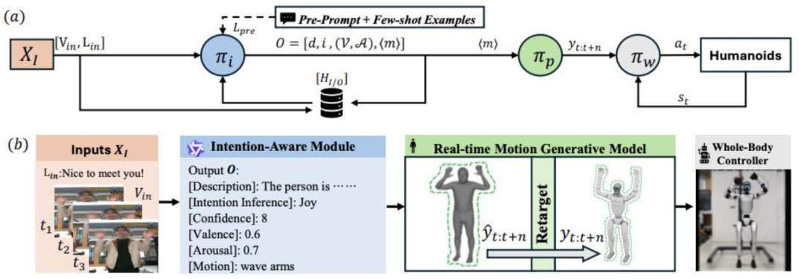

资料来源：《Hierarchical Intention-Aware Expressive Motion Generation for Humanoid Robots》（Bao et al., 2025），中金公司研究部

VLA范式突出跨任务与跨平台的泛化能力。VLA（Vision-Language-Action）范式在Brohan等（2023）的《RT-2: Vision-Language-Action Models Transfer Web Knowledge to Robotic Control》中系统化提出，通过视觉和语言输入直接输出动作，实现“从指令到执行”的端到端链路，其模型在62类机器人操作任务中实现78%零样本泛化率。PaLM-E（Driess et al., 2023）也提出可扩展至5620亿参数模型，将语言模型与具身控制相结合，实现机器人在复杂的自然语言指令下执行输出精度达厘米级的空间操作。

图表2：RT-2大型VLA模型与机器人数据结合示意图

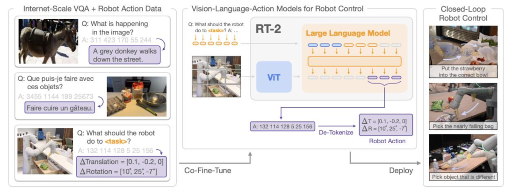

资料来源：《RT-2: Vision-Language-Action Models Transfer Web Knowledge to Robotic Control》（Brohan et al., 2023），中金公司研究部

世界模型正从强化学习验证走向生成式模拟融合。Meta在2025年9月提出的Code World Model，具有320亿参数，通过模拟代码执行轨迹实现因果推理，在数学任务中准确率达96.6%，其长上下文（131k tokens）能力为世界模型在人形机器人长时序任务（如“组装汽车零件”）中的应用提供参考，可推演100+步动作序列的后果。

此外，视频生成模型（如2024年发布的OpenAI Sora）被视为“世界模拟器”的一种，用于学习环境动态并迁移到具身智能与自动驾驶。这一路线的优势在于模型可跨任务迁移并支持零样本策略优化，当前处于科研主导阶段。

图表3：世界模型的异步训练与环境模拟机制

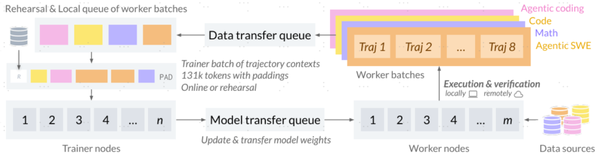

资料来源：《CWM:An Open-Weights LLM for Research on Code Generation with World Models》（Meta, 2025），中金公司研究部

我们认为，短期内机器人分层架构因安全性与工程可控性仍是主流，尤其适合工业落地；VLA在复杂任务和人机交互中展现潜力，但需要与分层结合保证稳定性；世界模型虽仍在探索期，却因具备跨设备迁移能力被视为长期方向。总体来看，算法格局正逐步进入“融合期”，不同路线将在实际工程中互补发展，推动人形机器人算法从“执行层面”走向“通用智能”。

**具身智能数据篇：从获取到应用**

**数据获取：多源融合驱动具身智能崛起**

数据是人形机器人大脑演进的燃料。具身算法竞争的本质已从“模型架构之争”转向“数据之争”。与传统互联网AI主要依赖文本和图像不同，机器人所需数据更加复杂、多模态且高维，涵盖物理、视觉、语音、力觉与行为反馈等。当前机器人行业数据采集正形成三大路径：真机获取、视频学习、仿真生成，并在近年来逐渐形成互补格局。

图表4：机器人三类数据获取路径

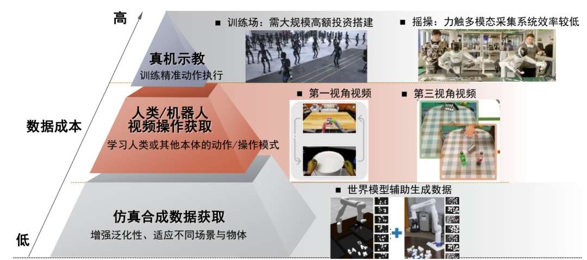

资料来源：《Learning Generalizable Robot Policy with Human Demonstration Video as a Prompt》（Zhu et al., 2025）、《EgoVLA: Learning Vision-Language-Action Models from Egocentric Human Videos》（Yang et al., 2025），中金公司研究部

一、真机获取：高价值、高成本的现实反馈

遥操作成为获取高价值人机共采数据的重要途径。遥操作强调“人机共采”，即由操作员通过VR头显、双手柄或力反馈外骨骼系统远程控制机器人执行任务，以采集更高质量的示范数据。

真机训练场成为数据采集的核心基础设施。中国多地已建立千平级具身智能数据采集基地，部署数百台轮式与双足机器人在固定场景中执行抓取、搬运、行走等动作，通过全天候运行采集视觉、触觉、力反馈及语言交互等多模态数据。这类训练场通常具备“高频采集+自动标注+云端上传”的能力，可在单位时间内生成PB级运动样本（1PB 等于1024TB），成为产业关键基础设施。

自主采集与遥操作正互补融合。领先实验室已探索“自主采集+人类接管”的混合模式：当机器人自主执行中遇到高不确定性场景时，系统自动切换至人类远程接管，完成复杂示范后再恢复自主模式。该机制实现了“主动采集+被动标注”一体化循环，既降低人工干预成本，又增强数据的多样性与长期连续性。

二、视频获取：用视觉重建“人类经验”

视频数据正成为人形机器人训练的关键增量来源。 相较真机采集，视频学习凭借低成本、高多样性与天然的场景丰富度，成为具身智能的重要数据补充路径。现阶段的主流方式包括两类：一是人类视频模仿学习（Human Video Imitation），通过解析互联网或工业环境中的人类操作视频，提取视觉—动作映射关系；二是机器人自我视频学习（Robot Ego-Video Learning），由机器人自身采集任务执行的视觉流，形成可循环训练数据集。

图表5：EgoMimic系统中的人机模仿学习流程

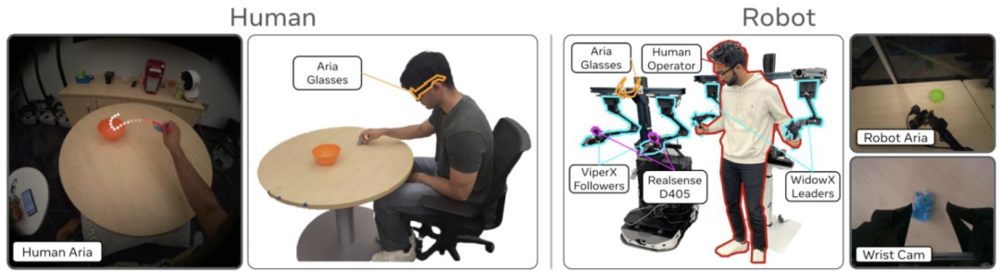

资料来源：《EgoMimic: Scaling Imitation Learning via Egocentric Video》（Kareer et al., 2024），中金公司研究部

视频数据经仿真对齐后可替代真机示教。UC Berkeley与斯坦福大学的联合推出VideoMimic（2025）系统，首次实现从互联网视频到真实人形机器人操作的完整迁移流程。该系统先在Isaac Gym中利用第三视角视频重建4D人类动作序列与环境几何，通过动作重定向与物理约束生成可行轨迹，并在仿真环境中引入域随机化和强化模仿学习，蒸馏出仅依赖本体感知的通用控制器。

特斯拉推动视频学习从“个体模仿”走向“群体协同”。在早期阶段（2022–2023），特斯拉 Optimus项目采用Egocentric Learning模式，通过与车载视觉系统共享的第一人称相机采集交互数据，使机器人在任务执行中形成“自我视觉—动作”强绑定特征。自2024年起，特斯拉逐步转向Multi-View Fleet Learning体系，利用全球超500万辆汽车实时采集的外部视频流构建“车—人形—环境”的多模态协同网络，实现了跨视角表征统一，使人形机器人能够以第三视角数据推理第一视角动作。

仿真获取：Sim2Real

在数据需求呈指数增长的当下，仿真合成数据成为规模化训练的新增来源。当前主流方案包括高保真物理引擎、数字孪生环境与程序化生成场景，在“近似真实”的虚拟世界中规模化合成动作—感知数据，再经Sim2Real迁移到真机。

研究表明，域随机化与模拟探索可提升迁移性能。Gu等人（2024）提出的 “Humanoid-Gym”强化学习框架，专门针对人形机器人任务，展示了使用大规模仿真训练政策并零调优迁移至真实人形机器人（XBot-S/XBot-L）平台。这些研究共同提示仿真平台若想落地人形机器人，需要不仅在物理动力学建模上精准，更要在时序、控制策略与环境分布上考虑迁移差异。

仿真平台正在朝生成式数据与闭环验证迈进。Li等人（2024）提出的 “RoboGSim”模拟器提供了“real2sim2real”闭环：先将真实场景映射到可微分仿真，再从仿真中训练、最终迁移回真实操控。此类方法标志着仿真从“静态环境”走向“动态可学习世界模型”，为人形机器人在多任务、异构平台间的迁移提供新路径。

**异构训练：跨本体学习与共享模型**

人形机器人算法正从“同构孤岛”迈向“异构共训”。当前全球人形机器人产业的技术分化较为严重：关节数、传感类型、运动冗余度各不相同，算法可复用性较低。传统训练方式往往在同构硬件上闭环（如三指手在三指手上复现），难以迁移至异构结构。异构训练的目标是让“不同形体共享同一大脑”。

在MIT与Meta（2024）联合发布的论文《Scaling Proprioceptive-Visual Learning with Heterogeneous Pre-trained Transformers 》中，研究者提出了首个针对多类型机器人的异构预训练框架。其核心在于通过模块化Transformer结构把来自不同机器人（例如10关节与30关节人形机型）的数据映射到同一潜在语义空间，从而使策略可以跨机体迁移。

图表6：HPT模型的异构机器人跨形体预训练框架

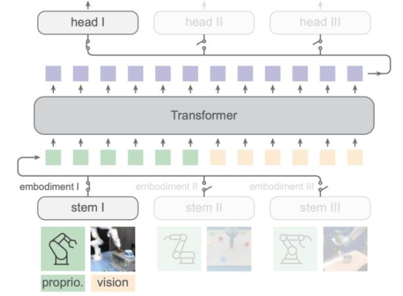

资料来源：《Scaling Proprioceptive-visual Learning with Heterogeneous Pretrained Transformers》(Wang et al., 2024)，中金公司研究部

**具身智能热点议题辨析**

**大脑模型何时迎来“ChatGPT”时刻？**

具身智能领域存在Scaling Law规律。离身智能如ChatGPT的出现证明了大语言模型的Scaling Law现象。具身智能领域同样存在Scaling Law规律，即随着模型规模、数据和算力的增加，机器人在认知和行为上显著提升，泛化性能和任务能力实现突破。学界和业界均对具身智能的Scaling Law现象进行了探索。

我们发现，已有文献主要证明了具身智能领域在单任务场景、小型模型和无预训练阶段的Scaling Law，但基于多模态数据、预训练后的Scaling Law尚未被充分证明，单纯数据量或模型参数的增加已不能支撑模型性能的规模性增长。

数据策略对实现模型数据的scaling law至关重要。目前机器人操作领域正经历一场以数据扩张为核心的重大变革，单纯堆砌数据量已无法支撑模型的scaling law，核心在于策略性方法的出现，研究范式从数据量提升转向包括场景、任务、物体、空间、本体及操作在内的多样性的研究。目前已有文献证明训练数据中场景、空间、物体、任务的多样性能驱动模型表现更优的scaling特性。

如Lin 等人在2025年的论文发现，引入包含多样化环境和物体的数据集能大幅提升模型泛化性能，并建立模型性能与数据多样性之间的幂律关系。ManiBox的论文证实了多样化的空间布局可提升操作任务中的空间泛化能力。Saxena 等人研究发现摄像头视角和空间布局是影响机器人操作模型性能的关键维度[1]。

MoE架构解决多模态参数竞争导致的性能衰减问题。混合专家（MoE）架构在自然语言处理领域已成为主流技术选择，被广泛应用于大模型研发中，是平衡模型性能、参数规模与计算效率的关键方案。在具身智能领域，美的集团、北京人形机器人创新中心和清华大学的联合团队等在2025年2月联合发布了ChatVLA，采用的MoE混合专家架构通过双路由器设计和共享自注意力层，类似于人类左右脑分别用于物理技能和语言视觉实践，实现了在计算资源有限的情况下进行更有效率的训练。

**Benchmark：物理AI测试框架呼之欲出**

具身智能缺乏行业公认评测Benchmark。如今，大语言模型已构建起一套多层次、成体系且持续迭代的评测基准生态。而具身智能的评测基准则相对匮乏，仍面临场景多样性、现实任务转化、能力基准碎片化三方面难题，缺乏行业公认的量化评估框架。纯任务认知类评测（Meta的OpenEQA基准、谷歌3DMEM-BENCH等）无需搭建可交互的仿真场景，仅通过输入环境视频&图像+文本问题输出回答即可。涉及到动态交互类任务的评测则需要搭建仿真平台，进行场景重建，涉及的环境仿真的sim-to-real gap、场景和物体丰富度、数据标注、任务时长和复杂度等都会影响评测结果的准确性和可靠性。

斯坦福李飞飞团队在2024年3月领衔发布具身智能评测Benchmark BEHAVIOR-1K，推动具身智能评测标准化。BEHAVIOR-1K基于 NVIDIA Omniverse 的高保真模拟器 OmniGibson进行环境仿真，覆盖50个场景和1000项活动，还包含了超9000个经过标注的物体。这些活动具有长时间跨度且依赖复杂的操控技能，考验具身AI的长程任务处理和泛化性能。

在2025年9月，李飞飞团队与斯坦福AI实验室官宣了首届 BEHAVIOR 挑战赛，有望成为机器人界的“Imagenet时刻”。此次挑战赛涵盖真实家庭场景下最关键的 1000 个日常任务，并首次以 50 个完整长时段任务作为核心赛题，采用星海图 R1 Pro 机器人作为默认本体，全面考验具身AI模型能力。

图表7：仿真基准评测BEHAVIOR-1K包含了基于1461位参与者选出的1000项家庭活动

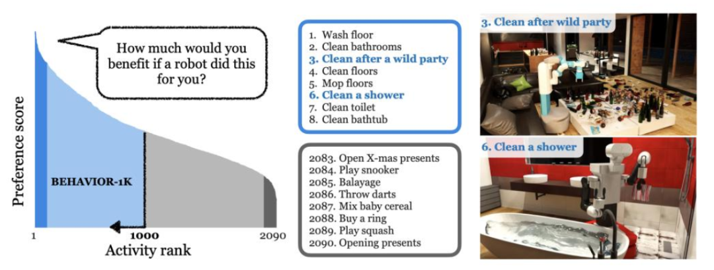

资料来源：《BEHAVIOR-1K: A Human-Centered, Embodied AI Benchmark with 1,000 Everyday Activities and Realistic Simulation》(Chengshu Li et al.,)，2023，中金公司研究部

英伟达支撑BEHAVIOR-1K物理仿真建模。物理仿真层面，BEHAVIOR-1K基于全新的仿真环境OMNIGIBSON构建，相较原来的iGibson 2.0仿真环境增设了许多功能。OMNIGIBSON 构建于英伟达Omniverse 平台与 PhysX 5 物理引擎之上，调用 PhysX 5 的多物理形态求解模块，能实现除刚体外的可变形物体、流体及柔性材料的仿真，同时具备对非运动学属性（如温度、浸湿程度）的仿真能力，能够支持对复杂物理过程的建模。

图表8：BEHAVIOR-1K支持可变形物体、流体及柔性材料的仿真

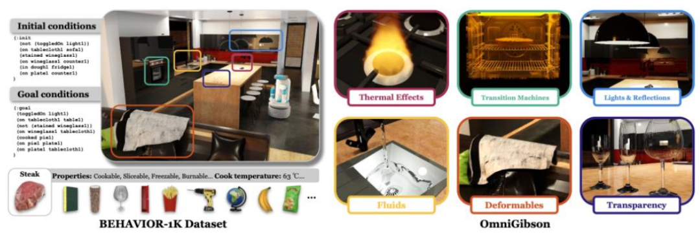

资料来源：《BEHAVIOR-1K: A Human-Centered, Embodied AI Benchmark with 1,000 Everyday Activities and Realistic Simulation》(Chengshu Li et al.,)，中金公司研究部

智元机器人在2025年4月发布仿真评测平台Genie Sim Benchmark。智元基于NVIDIA Isaac Sim引擎，构建了覆盖家居、工厂、商超等5 大核心领域的550 + 高精度仿真环境。在评测任务上，Genie Sim Benchmark涉及10+标准评测任务，任务的覆盖度相较BEHAVIOR-1K有较大提升空间。Genie Sim Benchmark定义了四大核心评测维度：运动自洽性、语义合理性、时空因果性和画面仿真性，全方位对具身AI的性能进行评测。

**物理AI：具身智能的底层探索方向**

物理AI是人工智能与物理引擎深度融合的产物，其核心在于通过物理规律建模与生成式AI结合，赋予机器人对现实世界的物理规则的认知和因果推理能力。与传统AI相比，物理AI的输入是来自物理世界的数据，依赖摄像头、激光雷达、力矩传感器等多模态传感器阵列构建对环境的多维认知。物理AI因其对动态环境的实时响应在泛化性能上会迎来大幅提升，同时通过生成式AI具备数据扩展能力，能解决真实数据产能不足问题。

图表9：AI演进经历感知AI、生成式AI、代理式AI、物理AI四个阶段

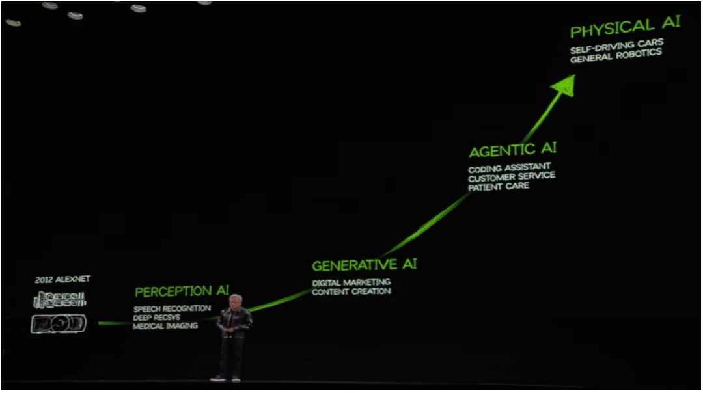

资料来源：CES 2025，中金公司研究部

仿真建模：从传统工程仿真向智能化仿真

物理AI的引入增强传统仿真建模的智能性。物理AI通过将物理知识以偏微分方程的形式编码到神经网络的训练过程中（如物理信息神经网络PINNs），一方面推动建模从“被动计算”向“主动学习”转变，另一方面引入真实传感器数据使生成内容符合真实物理世界规律。NVIDIA PhysicsNeMo就是一个物理模型驱动的AI架构，囊括了物理AI领域最前沿的架构：物理神经网络、神经算子、图神经网络和扩散模型等架构，兼顾AI的推理速度和物理规律的遵循，Shell使用英伟达PhysicsNeMo 将CO2存储建模速度提高100000倍。

物理AI赋能数字孪生技术从“仿真”向“推演”转变。数字孪生技术可理解为动态的仿真，能够通过传感器实时同步现实世界状态。传统的数字孪生平台缺乏高质量预测复杂物理系统的能力，通过嵌入具备物理推理能力的AI模型，数字孪生可从“仿真”向“推演”转变。英伟达通过Cosmos物理世界建模引擎和Omniverse多场景耦合仿真搭建了数字孪生平台，Cosmos模型是全球首个世界基础模型，基于2000万小时真实世界数据训练，形成了完整的物理AI数据生成与推理链条，能够理解现实世界的物理规则。通过引入Cosmos模型，数字孪生平台能够预测交互结果，实现了从仿真到推演的进化。英伟达的数字孪生平台还支持合成数据生成、强化学习和AI反馈等操作。黄仁勋在2025CES表示英伟达的数字孪生平台结合其AI训练端DGX计算机和部署在边缘设备的AGX计算机共同定义未来物理AI生产方式。

物理AI如何迁移到具身智能

谷歌Deep Mind在2025年3月推出VLA具身智能模型Gemini Robotics，相较基本模型能稳定完成“折纸”“午餐盒打包”等挑战性任务。

图表10：Gemini Robotics相较其他基准模型更能稳定完成“折纸”“午餐盒打包”等极具挑战性任务

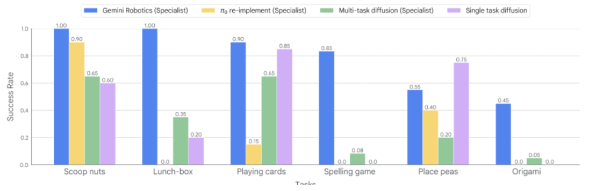

资料来源：《Gemini Robotics: Bringing AI into the Physical World》（Gemini Robotics Team, Google DeepMind，2025），中金公司研究部

自监督视频学习也能实现较好的物理世界理解。Meta的世界模型V-JEPA 实现了AI直观理解物理世界。Meta基于JEPA框架（联合嵌入预测架构）提出了自监督视频理解模型V-JEPA，让AI通过自监督的视频学习像人类一样领悟物理世界的运作规律。V-JEPA能够准确一致地分辨出符合和违背物理定律的视频，远超多模态LLM和像素空间中的视频预测方法。

亚马逊FAR（前沿人工智能与机器人）团队在2025年5月推出数据生成引擎OmniRetarget，能基于交互网格的约束优化将捕捉到的人类动作映射为物理层面合理的机器人运动学参考依据，使机器人以极高的效率掌握复杂的移动操作技能。该引擎解决人形机器人高质量训练数据的瓶颈，并实现从仿真到人形机器人的零样本迁移。宇树G1机器人基于此引擎完成了搬运箱子、翻越障碍物和跑酷动作等长序列动态动作系列。

图表11：OmniRetarget基于交互网格的约束优化，将人类示范动作映射到机器人上

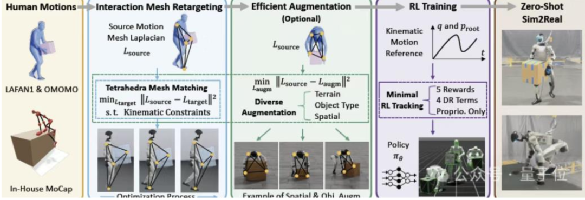

资料来源：量子位，中金公司研究部

**具身智能大脑巡礼：科技巨头与初创协同发力**

**AI巨头集中布局，初创卡位生态**

人形机器人软件生态由基础模型、数据科学与分析软件、模拟仿真与视觉软件、开发工具和评测系统等构成。其中基础AI模型和算法是实现机器人自主功能的核心模块；数据科学与分析软件用于捕获和分析边缘设备采集的传感器数据；模拟仿真与视觉软件构建用于机器人训练的数字孪生平台以及视觉数据采集等环节，支持AI模型的训练；开发工具则用于构建和控制机器人系统本身，包括底层控制和功能实现。

大脑层面参与群体包括科技大厂、人形机器人公司和第三方跨界公司。科技大厂主要包括如谷歌、Meta、英伟达、微软、OpenAI等的海外科技巨头，以及字节、阿里等国内大厂，这些科技大厂更侧重基础模型和软件生态的构建。人形机器人大脑初创公司也是大脑生态的关键力量，且人形机器人初创公司多与AI科技巨头进行合作，核心公司包括FigureAI、1X、Physical Intelligence等以及国内的智元、银河通用等。部分原工业软件企业也跨界AI，开发用于训练机器人的仿真模拟和视觉数据采集系统，如达索系统、海克斯康、西门子、索辰科技等。

图表12：人形机器人大脑公司包括科技大厂、人形机器人整机公司和第三方跨界公司

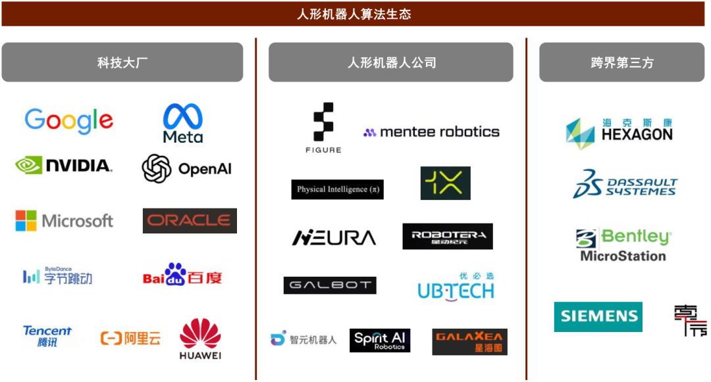

资料来源：各公司官网，中金公司研究部

**风险提示**

技术路线不确定性风险：核心组件如环境建模、实时运动控制、自主导航等技术仍处于快速迭代期，高温超导传感器、边缘端低功耗 AI 芯片等硬件与算法的适配性尚未完全验证。同时，不同应用场景（工业、医疗、家庭）对技术指标的要求差异极大，通用型技术路线落地时需频繁定制化调整，进一步推高研发成本与周期风险。

数据安全与合规风险：采集数据涵盖生物特征（人脸、语音、生理参数）、环境隐私（家居布局、工业工艺、医疗场景细节）等敏感信息，且需经过“终端采集 - 边缘预处理 - 云端训练”全链路流转。每个环节均存在安全漏洞，如边缘节点防护薄弱易被窃取本地数据，元宇宙场景中数字孪生数据未脱敏可能反向关联真实用户。

[1] 《Viewpoint-Agnostic Manipulation Policies with Strategic Vantage Selection》，Saxena，2025。

**Source**

**文章来源**

本文摘自：2025年11月11日已经发布的《机械：人机系列04：具身智能大脑的进化之路》

刘中玉  分析员 SAC 执证编号：S0080521060003 SFC CE Ref：BSP722

郭威秀  分析员 SAC 执证编号：S0080521120004 SFC CE Ref：BSI157

张梓丁  分析员 SAC 执证编号：S0080517090002 SFC CE Ref：BSB840

王梓琳  分析员 SAC 执证编号：S0080523080005

**Legal Disclaimer**

**法律声明**

特别提示

本公众号不是中国国际金融股份有限公司（下称“中金公司”）研究报告的发布平台。本公众号只是转发中金公司已发布研究报告的部分观点，订阅者若使用本公众号所载资料，有可能会因缺乏对完整报告的了解或缺乏相关的解读而对资料中的关键假设、评级、目标价等内容产生理解上的歧义。订阅者如使用本资料，须寻求专业投资顾问的指导及解读。

本公众号所载信息、意见不构成所述证券或金融工具买卖的出价或征价，评级、目标价、估值、盈利预测等分析判断亦不构成对具体证券或金融工具在具体价位、具体时点、具体市场表现的投资建议。该等信息、意见在任何时候均不构成对任何人的具有针对性的、指导具体投资的操作意见，订阅者应当对本公众号中的信息和意见进行评估，根据自身情况自主做出投资决策并自行承担投资风险。

中金公司对本公众号所载资料的准确性、可靠性、时效性及完整性不作任何明示或暗示的保证。对依据或者使用本公众号所载资料所造成的任何后果，中金公司及/或其关联人员均不承担任何形式的责任。

本公众号仅面向中金公司中国内地客户，任何不符合前述条件的订阅者，敬请订阅前自行评估接收订阅内容的适当性。订阅本公众号不构成任何合同或承诺的基础，中金公司不因任何单纯订阅本公众号的行为而将订阅人视为中金公司的客户。

一般声明

本公众号仅是转发中金公司已发布报告的部分观点，所载盈利预测、目标价格、评级、估值等观点的给予是基于一系列的假设和前提条件，订阅者只有在了解相关报告中的全部信息基础上，才可能对相关观点形成比较全面的认识。如欲了解完整观点，应参见中金研究网站（http://research.cicc.com）所载完整报告。

本资料较之中金公司正式发布的报告存在延时转发的情况，并有可能因报告发布日之后的情势或其他因素的变更而不再准确或失效。本资料所载意见、评估及预测仅为报告出具日的观点和判断。该等意见、评估及预测无需通知即可随时更改。证券或金融工具的价格或价值走势可能受各种因素影响，过往的表现不应作为日后表现的预示和担保。在不同时期，中金公司可能会发出与本资料所载意见、评估及预测不一致的研究报告。中金公司的销售人员、交易人员以及其他专业人士可能会依据不同假设和标准、采用不同的分析方法而口头或书面发表与本资料意见不一致的市场评论和/或交易观点。

在法律许可的情况下，中金公司可能与本资料中提及公司正在建立或争取建立业务关系或服务关系。因此，订阅者应当考虑到中金公司及/或其相关人员可能存在影响本资料观点客观性的潜在利益冲突。与本资料相关的披露信息请访http://research.cicc.com/disclosure_cn，亦可参见近期已发布的关于相关公司的具体研究报告。

本订阅号是由中金公司研究部建立并维护的官方订阅号。本订阅号中所有资料的版权均为中金公司所有，未经书面许可任何机构和个人不得以任何形式转发、转载、翻版、复制、刊登、发表、修改、仿制或引用本订阅号中的内容。
