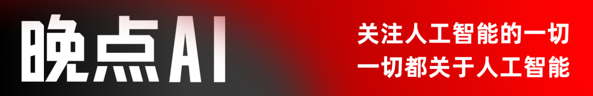
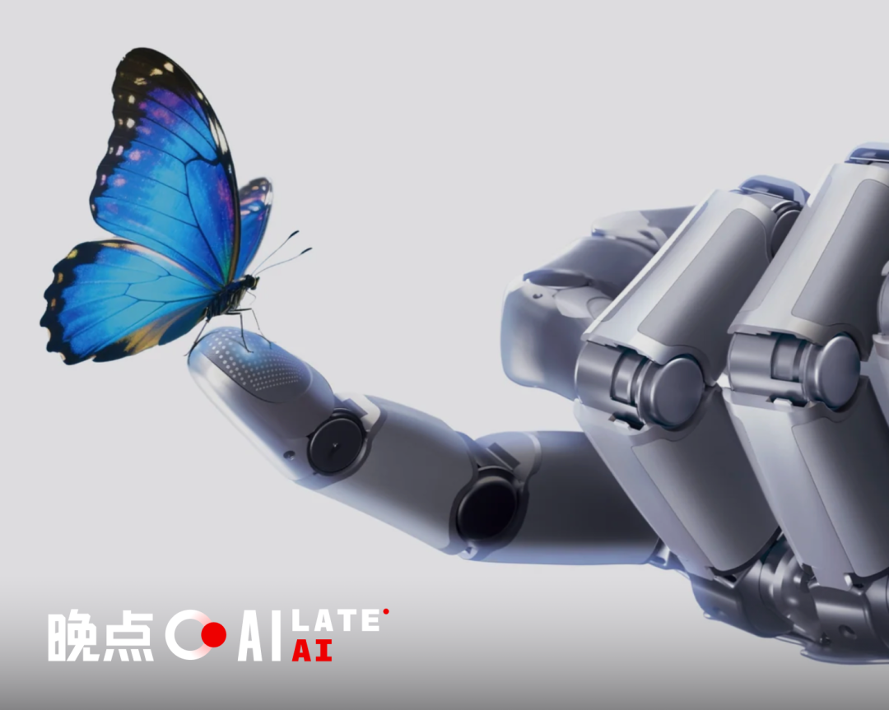
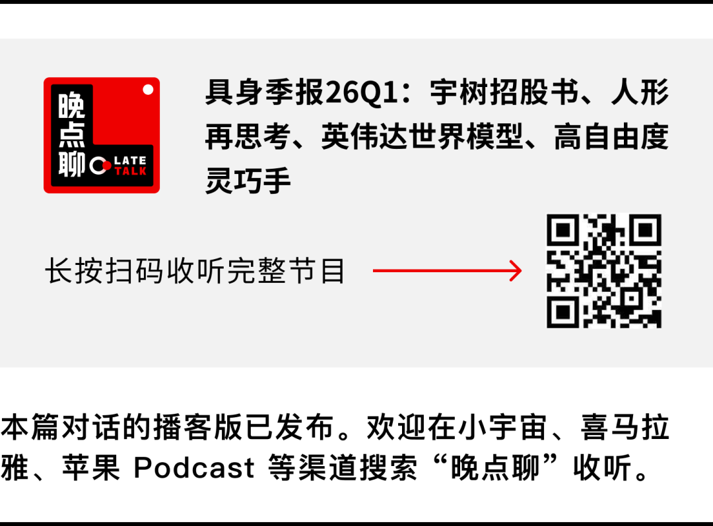
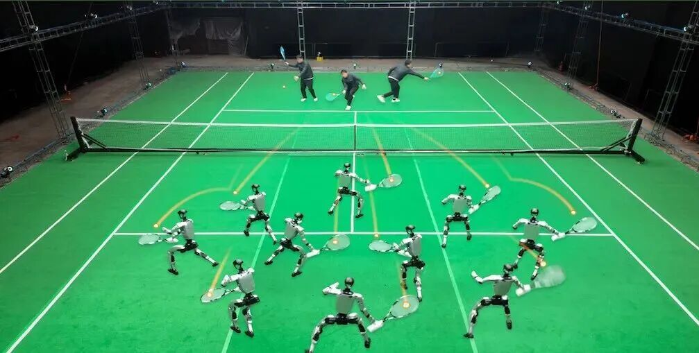
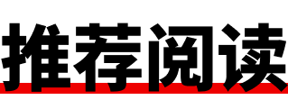
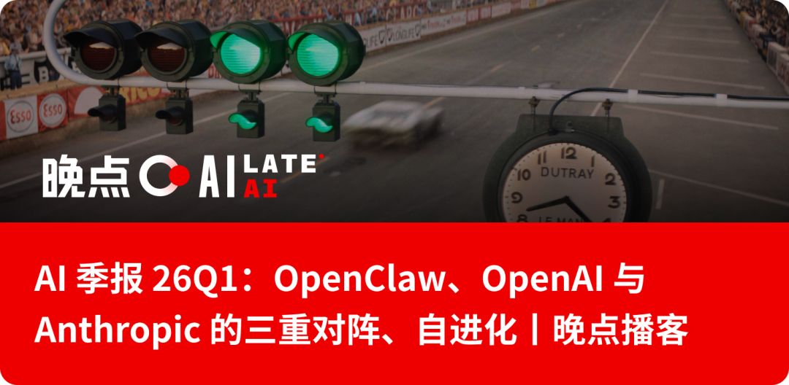
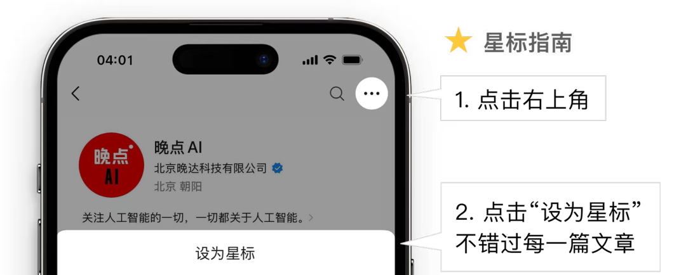

# 具身季报 26Q1：宇树招股书、人形再思考、英伟达世界模型、高自由度灵巧手 | 晚点播客

> **原文链接**：https://mp.weixin.qq.com/s/bOaO-2IwcAEmofUFD_DTAw

- **公众号**：晚点AI
- **作者**：晚点团队
- **发布时间**：2026-04-09 00:00:00
- **抓取时间**：2026-11-17 12:31:39
- **正文长度**：28172 字 | **图片**：9 张（已本地化）

---

不仅是比特，不仅是语言。

**
**

**文 丨****实习生**裴** 雨桐**

**访谈 丨程曼祺**

**
**

2026 年一季度，全球具身智能领域新变化频出：英伟达连续发布世界动作模型多个成果，Sharpa 展示高自由度灵巧手的长程任务，宇树、银河等中国人形机器人公司拿出了更高水平的实机演示。而宇树发布的招股书，也让市场得以窥见人形机器人公司的具体财务情况。

《晚点 LatePost》出品的商业科技播客《晚点聊》推出第一期具身智能季报，邀请 Alphaist Partners 创始合伙人陈哲 Peter 作为分享嘉宾。

过去七年，陈哲在五源专注投资机器人和硬件科技，投资过海柔、松灵、本末、地瓜等公司。

这期季度总结，陈哲 分享了三月中旬去 GTC 与全球从业者的交流，同时也带到了过去两年具身智能的发展。

在讨论人形机器人的部分，我们盘点了中美几家头部公司，如宇树、银河、特斯拉 Optimus、Figure 的近期进展，以及那些在智能能力或数据上给行业带来启发的公司，如 Pi、Sunday 和 Generalist。

接着重点讨论了当前具身智能的两个前沿研究方向：灵巧手和世界模型。分别以 Sharpa 和英伟达的近期进展作为讨论重点。

**以下是播客的文字整理，有部分精简。**

**Q1 核心进展与中国玩家：专注成就宇树 G1 的成功**

**晚点****：如果要评选 2026 年 Q1 具身智能领域的 top 5 进展或事件，你会选择哪几个？**

**陈哲** ：一是宇树科技在春晚的表演。 20 多台宇树机器人带来现场功夫表演，代表了目前中国在本体与运动控制方面的最高水平。

二是 Sharpa 在 CES 上展示的灵巧手 demo。他们演示了自主组装风车的长程任务，展现了目前全球灵巧手领域的 SOTA（State Of The Art，最先进水平）。这家具身智能公司的创始人正是禾赛科技的三位创始人。

三是世界模型的突破。代表是英伟达发布的 DreamZero 和 DreamDojo 两个应用于机器人的世界模型。这项尝试最早源于字节跳动在 2024 年底发布的 GR-2，那是首次将互联网级别的视频内容应用于具身模型的预训练过程，并直接生成动作与操作。在当时，这是 VLA 之外的一条创新路径。今年，包括英伟达在内的更多公司都在这条路径上做了大量优化，取得了更好的效果。

四是银河通用在春节后发的机器人打网球 demo，展示了人形机器人能在需要高速和即时反馈的系统中表现优异。虽距离商业化还比较远，但它让大家看到了在现有硬件和算力基础上实现实时任务的可能性。

银河通用展示人形机器人打网球 demo。

五是波士顿动力 在今年 CES 上宣布量产全新电动版 Atlas。作为人形机器人研究的鼻祖，他们对困难场景和落地价值有长期的深入研究。电动版 Atlas 反映了他们对人形机器人进入工业场景及实际落地的新思考。作为欧美在人形机器人领域最快实现量产的代表，其技术思路对全行业都有重要参考价值。

这些进展是我基于长期关注该领域的投资人视角，从技术、市场、商业维度的综合观察，不完全代表纯学术突破。

**晚点****：去年宇树上春晚时，很多业内人士还不以为然，觉得动作是靠机械装置取巧；但今年春晚表演后，业内认可度很高。这背后的变化是什么？**

**陈哲** ：2025 年机器人的运动控制技术发展极其迅速。宇树这次春晚表演所用到的技术与控制技巧，背后的学术成果大多是 2025 年中旬甚至下半年才发布的。宇树将这些前沿工作在春晚舞台上集中展现，效果非常惊艳。

核心变化是动捕和模仿学习能力的提升：能更快速地将真人的动作迁移到人形机器人上。同时，更先进的强化学习训练工具，让具身系统能在虚拟环境中将粗糙的动捕数据转化为更稳定的策略，并执行在实体机器人上。简而言之，就是先通过动捕或遥操作录制人的动作，再在仿真器中不断进行强化学习迭代，使其变得更稳定、更鲁棒，最终完美迁移到宇树的机器人本体上。

同时，20 台机器人同台表演，有整齐划一的部分，也有多台机器人配合的部分，这反映了宇树 G1 机器人在机电能力绝对性能和一致性上的巨大优势。

“一致性” 是最大的亮点，20 多台量产机器人同时完成弹射、大回环、连续翻滚等复杂动作，且在不同环境干扰下保持高度一致。这不仅需要精心调参，更对硬件质量控制和运控算法稳定性提出了极高要求。这是宇树目前相较其他公司最大的优势。

**晚点****：多年前波士顿动力的视频中，机器人也能做跑酷、空翻等类似真人的动作。宇树现在的成果和波士顿动力当年的表现有什么区别？**

**陈哲** ：那个年代波士顿动力的跑酷动作，基本是靠老专家使用传统控制算法（如 MPC，model-predictive control，模型预测控制器）精心调出来的。而现在的底层控制策略，是通过强化学习、仿真和端到端方法训练的，原理截然不同，对环境扰动的适应能力远超当年的波士顿动力。

此外，波士顿动力的视频是经过精心剪辑的，背后有大量失败的尝试。即使是单台机器完成长序列跑酷，成功率也不高。而宇树这次是 20 多台机器人在台上实时保持高度一致，对可靠性的要求高了几个量级。

另一点不同是，近一年，大量的跑酷和舞蹈动作开始加入视觉反馈和定位能力。这次上台的 G1 机器人，每台头顶都配备了激光雷达，具备了初步的建图和定位能力。

**晚点****：这是取得进展的部分。另一方面，目前大众对人形机器人有哪些夸大的想象？**

**陈哲** ：很明显，目前的舞蹈或表演动作，本质上还是事先编排好的固定程序。如果机器人受到强干扰，很难自主决策。而且这些表演主要集中在全身或下肢运动，基本没有涉及上肢操作能力。而当前具身智能的大量研究，核心恰恰在于操作以及对复杂任务的理解。

**晚点****：从宇树招股书披露的财务信息和产品收入构成看，你认为有哪些值得注意的点？**

**陈哲** ：宇树的人形机器人业务增长非常快。2023 年发布第一款人形机器人 H1，2024 年发布 G1。随着 G1 热销，人形机器人收入占比迅速攀升，23 年还不到 2%，25 年前三季度已超过 50%。这表明宇树未来将以人形机器人为核心。四足机器人长期来看可能会在特定场景中保持稳定的市场。

机器人行业现在是典型的供给驱动，而没到需求驱动，因为还在行业早期。就是一旦有了稳定、可量产的好产品的供给，销量自然会来。好的供给，本身可以打开一些之前想不到的市场需求。

**晚点****：我看招股书印象最深的是，宇树人形机器人的高毛利率。2025 年前三季度毛利率达到 63%。在软硬一体的智能硬件产品中，这算非常高了吧？**

**陈哲** ：这主要是因为目前人形机器人还未进入真正的商业化落地场景，绝大部分是卖给科研市场。科研市场规模小、订单分散，传统科研教具有 70%-80% 的毛利率很正常。宇树目前的定价，一方面是因为市场缺乏竞争，另一方面也是因为科研市场对价格敏感度不高。

其实更有意思的问题是：宇树 G1 发布了 20 个月，为什么至今没有第二家公司真正挑战它的地位？

**晚点****：所以为什么呢？**

**陈哲** ：G1 的产品定义极其成功，它完全是为科教市场量身定制的。宇树的第一款人形机器人 H1，你可以理解为是让一只大型四足机器狗站起来。但 G1 是宇树第一台正向设计的人形机器人。身高从 1.8 米降到了 1.3 米左右。随之而来的是重量大幅下降，这对电机功率密度、运动性能以及电池续航都有巨大帮助。

之所以能缩小尺寸，也是因为在科研场景，一台 1.3 米的机器人能做的研究与 1.8 米全尺寸机器人基本没区别。因为产品定义精准契合了场景需求，其他公司很难在这个细分领域去跟随或竞争。

**晚点****：科研是一个好市场吗？朱啸虎曾公开表达，科研和表演都不是持续性的市场。**

**陈哲** ：所以很长一段时间里，投资人并不看好它做科教市场。如果你回到 2020 年或 2021 年，全球科研市场规模也就 10 亿人民币左右。

其实早几年的宇树，从来就不是一个被投资人喜欢的公司，最初融资很难。在人形机器人大规模商业化遥遥无期的情况下，很难投一个天花板如此低的市场。

除了产品定义，硬件的壁垒在于长期的验证与测试。做出一两台样机容易，但要实现成千上万台的可靠量产，需要极高的供应链打磨和质量控制能力。在做 G1 之前，宇树已经销售了几万台四足机器人，真正走过了百万台电机的设计、生产和量产流程。这种时间成本和硬件门槛，是所有新入局者必须跨越的。大模型公司的领先优势可能只有 3 到 6 个月，但硬件公司的优势可能会维持 12 到 24 个月。

**晚点****：宇树下一阶段靠什么发展？现在大家明显看到更大的机会在于机器人的智能，即大脑和小脑结合的部分。这也被视为宇树的相对短板。根据招股书，25 年前 3 季度，宇树的研发费用只有 9000 万。**

**陈哲** ：他这种在经营上的谨慎是刻在基因里的，如果王兴兴不是这样一个人，不是这样一个创始人，宇树活不到具身智能热潮到来的这一天。

王兴兴和汪滔很像，他们都是为了热爱而创业，而不是因为看到一个巨大的商业机会才创业。前几天我见一个投资前辈，2017 年王兴兴就去找他融资，他问王兴兴你这个可以做什么？王兴兴答不上来，他也应该答不上来。

宇树之前一直专注做好机器人本体，在 AI 或模型相关的研发投入上相对较少。所以宇树是个盈利的公司，否则也很难生存。就是前面说的，它很长时间不被投资市场看好。

但这次招股书显示，他们计划用募资的 42 亿元里的一半投入大脑研究，并且在积极推进开源工作。我对他们的长期突破有期待。

**晚点****：很多新的具身智能公司中，会有 AI 背景创始人、联创或高管。但宇树的核心管理层里没有深度学习背景的领军人物，这会是一个问题吗？以及，是否一定要有这样的人才能做好具身大脑？**

**陈哲** ：宇树是以王兴兴为绝对核心的公司。我的判断是，宇树在大脑或智能层面，长期会采取跟随策略。

**晚点****：这种策略足以维持宇树的整体竞争力吗？**

**陈哲** ：我认为足够了。具身智能模型的价值体现离不开硬件本体。对宇树而言，最关键的是占据全球科研人形机器人市场 “事实标准” 的生态位。只要保持这个生态位，哪怕其他公司推出了极优秀的闭源具身模型，宇树也能连带受益。同时，行业玩家也会持续在宇树的硬件上开发高性能开源模型。

**晚点****：宇树预计 2026 年人形机器人出货量能达到 1 到 2 万台，是 2025 年的两到三倍。你觉得能实现吗？**

**陈哲** ：我觉得没问题。随着春晚的爆火和 G1 表现力的成熟，未来一两年会有广泛且持续的表演和租赁需求。最近一家专注于人形机器人租赁的公司 “擎天租” 的估值都已达到 30 亿人民币。从需求看，一年一两万台的销量都是线性的预测，甚至可能更多，主要取决于宇树愿意投入多少产能。

**晚点****：接下来我们聊聊银河通用的网球机器人，印象中机器人打乒乓球、打网球早就有相关的创业项目和产品了，比如专门陪练的网球发球机或轮式机器人。从银河通用用人形机器人打网球这件事上，你看到了怎样的技术进展？**

**陈哲** ：正因为我看过很多打网球的机器人创业项目，才深知一个实时网球机器人的技术复杂度。网球球速极快，可达 100 公里 / 小时。在有限的球场空间内，留给机器人进行轨迹预判和实时响应的时间非常短。

所以对于自由度更高、更复杂的人形机器人而言，要在极短时间内完成球路识别、判断，并控制全身完成挥拍击球动作，以 2026 年初的技术栈来看，是一项极其复杂的系统工程。银河的这个 demo 真正实现了实时感知决策与全身控制的闭环，这与预先编排好的跳舞或武术表演完全不同。

从技术角度看，这个 demo 没有颠覆性的学术创新。据我所知，他们是在春节期间租了网球场，利用大量动捕设备采集数据，并对模型进行了反复的强化学习训练。这更多体现了公司在复杂系统工程上的强大执行力。

但对我而言，它最大的启发在于拓宽了我们对人形机器人能力的想象边界。在它出现前，很难想象人形机器人已经能完成这类任务。当时 Andrej Karpathy 在 X 上看到银河的这个视频时，第一反应也是 “这不可能是真机做出来的，肯定是 AI 生成的”。

像近期 Figure 发布的全身运控 demo 也是类似的情况，动作非常丝滑自然，虽然经过了精心的编排和剪辑，但确实是真机自主执行的，展示了人形机器人的潜力。

**晚点****：这些具体的展示场景，未来能迁移到其他应用上吗？**

**陈哲** ：网球这个具体场景确实很具体，而且它大概率不是依靠机器人本体（onboard）的算力和视觉来处理球路的，而是借助了球场外部的高帧率摄像头，且运算可能也不在端侧（on device）。

但计算机科学的发展经验告诉我们：只要这件事情被证明 “能做”，人类就一定能找到优化的方法，让它在更小算力、更少资源下实现。所以，“能不能做” 是第一步且最关键的，“怎么优化” 是第二步。

这个 demo 的意义是既有下肢的高复杂度、快速移动，又有上肢复杂操作，展现了全身运控优化的能力。

**晚点****：总结一下，像宇树、银河通用、智元、魔法原子等中国全人形机器人公司，在 Q1 的整体表现和进展如何？**

**陈哲** ：整体表现超预期，一个趋势就是全身运控能力。

在 2024 年和 2025 年，机器人的上肢操作（manipulation）和下肢运动（locomotion）还是两个独立的控制体系。但从今年开始，随着硬件成熟、算法演进和数据积累，我们越来越多地看到使用单一统一模型进行全身运控和操作的趋势。

例如，智元近期发布了新的全身运控工作， 英伟达也发布了 Sonic 全身运控框架。

这标志着一个新范式的端倪。未来 12 个月，这种发展的复利和加速度将非常惊人。只要这个统一控制的范式被确立，就会有更多人去迭代和改进。我现在很难想象，到 2027 年春晚时，人形机器人会展现出怎样惊艳的表现。

**晚点****：这里有个老生常谈的问题。很多人认为双足形态的价值并不大，不是让机器人快速落地的最高优先级。**

**陈哲** ：我以前也是这么认为的。

**晚点****：那你是什么时候，因为什么改变了想法？**

**陈哲** ：就在最近这个季度，我受到的冲击很大。

我认为机器人行业的制约是供给受限，当机器人能稳定交付某种能力时，就会快速释放大量价值。

但我之前觉得，人形结构的实现难度太大了，相当于形成稳定供给的困难远大于它的好处和价值。但我最近看了波士顿动力的几段访谈，深受启发。过去我们说人形的价值，老生常谈的理由就是，世界是为人类设计的，所以人形最通用形态。但在平整、结构化的工厂环境里，轮式机器人已经完全能满足移动需求。

然而，事实并非如此简单。一个人形机器人在结构化环境中稳定移动，大约只需要 40×60 厘米的空间，就是人站立所需要的位置。而且由于腿部和身体拥有极高的自由度，它可以下探到地面，也可以向上触达 2.3 米的高度，并能轻松搬运 10 到 20 公斤的箱子。

相比之下，如果用轮式机器人实现同样的功能，例如搬运重物并覆盖较大的高度范围，其复杂度甚至远超人形。

**晚点****：轮式底盘一般需要占多大面积？**

**陈哲** ：肯定远大于 40×60 厘米。轮式机器人最大的挑战是重心问题。以波士顿动力的复合机器人 Stretch 为例。它是在一个巨大的 AGV 底盘上加装了单臂机械臂，为了能从高处取下约 20 公斤的箱子而不发生倾覆，整个 Stretch 的重量达到了一吨左右。

而人体结构非常神奇，我们可以通过动态调节重心和姿态来轻松完成同样的取放动作。一个全尺寸人形机器人可能只有 60 到 80 公斤重，与近一吨的 Stretch 相比，总重量差了十几倍。而越大的重量就意味着越多成本和能耗。

再分享一个我最新的认知：如果想做一个在空间内移动性极佳的轮式机器人，最理想的方案是 “四轮四转”，这至少需要 8 个主动电机。如果还要像人形机器人一样适配不同高度，还需要增加复杂的升降结构和更多电机。从电机数量和结构复杂度来看，这也不必然比双足容易。

**晚点****：所以，在实现同等性能时，轮式机器人的复杂度、成本并不一定比人形低。而一旦人形机器人的技术成熟，它能解锁许多轮式形态无法触达的场景。**

**陈哲** ：是的。而且波士顿动力的新版电动 Atlas 给了我们一个重要信号：人形机器人不一定非要完全模仿人类的物理限制，它可以成为 “超人”。人体的现有结构是大自然进化的偶然结果，机器人完全可以超越它。

**晚点****：波士顿动力新版电动 Atlas 在哪些方面超越了人类结构？**

**陈哲** ：首先是高度模块化的设计。过去的工业机械臂，每个关节的电机和减速器都是专门定制的复杂串联结构；后来的协作臂将电机简化为少数几种标准件。Atlas 采用了类似逻辑，放弃了复杂的电机结构，全身使用简单的旋转电机，通过性能冗余实现多功能化。这大大降低了生产、组装和维修的难度。

其次，它打破了人体的物理限制。它的头部、躯干以及各个关节都可以进行 360 度完整旋转。例如，如果人类需要从面朝北转身到面朝南，需要腿和身体配合走好几步；而 Atlas 只需要腰部电机 360 度旋转即可。它甚至不分左右腿、左右手，结构可以互换。

这种高度模块化、打破生理限制的设计，不仅提高了场景适应度，更极大地降低了制造和维护成本。我之所以特别提到波士顿动力这一转变，是因为它深刻契合了美国当前制造业缺乏熟练技术工人的现状——通过结构的简化和性能的冗余，来解决复杂的安装和维修难题。

**美国重点公司盘点：波士顿动力 Atlas 走向 “超人”，Optimus 的绳驱之困与 Figure 的顺势而为**

**晚点****：前面我们聊的都是中国公司以及你对人形机器人形态必要性的新认知，接下来我们聊聊美国具身智能领域的进展。首先，目前业界最关注的美国人形机器人公司有哪些？**

**陈哲** ：最受关注、声量最大的无疑是特斯拉的 Optimus，其次是目前融资最多、估值最高的 Figure AI。老牌一些的包括波士顿动力，还有一些创业公司，比如挪威的 1X 和德州的 Apptronik（Apollo 机器人）。但市场的核心焦点依然是 Optimus 和 Figure。

**晚点****：像大家经常提到的 Pi、Sunday、Generalist 等，他们不算做全人形硬件的公司，而是以模型和智能为核心的公司，是吗？**

**陈哲** ：是的，其中 Sunday 也做硬件，可以算模型+轻硬件的公司。

**晚点****：先从 Optimus 聊起。它是掀起这轮人形机器人风潮的引领者，也激发了中国一批公司创业。马斯克前阵子在采访中表示，Optimus 的第三代（Gen 3）已经设计定型。但我们从中国供应链了解的情况是，它原计划在 4 月发布，现在可能要延期到 6 月下旬；原定今年 10 月的量产计划也可能延期到明年。**

**陈哲** ：这符合预期。我之前听说的最早计划是今年 3 月或 Q1 发布，进度一直在 delay。行业里有句玩笑：“Elon is always right, but his timing is always wrong.”（伊隆·马斯克总是对的，但他的时间表总是错的。）。

据我了解，Gen 3 无论在硬件还是软件上都面临巨大挑战。硬件方面，最大的挑战是 “手”。他们正在研发一种非常有野心的高自由度 “腱绳驱动” 方案，这在量产和可靠性上遇到了极大阻力。

不过另一方面，Optimus 今年的量产目标还是挺激进的，马斯克的预期是至少是 1 万台左右。

**晚点****：1 万台？比他之前说的目标又缩水了。**

**陈哲** ：确实在缩水。之前可能说过 2025 年要实现万台甚至 2026 年十万、百万台。但考虑到现在已经 4 月了，即使是 1 万台的产量，挑战也极大。

**晚点****：你刚才提到 Optimus 的手采用了绳驱方案。之前我们和供应链交流时，了解到特斯拉其实也在考虑电机直驱方案，或者说至少给部分供应商提了一些预研需求。**

**陈哲** ：其实绳驱里也有电机，只是位置不同。目前的绳驱方案是将大量电机放置在前臂，而不是手掌内。而像 Sharpa 这样的直驱方案，是把电机直接放在每个指节的关节处。这是两种完全不同的设计理念。

马斯克选择绳驱方案，是因为他认为这是一种更符合 “第一性原理” 的仿生方案。

**晚点****：是因为人手就是靠肌肉和肌腱来驱动的吗？**

**陈哲** ：对，为了实现高度仿人的灵巧性，马斯克认为绳驱是必由之路。但这带来的工程问题非常多，这也是过去一年里我听到他们在灵巧手上遇到巨大挑战的原因。

组装一只高自由度的绳驱灵巧手，意味着要在手腕和手掌狭小的空间内穿入 40 多根不同的腱绳，必须解决它们在一致性、蠕变和可靠性等种种问题。一旦某根腱绳松动或损坏需要替换，重新组装和维修的难度极大。

**晚点****：听起来像是在做手部外科手术。**

**陈哲** ：是的。有一个很有意思的问题，我们都说马斯克选择绳驱是因为这更符合 “第一性原理”。但也有 Tesla 工程师提出疑问：既然已经使用了电机和腱绳，它本身就不是肌肉，又何谈第一性类比？

人的肌肉和组织是可以再生的，拉伤后可以通过休息和训练康复。但对于腱绳、电机或齿轮来说，磨损是不可逆的。而且，人体肌肉拥有极高的能量密度和力矩密度，这是现有的电机远无法比拟的。用一个完全不是肌肉的东西去强行模仿肌肉的结构，并期望达到同样的性能，这本身可能并不符合第一性原理。

**晚点****：如果工程师有这种疑虑，他们能在 Optimus 内部向马斯克反馈吗？**

**陈哲** ：在技术路线的选择上，马斯克非常强势。就像当年他坚持做自动驾驶的纯视觉方案和端到端路径一样。

作为一个行业观察者，我也很纠结。从历史上看，马斯克在很多长期技术路线的判断上，最终都被证明是对的，哪怕当时他对抗了市场上所有的声音。在 AutoPilot 早期，大约 16、17 年，很多人也不相信纯视觉和端到端的前瞻愿景，但过去几年通过工程和技术的不断努力，这个愿景正在实现。

所以，绳驱灵巧手是否会经历同样的逆袭，我目前说不准。但至少 Optimus 在 2026 年要量产 1 万台，它必然会面临巨大的工程挑战。

**晚点****：接下来我们聊聊目前融资最多、估值最高的人形机器人创业公司 Figure，从业者者对它的评价是：一方面觉得它总能发布惊艳成果，另一方面又觉得这家公司风格浮夸。**

**陈哲** ：确实浮夸，我觉得他们值得拿一个 “奥斯卡最佳影视特效奖”。这可能与创始人 Brett Adcock 的经历有关。他非常善于向投资人传达愿景和故事。

**晚点****：他创办 Figure 之前在做什么？**

**陈哲** ：他之前创办了一家名为 Archer 的飞行汽车（eVTOL，垂直起降飞行器）公司。大概在 2021 年公司上市后不久，他就离开了并创办了 Figure。再之前，他也成功卖掉过自己的第一家创业公司。

Brett 的特点是：总能精准踩中下一个创业热点，吸引一群认可他愿景的投资人。而且从历史记录看，他的核心诉求似乎是快速把公司卖掉或推向上市。事实上，他确实从 Archer 套现退出了，而 eVTOL 行业至今仍处于非常早期的阶段。我还听说他最近又成立了一家智能硬件新公司，并投入了大量资金。

这种连续快速退出的背景，让市场怀疑 Brett 是否具备足够的专注度和韧性去死磕人形机器人。

**晚点****：为什么以前大家对马斯克没有这种质疑？**

**陈哲** ：因为马斯克把事情做成了。在特斯拉或 SpaceX 真正成功之前，大众可能也分不清他到底是个 visioner（有愿景的人）还是骗子。

所以 Brett 到底是不是一个长期主义的创始人，目前存在争议。但不可否认，2023 年 Figure 成立时虽饱受质疑，甚至 Brett 自己也不太懂机器人，早期吸引的很多顶尖技术人才也陆续离职了；但随着行业快速爆发和资源集中，过去一两年 Figure 确实交出了非常扎实的成果。他们发布的几款人形机器人以及全身运控的 demo，证明了他们在该领域是有干货的。

**晚点****：Figure 是一家软硬件都在做的公司。他们在模型这块的业界评价如何？**

**陈哲** ：他们比较早地公布了 Helix AI 的三层架构逻辑，实现了一套从低频、中频到高频的全身统一运控算法框架。从 demo 效果和内部了解到的信息来看，他们的能力在市场上非常领先。当然，除了 Optimus，美国目前也没有太多真正在做全尺寸人形硬件和模型的公司。在这一点上，Figure 代表了目前美国市场的最高水平。

**晚点****：Figure 融了很多钱，说明美国也有资金愿意支持这个方向。但为什么美国这类公司很少？而国内在 2025 年下半年还不断涌现新的具身智能创业公司。**

**陈哲** ：这与美国制造业、机器人硬件供应链的整体衰退密切相关。在中国，大家开玩笑说花几百万就能攒出一台人形机器人样机，但在美国，很难想象。

Figure 之所以需要融这么多钱，某种程度上也体现了美国国家战略意志。美国希望通过重点扶持头部企业，带动制造业回流和复兴。但大量的基础零部件供应商在美国已经不复存在了。如果 Figure 想完全在美国本土生产人形机器人，前期的供应链建设投入将是极其巨大的。

**晚点****：另一家美国可能会扶持的公司是波士顿动力。它 1992 年就成立了，有 30 多年历史，虽然一直没有大规模商业化，甚至被多次收购转手，但一直活到了现在。前面提到了他们电动版 Atlas 硬件的进展，其实他们在 Q1 还有一项进展：在模型和智能领域寻找了合作伙伴 Google DeepMind。**

**陈哲** ：这其实并不意外。一两年前，Google DeepMind 曾与德州的 Apptronik（Apollo 机器人）合作。但据我了解，那次合作非常失败。核心原因是 Apollo 硬件在可靠性、精度和一致性上都有问题，导致 Google 的研究员把大量时间耗费在 “让机器人能用” 上，而不是做真正有效的 AI 研究。所以，Google 转向选择硬件极其成熟的波士顿动力合作，是非常明智且合理的选择。

**晚点****：Google 为什么不自己做全人形机器人的硬件呢？你之前在 Google 也做过 Google Glass 等硬件项目。**

**陈哲** ：像 Google、Meta 这样的互联网公司做不了硬件，骨子里缺乏这个基因。做硬件是一个极其复杂的系统工程，需要整个产业链和供应链的深度配合。

**晚点****：这是否也跟硬件的复杂度有关？比如 Meta 的 Meta Ray- Ban 智能眼镜似乎卖得还不错？**

**陈哲** ：我不觉得 Meta Ray-Ban 做得有多成功。它的销量是巨大的亏损和补贴支撑起来的。从收购 Oculus 到 Reality Labs 部门被降级，这十年间 Meta 在硬件上累计亏损了数百亿美元。

Meta Ray-Ban 确实卖得很好，定价 299 或 399 美元，但一副普通的 Ray-Ban 墨镜就应该卖这个价格，而且有 90% 以上的毛利。你可以想象每卖出一副智能眼镜，Meta 要给 Ray-Ban 补贴多少钱。所以我觉得眼镜业务对 Meta 来说是一门相当失败的生意。

**晚点****：说回 Google 和波士顿动力的合作。他们打算如何解决生产制造的问题，如果不依靠中国供应链的话？**

**陈哲** ：波士顿动力目前的主要股东是现代汽车。作为一家汽车巨头，现代在生产制造和供应链上能提供巨大帮助。波士顿动力的很多生产组装和前期测试，都是在现代的工厂里完成的。这也是所谓的依靠美国盟友的力量。

**晚点****：美国确实在要求日韩等具备制造能力的盟友去美国本土投资，通过这种方式来补足在复杂机器人本体上的制造短板，你觉得这条路走得通吗？**

**陈哲** ：这是一条路。但就像对电动汽车的封锁一样，这意味着同样的产品在美国制造，需要付出两到三倍的成本。这个高昂的成本长期来看必须由美国社会、客户或消费者来承担，问题是他们是否愿意买单。

**灵巧手可能是一个被低估的创业机会**

**晚点****：美国还有一类专注具身模型的公司，比如被很多中国从业者视为标杆的 Pi 等。他们在 Q1 有什么新进展？**

**陈哲** ：Pi 除了去年发布极具影响力的 π0.6 模型外，今年 Q1 还提出了一种解决 “长期记忆” 问题的新思路，类似于 Openclaw 的做法：通过外挂上下文方式长期记录机器人当前状态，并对这些状态不断反思，以此增强长时间操作的一致性和稳定性。

此外，他们还在真机强化学习和复杂场景执行端的在线学习方面，提出了一些新思路和框架。整体看，Pi 在跨具身形态（Cross-Embodiment）和动态环境适应性方面的研究处于全球最领先的水平。

**晚点****：刚刚提到的给模型增加长期记忆的等系统层的优化，中国很多从业者也注意到了，会把它表达为：具身智能系统就是一个物理世界 Agent，它不仅包含基础模型，还有编排层、skills、工具和记忆等，它们共同组成一个能在复杂环境中完成任务的系统。**

**陈哲** ：是的。关于系统架构，Sharpa 在今年 CES 上提了一个很有启发的新架构，分为 3 层：System 2、System 1 和 System 0。

最上层的 System 2 是一个低频、高维的语言规划层。它主要接收文本输入，负责宏观的任务规划。

往下的 System 1  是一个较高频的控制层。它接收视觉、图像信息、机器人当前状态以及 System 2 传来的文本任务。它的输出是粗略的运动轨迹，比如手臂关节的粗糙动作、力矩信息、夹爪开合等。这类似目前大多数 VLA 模型在做的事。

System 0 是最高频、底层的控制模块。它的输入是触觉信息以及 System 1 传下来的粗略运动轨迹。当机器人拥有粗略轨迹和实时触觉反馈时，就能实现具体精细动作的闭环控制。

**晚点****：在它摸到东西之前，触觉信息从何而来？**

**陈哲** ：摸到之前是没触觉的。当 System 1 控制夹爪碰触到物体时，往往位置是不准的，或者这种接触状态不足以稳定地抓起物体。这时候 System 0 就介入了。它根据实时传回的触觉信息和原始的任务意图，计算出每个手指、每个关节具体该如何微调。

**晚点****：有实验证明，如果屏蔽人手指的神经末梢感觉，即使看着物体，很多看似简单的精细操作也无法完成。**

**陈哲** ：是的，甚至如果蒙上眼睛，仅靠触觉也能完成很多任务，可见触觉信号对于最终任务的执行至关重要。但目前主流的 VLA 模型或世界模型，训练数据几乎完全没有引入触觉信号。所以 Sharpa 的进展证明，当把触觉引入灵巧手时，机器人能够完成很多以前难以想象的复杂任务。

在一两年前，具身智能或机器人领域世界前沿的研究人员可能在研究四足机器人的运控、VLA 模型，或者两指夹爪及 UMI（Universal Manipulation Interface，用于机器人操作的通用数据采集接口）这种结构的灵巧操作。

而从去年开始，我接触到的几乎所有研究人员，都将灵巧手作为下一个方向。

**晚点****：“世界模型” 不是下一个方向吗？**

**陈哲** ：也是。但世界模型很可能是一个由大厂主导的研究方向。世界模型的 backbone 是视频生成模型，对算力和资源的消耗呈指数级增长，计算量远大于文本模型。这也是为什么几天前 OpenAI 宣布停止 Sora 产品。像 Google 每天在视频生成模型上的研发和算力投入量级极其巨大，对于任何创业公司来说都难以想象。

**晚点****：连资金雄厚的 OpenAI 也是如此吗？还是因为他们想聚焦资源去和 Anthropic 竞争？**

**陈哲** ：没错。目前市场对 Agent 和 Coding 的需求非常明确，而 OpenAI 在这方面有些落后，需要集中精力去应对。

但更深层的问题是，视频生成极其消耗资源，如果没有明确的下游消费和变现场景，对公司来说就是一个巨大的、持续的资金无底洞。这也是为什么放眼全球，目前真正把视频生成模型做到顶级的，是字节跳动、Google、快手这样拥有庞大 C 端应用场景的顶级互联网公司。

**晚点****：现在研究员们做灵巧手研究时，主要使用哪些公司的产品？这听起来是个不错的创业机会。**

**陈哲** ：过去一年，海外研究人员使用最多的是星动纪元的一款 12 自由度的灵巧手。但在过去三四个月，随着 Sharpa 的灵巧手开始向海外研究机构供货，大家逐渐开始使用 Sharpa 的产品。

Sharpa 的灵巧手是在 2025 年 5 月亚特兰大的 ICRA 会议上正式发布的。我当时在现场第一次体验，效果确实非常惊艳。

**晚点****：22 个自由度，那就是和人手一样，人手不含手腕也是 22 个自由度。**

**陈哲** ：对，要做复杂精细的操作，自由度不够是无法完成的。今年初英伟达发布的 EgoScale 的数据框架就能很好地映射到 Sharpa 这种高自由度的灵巧手上。

**晚点****：你觉得灵巧手接下来会怎么发展？**

**陈哲** ：我认为在未来 12 到 18 个月内，市场上各家公司会展开激烈的竞争，争夺灵巧操作和灵巧手研究的行业标准，也就是 “默认选择” 这一生态位，类似于宇树 G1 在人形机器人科研里的位置。这款手必须具备极高的可靠性、足够的自由度以完成复杂操作、较低的成本，以及完善的传感器和开发环境。

**晚点****：不过 Sharpa 的目标不止于此，Sharpa 创始人提到，AI 能力才是最重要的。**

**陈哲** ：他们的终极目标是做一家通用机器人公司，而不是灵巧手供应商。但这里面可能存在一个巨大的被低估的机会，就是成为灵巧手和精细操作研发的基础设施。

我们可以从宇树的成功路径中吸取经验。2019 年 MIT 开源了 Mini Cheetah。在此之前，市场上的四足机器人大多采用液压或昂贵复杂的电机方案；而 Mini Cheetah 引入了准直驱 QDD 电机、精简结构和开源控制算法，让国内很多业余团队和爱好者也能快速搭建四足机器人，催生了整个生态的繁荣。

当时涌现出大量创业公司。小米做了铁蛋，小鹏收购了一家公司成立了鹏行智能，第一笔融资时的估值就达 5 亿美金。而同期的宇树还默默无闻。

但为什么是宇树走到了今天？因为王兴兴非常本分和专注。2021 到 2024 ，他就是专注服务科教市场的研究者，他们需要便宜、好用的硬件。他没有把钱砸向虚无缥缈的 AI 研发或 C 端量产。正是在四足领域的深厚积累，让他们顺理成章地推出了人形机器人 G1。

我认为在灵巧手市场，同样存在一个 “G1 的生态位”。但这需要极大的克制和专注去打磨产品，才能成为中美所有灵巧手研究者的首选方案。

**晚点****：过完了中美重点公司的进展，你对目前中美在具身智能领域的发展情况有何整体感受？行业的普遍观点是：与大模型初期中国明显落后美国半代到一代不同，在具身智能领域，中美处于同一起跑线。另外，通用机器人是一个软硬件、系统、工程、供应链高度结合的产物，美国在硬件供应链上的先天短板是个巨大的挑战。**

**陈哲** ：我个人的感受是，在具身智能领域，我们不仅仅是没有落后，甚至有可能处于领先状态。

首先，在复杂的机器人硬件，无论是本体还是灵巧手上，中国公司是领先世界的。其次，在大脑层面，美国以 Pi 为代表的公司在顶尖人才、算力和数据上确实有明显优势。但随着具身大脑与硬件的进一步深度耦合，无论是手部精细操作还是本体全身运控，如果未来的 AI 研究需要大量依赖复杂的人形硬件载体，那么中国在软硬结合上的优势只会放大，不会缩小。

英伟达带来 WAM 世界动作模型，这是理论上比 VLA 天花板更高的路

**晚点****：前面讨论的中美行业对比其实有个变量，就是世界模型。我们在上面也聊到了，世界模型的 backbone 是视频生成模型，而做视频生成又要消耗大量算力资源，这会是中国具身产业链的相对弱势吗？正好，英伟达从去年底到 3 月的 GTC 上发表了一系列和世界模型相关的成果，它们称为 WAM 世界动作模型。可以先讲一讲，如何理解世界模型？**

**陈哲** ：世界模型和 VLA 模型代表了具身大脑研究的两个主要路径。VLA 以文本为 backbone，代表了人类通过语言进行沟通、描述和推理的能力；而世界模型以视频为 backbone，代表了人类的视觉智能。

这两者并不是互斥的，而是互补的。人类的智能既离不开语言，也离不开视觉。如果一个人先天失明或失聪，他依然能发展出相当程度的智能，但其智能上限会受到很大局限。对于机器人来说也是如此，世界模型将人类智能中极重要的视觉理解与泛化能力，用一种巧妙的方式赋予了机器人的大脑。

世界模型并非新概念。如果要下个定义，它就是一个基于当前观测、能够预测未来会发生什么的物理模型。这个概念已应用于许多不同场景。例如在自动驾驶领域，特斯拉曾提到他们有一套用于自动驾驶仿真和模拟的世界模型。

再比如 OpenAI 推出 Sora 时，从未将其定义为视频生成模型， Sora 的定位始终是世界模型。大家对 Sora 的讨论，也是因为它让人感觉模型似乎具备了理解物理规律的能力。

像 LeCun 提出的体系也是一套世界模型，但他认为物理世界有更多可以显性表达的规则和内在（intrinsic）信息来描述。

在机器人场景中，最直接的理解就是通过视频生成或脑补的方式，预测物理环境会因我们的动作发生怎样的变化。它可以用于动作仿真和策略生成。这也是为什么我们认为相比 VLA，世界模型是一种新的技术范式或模态补充。

**晚点****：具体到英伟达发布的世界模型相关成果， DreamZero 和 DreamDojo， 它们是什么？在世界模型路线上做了哪些具体贡献？**

**陈哲** ：DreamDojo 可以被视作一个基于视频的世界模型仿真器，它能基于当前图像预测并渲染世界未来的样子。而 DreamZero 则是通过视频生成的方式，将当前任务与环境转化为机器人需要执行的策略和动作。

英伟达定义的 WAM 底层打破了 VLA 模型那种 “基于图片或视频观测直接输出动作序列” 的映射关系。它根据当前的视频信息，对未来世界进行预测和建模，并通过 “脑补” 建立因果推理。在这个预测过程中，自然而然地生成符合物理规律的动作序列。

这两项工作实质上都脱离了 VLA 以文本和动作克隆为核心的控制范式。如果类比人类智能，文字代表的是一种低频、复杂的推理思考过程；而视频代表的视觉智能，则是更加应激、实时且与环境高频互动的能力。在未来的通用机器人中，这两种能力缺一不可。

**晚点****：这是否意味着世界模型相比 VLA 具备了时间感？因为 VLA 只是从单帧图像直接映射到一个动作，它无法理解前因后果。**

**陈哲** ：这个描述很准确。 VLA 作为运动生成模型之所以非常受限，是因为它底层作为 token 的输入描述是静态的图片和语义文字。它之所以能生成动作序列，是因为在训练 VLA 时，我们通常在一个已具备图文理解能力的 VLM 基座上，强行粘贴并映射一段关节动作信息。简而言之，它是一种带有描述的行为克隆。因此，在遥操作场景下反复叠衣服，模型是通过记录衣服不同折痕的图片，建立起它与关节动作之间的固定映射。

**晚点****：在我们之前的具身智能测评节目中，嘉宾提到 RoboChallenge 测评里 able 30 有一个刁钻的任务：扫二维码。由于扫码需要根据画面变化来判断扫完了没，如果单纯依赖 VLA 模型而不加外挂，当时的模型都做不了。**

**陈哲** ：首先，VLA 确实也可以像 agent 一样加外挂。但关键在于， VLA 本身并不预测未来，它只是在建立特定条件下的映射关系，因此泛化能力差。比如在抓取任务中，当杯子颜色从蓝色换成红色，或位置从左边移到右边，它就可能失败，因为这些样本分布在它克隆的行为数据中可能并不存在。

而世界模型是基于海量、广泛的视频数据进行训练。视频数据涵盖的分布要广阔得多，也极具多样性。如果能从广泛的数据中学到动作规律，用来进行运动仿真验证或策略生成，理论上能力上限会高得多。

**晚点****：Google 当年在 RT-2 中提出了 VLA。在用于具身智能的世界模型上，Google 这一季度有什么进展吗？**

**陈哲** ：目前没看到公开相关的工作，但 Google 正全力推进视频生成模型，此外，据我所知， Google DeepMind Robotics 的研究方向与 Pi 的重合度非常高。去年 Google 推出的基于 Gemini Robotics 1.5 的成果非常出色，比同期的 Pi 更好。

这种优势很大程度上归功于强大的基模。Google 使用了 Gemini 做具身模型的基模，而 Pi 用的是相对小和弱的开源模型 PaliGemma（Google 开源的一个 3B 参数的 VLM 模型）。

在国内众多具身智能公司中同样可以观察到：只要换一个更强的预训练基模，即使不做其他改动，最终的具身模型效果也会显著提升。

因此 Google 具备极强的后发优势。如果它能训练出更好的视频基座模型，自然能极大赋能世界动作模型。只要 Google 认定这是一个值得投入的方向，他们到时很可能会后来居上。

**晚点****：英伟达这种世界模型的新方法目前有哪些不成熟的地方？比如 DreamZero 的运行速度非常慢，跑在机器人上只有 7 赫兹。**

**陈哲** ：速度问题都可以解决。计算机科学的核心逻辑是：只要找到正确的路，优化只是时间问题。优化相对容易，难的是路径探索。GPT-3.5 刚发布时，token 生成速度也很慢，但今天已经提升了百倍甚至千倍。

其实我从 WAM 上看到的一个更关键的行业问题是，过去几年，具身智能的发展都高度受惠于外部力量，先是大语言模型（LLM）和视觉语言模型（VLM），有更好的 VLM，才能训出更好的 VLA；而世界模型则需要更好的视频生成模型。

这意味着，具身智能这一新兴领域的基础性能提升，很大程度上是由外部力量，也就是基座模型的能力决定的。

所以世界模型在基模上的挑战，也不能单靠具身智能公司自己解决，它有赖于能做大规模基础模型预训练的公司。

**晚点****：那相当于，具身智能公司自己并不掌握自己的命运。这又呼应了你前面讲的灵巧手的机会，在与之相关的触觉和精细操作研发上，看起来大厂和创业公司是同一个起跑线，大型科技公司也没有历史积累。**

**陈哲** ：是的。视频这一模态天然不包含触觉信号，即使视频生成模型未来能完全遵守物理定律保持空间一致性和长时序稳定性，世界模型能闭眼 “脑补” 未来 30 秒，它依然缺失触觉信息。

因此，未来在世界模型更成熟后，如何融合或增强触觉信号，将是研究的重中之重。

这也恰恰是我看到很多具身创业公司正在做的事。他们深知自己很难去预训练一个超大规模的 VLA 或世界模型，但他们可以解决灵巧手操作问题，或是触觉与末端执行器（如夹爪、Sunday 的 Gripper）的结合问题，这些都是基模厂商无法提供的价值。

**晚点****：英伟达在提出 DreamDojo 和 DreamZero 的同时，还发布了 EgoScale 新数据框架，使用了超过两万小时的自我中心的人类数据，打破了灵巧操作迁移的规模瓶颈。这是一个怎样的进展？**

**陈哲** ：EgoScale 采集到的数据，既可以应用于 VLA 模型，也可以应用于世界模型，并不受限于具体的预训练方法。它先采集海量真实场景中的第一视角视频，然后使用 Manus（一家荷兰的动捕手套公司）的数据手套和摄像头跟人类数据做对齐。

它属于整个数据金字塔中的一个环节。如果我们构建一个具身智能的数据金字塔：最顶层、最高效、最精准的是机器人遥操作数据，它直接反映了任务中机器人各个关节和电机的状态；往下是类机器人架构数据，比如 UMI 或 DexUMI 这种使用类似夹爪或灵巧手结构的末端执行器采集的数据，但其手臂和视角等自由度不受机器人本体硬件约束；再往下是 EgoScale 这种 ego-centric 的操纵数据；最底层则是海量的互联网、YouTube 视频数据，包含大量非人类操作的物理现象。

过去半年，业界对 ego-centric 数据的重视度急剧升温。因为大家发现，为了实现运动的泛化性，必须引入更多样化的数据。仅仅依靠遥操作或 UMI 方法，数据的多样性是远远不够的。

**晚点****：直接使用互联网视频数据不是最有多样性吗？**

**陈哲** ：这就涉及到数据质量和迁移 gap 的问题。即使是第一视角视频，人类关节、手掌乃至上半身的自由度，远超目前的机器人硬件。机器人无法完全复刻视频中人类精细的手腕或手指动作，这就产生了巨大的迁移 gap，导致动作学不过去。

当然，随着硬件越来越灵活强大，比如开发高自由度的灵巧手，这种 gap 会缩小。但无论硬件多好，机器人上肢与人类的自由度仍有差距。因此，ego-centric 视频虽然比第三视角的 YouTube 视频质量更好、数量庞大，但其精度和直接可用性，依然与 UMI 数据或遥操作真实数据有很大差距。

**晚点****：也就是说，金字塔越往上数据越贵、越少、但质量越高；越往下则反之。这个金字塔里全部都是真实数据吗？**

**陈哲** ：仿真数据也包含在内，主要有两种形式。一种是在完全虚拟的环境中建模生成的数据；另一种是对真实数据进行数据增强后得到的数据。仿真数据的质量通常介于 ego-centric 数据和 UMI 数据之间，它是一种重要的扩充手段。

**晚点****：英伟达和 Generalist 去年 10 月也发布了数据解决方案，是否意味着具身智能在数据这一瓶颈上已经基本得到解决？**

**陈哲** ：目前不是问题已经解决，而是大家看到了可能解决问题的方法与路径。

提到 Generalist，它和另一家初创公司 Sunday 对行业的促进作用巨大，他们总能推出一些前所未有、极其巧妙，事后看来又极其合理的创新设计。

迟宬（Sunday Robotics 的联创之一）在斯坦福时就参与了 UMI 方案的工作。它本质上是人手持一个与机器人末端 “同构” 的夹具进行动作采集，从而避免了异构带来的 domain transfer 损失。后来，Generalist 对斯坦福的 UMI 方法进行了改良并大规模采集数据。而 Sunday 则在此基础上，将两指的 UMI 扩到了三指，并加入了触觉反馈。仅仅增加这一个自由度，就能完成大量两指夹爪无法完成的动作。

**晚点****：类似的用可穿戴设备采集数据的方案也是目前很多中国公司正在做的方向，比如它石、千寻等等**

**陈哲** ：是的，中国公司的优势在于，只要有了技术路线，跟进速度极快。过去半年，类似 UMI 或 Sunday 的数据采集方案在国内快速涌现。

许多国内具身智能公司今年的目标是实现百万小时级别的真实数据采集。但即使采集到了，数据的清洗、准确标注以及规模化还需要很长时间，我认为数据瓶颈并不会很快被解决。即使真的获得了百万小时的真实数据，这些数据量是否足够支撑通用具身智能，目前还没有定论。

**晚点****：除了英伟达近期的成果，世界模型在整个业界还有哪些新进展？比如 Google 的 Genie 3、SIMA 2，这些对具身领域有帮助吗？**

**陈哲** ：这些与机器人的直接关联不大。

具体来说，Genie 3 是一个高度基于 diffusion 的生成网络，追求的是视觉上的高保真和美观，对物理环境和物理规则的遵从度较弱，这对于需要训练物理交互的机器人模型是不友好的。字节的 Seedance 着重优化了视觉表现力和艺术风格，这对具身没什么用。

目前，世界上绝大部分机器人视觉模型的基座，使用的都是阿里开源的 Wan2.1 或 2.2（阿里通义万相的开源视频生成模型系列）。因为这是市面上最后一个开源版的视觉生成模型。视频生成模型的算力消耗实在太庞大了，以至于头部公司都不愿意继续开源了。

**晚点****：连英伟达也没有自己从头训练一个模型吗？**

**陈哲** ：英伟达用的也是开源模型。现阶段还在研究探索期，没有必要从头开始训。不过，这也带来了很多问题。许多研究员反馈，世界模型目前面临的最大挑战之一，就是现有的开源模型根本不适合具身智能。

**晚点****：回到之前的问题，如果随着世界模型竞争加剧，中国公司由于算力相对较少，会不会处于劣势？**

**陈哲** ：有可能。但如果世界模型高度依赖 SOTA 的视频生成模型，至少字节跳动等中国顶尖大厂在资源上，并不会比 Google 少太多。

**晚点****：那字节也可以自己把具身模型和智能机器人做了，实际上字节也在做。**

**陈哲** ：这是所有模型创业公司，无论文本、视频还是语音面临的共同风险。比如 Google 的研究员就深信，终局就是大厂赢家通吃。

但即使如此，对于真正想要商业化落地的具身智能和通用机器人公司来说，依然有足够多的事情可以做。虽然软硬件的边界可能会比 iOS 和 Android 时代更加模糊，但边界依然存在。长期看，在具体垂直场景中的 Know-how 和专有数据，才是最有价值的资产。而这些长尾数据和场景经验，大厂不一定具备。

**晚点****：沿着英伟达提出的世界模型新方向，有什么新的创业机会吗？美国最近就出现了一些融资金额很高的新公司。**

**陈哲** ：确实有。比如在 GTC 大会上宣布获得 4.5 亿美元融资的 Rhoda AI 团队，就是一家明确以世界模型为核心技术路径的创业公司。

**晚点****：Rhoda 是自己从头做视频生成大模型，还是基于开源模型做研发？**

**陈哲** ：具体的细节他们没透露。比较确定的是，即使他们使用了开源基座模型，也采集了大量的 ego-centric 数据做 continue train。就像 VLA 一样，对于已经预训练好的底层模型，没必要重新训，而是用自己的专有数据做微调和再训练。

**晚点****：中国目前有以世界模型为主攻方向的新创业公司吗？**

**陈哲** ：有一些。比如黄冠创立的极佳世界等。总体而言，作为创业方向，世界模型非常新，但也极其困难，这条路线的陡峭度远超 VLA，理论上限更高，但也更难。

**晚点****：除了极其耗算力，还有哪些难点？**

**陈哲** ：对数据和算力的要求都很高。目前全球最好的三个视频生成模型，恰恰出自拥有 YouTube 的 Google、拥有快手的可灵和拥有 TikTok 的字节跳动。更关键的是，所有优秀的算法架构和训练配方，都是靠海量的实验和算力堆出来的。

这正是今天所有具身智能创业公司面临的最大挑战：没有足够的算力试错。哪怕你拥有几十万小时清洗标注好的优质数据，为了跑通模型、找到最优配方，也需要进行无数次的实验和测试，而绝大多数创业公司缺乏支持这种实验规模的算力资源。

**具身算力：从数据中心到汽车，再到机器人，英伟达的统治力越来越弱**

**晚点****：接下来聊具身智能领域中重要基础设施话题：算力。相比大模型领域对算力的热烈讨论，业界对具身智能的算力，特别是端侧算力的讨论相对少。目前机器人上的主芯片是怎样的市场格局？通常会选哪家公司的产品？**

**陈哲** ：默认的首选英伟达的车载芯片。

**晚点****：车载芯片？不是英伟达专门为机器人推出的 Jetson 系列吗？**

**陈哲** ：不是。因为算力不够，Jetson 的定位比较尴尬。

现在做端到端自动驾驶的公司，把一个模型实时压缩到一颗 Orin 芯片上运行已经十分费力。而无论是 VLA 还是世界模型，复杂度都不比自动驾驶模型低。目前能在一两百瓦的功耗限制下提供最大算力的解决方案，就是自动驾驶芯片。现在还没有到要在端侧节省算力的阶段。

**晚点****：除了英伟达，还有其他公司吗？比如高通有涉足吗？**

**陈哲** ：国内很多具身智能公司也在和地平线合作。在量产的自动驾驶市场，英伟达和地平线各占约 40% 的份额，其他厂商占据剩下的 20%。由于技术栈的相通性，很多人自然而然地将这些成熟的车载芯片应用到了人形机器人上。

**晚点****：那么这个机会是不是也属于华为？他们在高阶自动驾驶领域也有相当的市场份额。**

**陈哲** ：华为确实有机会，但大厂内部有优先级问题。受限于制裁和产能，华为芯片产能要优先保供云端芯片和手机端芯片，车载芯片的优先级相对不够，机器人的优先级就更低了。

英伟达也面临类似的问题，他们在云端 GPU 市场拥有压倒性的统治地位，但在车载市场就没那么强。

再延伸到机器人领域，英伟达的优势会被进一步削弱。因为真正的大规模量产机器人，极其考验成本、功耗等一系列综合指标。虽然目前具身机器人还没到规模化量产阶段，但参考其他已经商用量产的机器人，如家政机器人、扫地机器人、无人机，几乎没有使用英伟达的 Jetson 方案。这意味着，量产机器人芯片市场对中国及其他国家的公司是完全开放的。

**晚点****：已大规模量产的家用机器人市场中，主要的芯片玩家有哪些？**

**陈哲** ：最大的玩家是地瓜机器人，它是地平线分拆孵化出来的公司，专门为可量产的商用和消费级机器人提供算力解决方案。此外，还有一些主打中低端的传统 ARM 芯片或 MCU 芯片厂商，比如全志、瑞芯微。在家用机器人市场，英伟达几乎没有市场份额。

**晚点****：所以从云端到车载，再到端侧机器人，英伟达的统治力呈递减趋势。**

**陈哲** ：这就是一个典型的创新者的窘境，和当年的 Intel 如出一辙：Intel 在 PC 和服务器端赚得盆满钵满，因此不愿意去做利润微薄的手机芯片。2005 年乔布斯找 Intel 合作开发初代 iPhone 芯片被拒，这才成就了后来的 ARM 等公司。

我认为今天地平线或地瓜机器人面临的是同样的历史机遇。由于英伟达在云端业务的利润极其丰厚，车载或机器人芯片在内部根本算不上战略重点。

**晚点****：还有一个玩家是特斯拉。**

**陈哲** ：对。马斯克非常明确地表示，未来量产的特斯拉自动驾驶汽车和 Optimus 人形机器人，将使用同一款自研芯片。他们会基于统一的架构、算力和能耗标准，为这两个终端进行同步优化。

**晚点****：这也印证了，从车载到机器人，在技术栈和应用场景上具有极强的延续性。**

**陈哲** ：这意味着目前在国产自动驾驶芯片领域领先的公司，在未来的具身智能时代也将是强有力的竞争者。那些能够在智能汽车时代实现芯片自研量产的车企，如小鹏、华为、理想、蔚来等，未来也能为具身智能提供极具竞争力的算力解决方案。

**晚点****：听起来这将会是一个竞争极其激烈的市场。但通常来说，一个成熟的芯片市场最终应该不会容纳这么多供应商。**

**陈哲** ：从历史规律来看，任何一种复杂的芯片，最终市场上往往只能存活两家主力供应商。而且市场份额通常是 “二八定律”，第一名吃掉 80%，第二名占据 20%。

因此，无论是具身机器人的整机厂商还是底层的芯片供应商，大概率都会经历一场极其惨烈的淘汰赛，最终可能会高度集中。

**晚点****：你认为人形机器人的终局会是怎样的？**

**陈哲** ：对于创业者和投资人来说，这既是巨大机会，也是巨大挑战。人形机器人很有可能是一个高度收敛的赛道。它是一个通用、单一架构的机器人。如果产品足够好，产量和规模将是巨大的，赢家会高度收敛。智能手机之所以高度收敛，是因为人的手就长那个样子。在 iPhone 发明前，为了满足不同需求，功能机形态各异，就像现在的 feature robot，有扫地的、搬运的、工业的。但一旦通用机器人形成，大概率会是一个高度集中的市场。

**晚点****：但汽车市场没有手机集中？**

**陈哲** ：其实已经高度集中了。放眼全球，美国只有三大汽车公司，日本也是 3 家，韩国只有一两家，欧洲也主要集中在 3 家。从商业视角看，集中度已经很高，而且未来还会更加集中。

随着 AI 和自动驾驶的普及，作为软硬一体的载体，其门槛和优势会进一步放大。一个产品的复杂度越高、门槛越高、软硬件复利越高，其市场集中度就必然越高；只有高度同质化的产品，集中度才会低。因此智能汽车或自动驾驶汽车未来一定会高度集中。

同理，人形机器人作为未来人类技术的集大成者，市场集中度也一定会非常高。虽然可能会有适用不同场景的型号，比如 1.8 米或 1.2 米的差异，但整体格局不会出现太多玩家。所以对创业公司而言，这既是机会也是挑战。

**晚点****：对于创业公司来说，更稳健的路径是不是去做 feature robot？在一些特定场景下的机器人，或许也不会被通用机器人取代。**

**陈哲** ：很有意思的是，今天许多成功的年轻创业者做的正是 feature robot。比如大疆的汪滔做了无人机，石头科技做了扫地机，还有些公司在做割草机、仓储机器人或泳池机器人。

**晚点****：这些做 feature robot 的公司，有可能进化成通用机器人公司吗？**

**陈哲** ：有可能，但这对人、对组织都是巨大的挑战。就像我们很难相信一家传统家电或制造业公司能轻易做好复杂的机器人产品一样，这种转型对整个公司的组织文化和基因都会产生强烈冲击。

**晚点****：苹果最初是电脑公司，但后来又做出了智能手机。未来摘得通用机器人桂冠的公司，是一开始就做通用机器人，还是有可能从大疆、石头科技这种单点起步？就像 “Zima Blue” 里的那个机器人，最初是个泳池机器人，最后进化成了人。**

**陈哲** ：这不太一样，电脑本身就是一个多任务产品，具备极重的软件和算法成分。相比之下，无人机或割草机本质上仍是单任务产品。

最终能摘得通用机器人桂冠的，一定是积累并建设了相关核心能力的公司。比如，如果 sharpa 有一天做成了通用机器人公司，我不会感到意外。因为通用机器人的核心包括光机电结构、精密工程和量产能力，而这些正是 sharpa 团队过去 10 年验证和打磨出来的。他们在通用机器人的成功路径上可能已经掌握了 50% 的 recipe，只需补齐剩下的 50%。大疆也是同理，拥有强大的生产设计和开发能力，但能否补齐缺失的另一半，极度考验团队的学习与迭代能力。

**晚点****：反过来看，那些强于智能算法的公司，也有可能去补齐硬件和工程制造的短板吧？**

**陈哲** ：我觉得那是条更难的路。

宇树上市，是一家扎实的好公司上市，不是泡沫

**晚点****：最后，关于资本市场的变化。今年有一个明确会贯穿全年的现象：中国具身智能公司迎来上市潮，宇树等公司已经提交了招股书。这波上市潮整体会带来什么影响？**

**陈哲** ：机器人将是未来 10 年中国国家级、战略级的发展主线。无论是机器人的硬件技术，还是软件或算法大脑，宇树的上市都将开启一批具备全球竞争力的中国公司发展的新阶段。从市场角度看，这对创业公司和投资人都是极大的利好。

**晚点****：二级市场行情好确实是利好，但另一方面，资源可能会进一步向头部集中，这对其他创业公司或许是个挑战。**

**陈哲** ：头部集中并不是坏事，就像电动车行业的发展一样。对于创业公司而言，创业成功的财富效应本就是驱动大家进入这个市场投资和创业的原生动力。有了成功的标杆企业，会吸引更多人才与资本涌入。

最近我与清华、北大、交大、复旦等高校最聪明的年轻人交流，感觉可能有一大半的人都在研究具身智能。这与过去两三年一半的聪明大脑都在做 AI 非常相似。至少，这比 2012 年时中国最顶尖的大脑都在研究如何提高广告转化率要好得多。

从国家科技发展的节奏来看，现在正是中国企业和学者可以引领世界前沿的时刻，我们正从追赶者转向原创创新者。同时，具身智能发展所需的诸多要素也已成熟：大模型技术、生成技术、AI 算力以及数据中心等基础设施的完善，共同将具身技术推向了爆发的临界点。资源和脑力向这些有望突破的方向聚集，绝对是好事。

作为一名深信 Alpha 投资理论的风险投资人，我本能地警惕泡沫与市场 hype。但如果站在国家宏观发展与战略角度，这是中国引领世界的绝佳机遇。我们已具备电动车、AI 的基础，并在半导体和算力上取得突破，完全有能力在具身智能或通用机器人领域真正领先全球。这背后的奖励如此诱人，所以在资本市场或顶尖高校中，都能看到一股巨大的能量正在积聚。

**晚点****：目前很多公司都在启动上市流程，监管层面可能不会允许这么多同质化的具身智能或机器人公司集中上市。如果出现 “有的成功上市，有的没上成” 的情况，对接下来一级市场的投资和创业热情会产生影响吗？**

**陈哲** ：我认为，宇树是一家商业质量极高的公司。它不是泡沫或概念，而是创造了真实的用户价值和收入，且经营高效。

至于其他公司，能不能上、上了之后表现如何，都是后话。但如果上市预期破灭，肯定会打击投资热情，因为很多投资人的最终目的就是顺利退出，没有上市预期，大家自然就不会投了。

**晚点****：面对今年资本市场的不确定性，大量资金涌向一级市场具身智能创业公司的狂热现象何时会相对平息？目前的火热程度超出你的预期了吗？**

**陈哲** ：很难准确判断市场和同行的情绪，但目前的狂热程度绝对超出了我的预期。

更关键的是技术发展的速度。回顾 AI 经历的多个寒冬与周期，市场往往容易对技术的短期变化抱有过高预期。尽管我们见过科技周期的冷热交替，但当下具身智能的浪潮确实过于狂热。未来一段时间，市场预期必然会面临调整，这种调整对行业的冲击，可能比 “短期内能否上市” 要大得多。

我做过一个统计，目前中国估值超过 100 亿人民币或 15 亿美元的人形或具身智能公司已超过 20 家。而在 2023 年、2024 年大模型最狂热时，估值破百亿的大模型公司也不过四五家。更何况，大模型今天已经展现出极其明确的商业化和行业应用机会，从 OpenAI 和 Anthropic 的收入就能看出，市场正在快速拥抱这项新技术。

相比之下，具身智能真正落地还需要很长时间。即使是最头部的宇树，目前的收入仅 2 亿美元左右，但市场上却充斥着 20 家估值超百亿的公司。这需要一定的时间去吸收泡沫并完成淘汰。

**晚点****：接下来 1 个季度到半年，比较确定会发生的事情有哪些？**

**陈哲** ：首先，世界模型正快速成为行业研究热点。无论是中美哪家公司，谁能在世界模型技术上拿出显著超越 Pi 现有 VLA 技术路线的 demo 或成果，非常值得关注。

其次，随着更多研究人员用上带有触觉信号、高自由度的灵巧手，未来一两个季度极有可能会涌现出更多关于灵巧操作的研究成果。

最后是一件很有意思的事，未来 1 个月内将举办北京亦庄人形机器人比赛。去年举办时，很多人还觉得这只是个噱头，参赛公司寥寥；但目前，全中国几乎所有头部人形机器人公司都在不遗余力地备战。这种高密度、高竞争性的活动，会极大催生前沿技术与方案的迸发和突破。

**晚点****：早期大家可能更多是把这类比赛当笑话看。**

**陈哲** ：以前大家可能会觉得这是个政绩工程，但在今年春晚过后，很多人形机器人公司都憋着一股劲，想证明自己不输给宇树，甚至在某些领域具备超越宇树的能力。这种开放、公平的比赛，不仅是展现极致技术追求与竞争的绝佳土壤，也是一项民众能理解和欣赏的活动，其表演与宣传意义同等重要。未来，人形机器人的运动会很有可能成为机器人领域的 F1 。

**晚点****：最后一个问题，请分享一个此时此刻你觉得很重要、但还不知道答案的问题。**

**陈哲** ：这个问题是：人形到底是不是未来通用机器人的最优解，还是未来会演化出各种不同的形态和工作方式？

以前我对此有很多质疑，倾向于后者，就像交通工具分为汽车、飞机、轮船一样。但现在，这个答案对我来说反而更模糊了。见证了机器人几十年的发展史，我并不是一个盲目的技术乐观主义者。我们深知这极难实现，但技术突破往往是非线性的。一旦跨过某个临界点，就会进入正向加速的环境。

然而，由于机械结构、电机、能量密度等一系列物理限制，我们究竟能不能突破那个临界点？甚至这个临界点是否永远无法企及？今天我依然没有清晰的答案。但确切的是，全世界的资源、顶尖大脑和庞大算力都在涌向这个领域，试图攻克最难的问题。因此，我无法断言这个问题在 5 到 10 年后一定得不到解决，这也正是答案变得更加模糊的原因。

**晚点****：我们可以把这个问题记录下来。未来的季度访谈中，我们可以一边探讨新问题，一边回顾之前想法的变化。**

**陈哲** ：这其实和大模型的发展轨迹很像。从 ChatGPT 诞生至今，大模型发展了三四年。大家对 “AGI 什么时候到来”、“距离 AGI 还有多远” 的认知，也是一个起伏震荡的过程，但最终可能会变得越来越理性或越来越乐观。我相信通用机器人和人形机器人的发展，也会经历同样的心理认知过程。

题图来源：Sharpa

**-****  FIN -**

