# 具身季报 26Q2：世界模型大风不停，和不想被贴标签的人

> **原文链接**：https://mp.weixin.qq.com/s/HFrASYGywKTbP1N101E6dA

- **公众号**：晚点AI
- **作者**：晚点团队
- **发布时间**：2026-07-01 00:00:00
- **抓取时间**：2026-11-17 12:32:26
- **正文长度**：24435 字 | **图片**：14 张（已本地化）

---

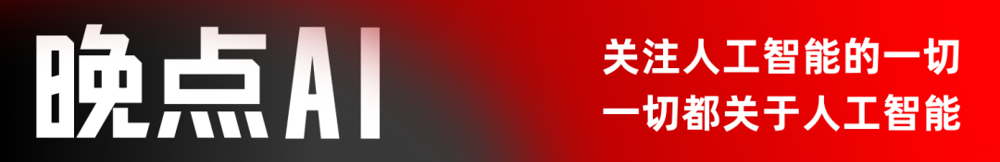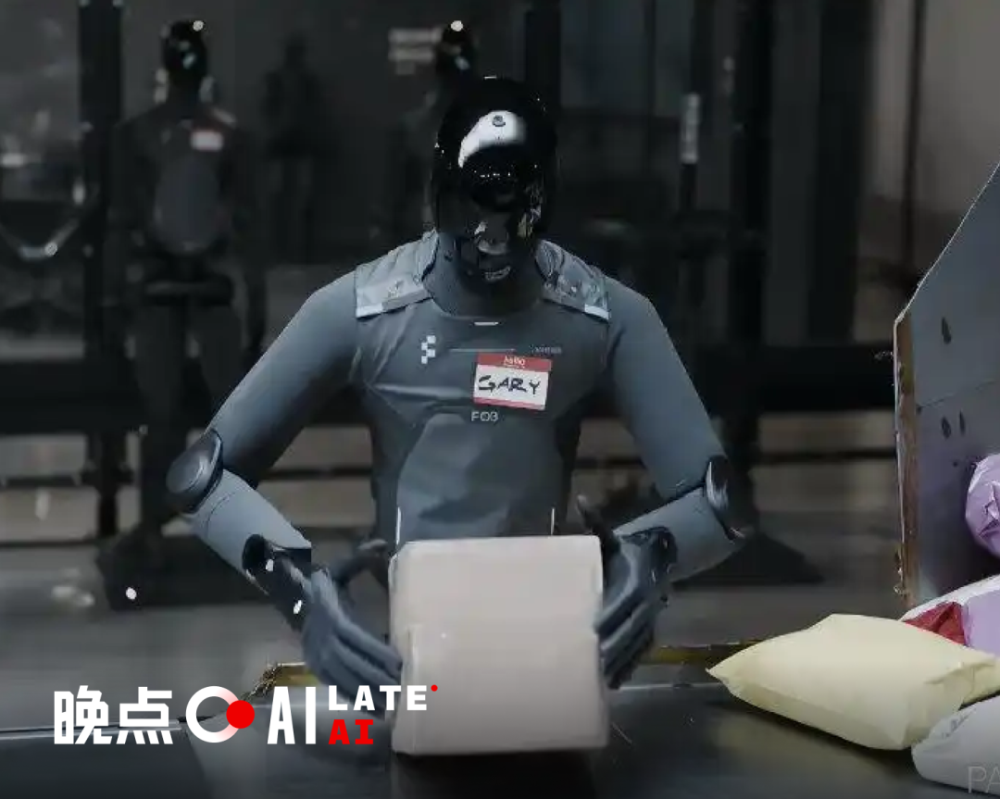

本季 Top 5 话题：人形马拉松、Figure 直播、灵巧手与灵巧操作、英伟达 Cosmos3 和世界模型热潮、Generalist 和 Pi 的最强模型进展。

**
**

**文 丨****实习生裴雨桐**

**访谈 丨程曼祺**

**
**

《晚点聊》具身季报系列第二期，我们继续邀请 Alphaist 的创始合伙人陈哲 Peter 和我们分享具身智能行业 2026 年第二季度的观察。

本次季报的主体部分，依然按照季度 Top 5 事件/进展展开，分别是：

人形机器人马拉松

Figure 的物流分拣直播

灵巧手和灵巧操作进展

英伟达发布世界模型 Cosmos3 和世界模型创投热

全球领先的具身模型进展：GEN-1 和 π 0.7。

我们也延展讨论了一些资本市场的变化、新玩家入场，如 OpenAI 的 Robotics 团队官宣和落地节奏之辩。

大模型和 Coding Agent 之后的下一步是什么？物理 AI 和机器人是重要候选答案之一，只是我们还难以看清时间。这一系列节目想做的正是记录和丈量行业的变化，也试图预测和判断。

**以下是播客的文字整理，有部分精简。**

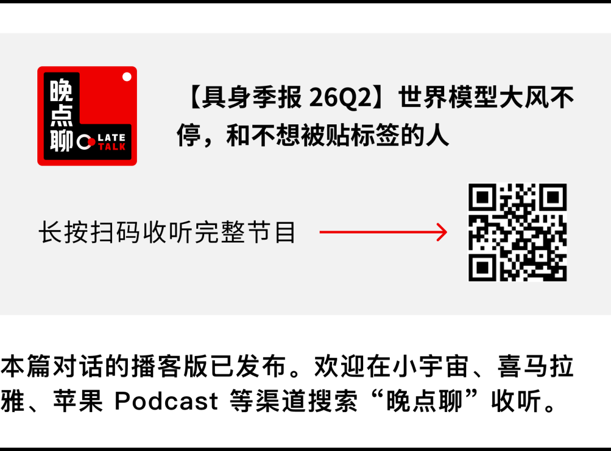

**26Q2 Top 5 总览与上季度回顾**

**晚点****：先总结这一季度最重要的 Top 5 话题，你觉得第二季度具身智能领域你最关注的五件事或技术进展是什么？**

**陈哲** ：Q2 比较明显的是世界模型和灵巧手取得了一些显著突破，同时人形机器人第一次大规模走进普通人的视野。我个人会这么排序：

第一件事是北京亦庄人形马拉松比赛，100 多个人形机器人参加了全程，冠军是手机厂商荣耀的机器人事业部。这件事传达的信号是：大厂可以把人形机器人做好，并且在未来可能变成整个市场非常重要的一股力量。

第二件是 Figure 连续几天直播人形机器人做包裹分拣，这算是第一次向全球大众普及人形机器人在工业场景的价值。

第三件是灵巧手和灵巧操作的爆发。在维也纳 ICRA 会议上，以舞肌为代表的公司发布了新一代高自由度灵巧手，多家创业公司也用高自由度灵巧手做出了精细操作的基座模型，让灵巧手成为下一个竞争战场。

第四件事 6 月 1 号英伟达发布 Cosmos 3 世界模型，让世界模型从概念向更产品化走了一步，世界模型也成为这个季度创业最火的风口。

最后一件事，是 VLA 的进一步迭代，包括 Physical Intelligence 的 π0.7、Generalist 的 GEN-1，VLA 也开始出现和世界模型融合的迹象。

**晚点****：上一季度结尾我们讨论对未来的展望时，第一点你就提到，想看世界模型将来能否拿出超出 VLA 的进展。这一季度算实现了吗？**

**陈哲** ：上个季度我们提到世界模型时，它还是一个研究上非常创新的思路，我们只见到了一些实验室级的早期样品，比如当时重点展开的英伟达 DreamZero，它实际上是 GEAR Lab 一个比小规模实验室作品，用的视频模型基座还是开源的 WAN 2.1。但到了 6 月，英伟达发布的 Cosmos 3 是一个更产品级、也更大规模预训练的模型，把世界模型从实验室拉到了工业级，变成了可以被调用、可以被部署的状态。

**晚点****：这算超越吗？还是现在比较难判断。**

**陈哲** ：应该说经典 VLA 架构的优势和劣势已经比较明显，世界模型的长处是对环境的预测和建模。以 Cosmos 3 为代表，我们看到一个统一架构的世界模型，可能对 VLA 能力带来潜在提升；同时领先的 VLA 模型也正在用不同方法连接、缝合世界模型的能力，进入自己的体系。

所以与其说世界模型颠覆或超越了 VLA，不如说它给现有的 SOTA 模型带来了更新的能力和思路。

**人形机器人马拉松第二年，终端大公司身影浮现**

**晚点****：下面我们正式进入 Top 5 话题的讨论。第一件事是 4 月 9 号在北京举行的人形机器人马拉松，这一次的冠亚季军都是荣耀机器人事业部的机器人闪电，这让从业者感到意外吗？**

**陈哲** ：亦庄马拉松我当天也去了现场。比赛开始前，夺冠的三大热门就是宇树、北人（北京人形机器人创新中心）和荣耀。

北人的天工是上一届冠军，作为卫冕方做了不少准备；宇树今年第一次正式参赛，作为人形运动控制的全球标杆，赛前测试视频跑出了 10 米每秒的成绩。

荣耀机器人事业部大概两年前成立，团队接近一两百人，从行业招揽了一批有经验的工程师和专家，研发投入量级显著高于另外两家。这笔钱用来定制比赛所需的大扭矩电机，还设计了一套非常精密的液冷机构。

现场很明显：其他公司的机器人长时间高速跑动会电机过热、不得不休息，而荣耀的液冷机制让整个比赛中，电机温度都控制在比较低的水平。这是它能保持高速度和较好一致性的重要原因。

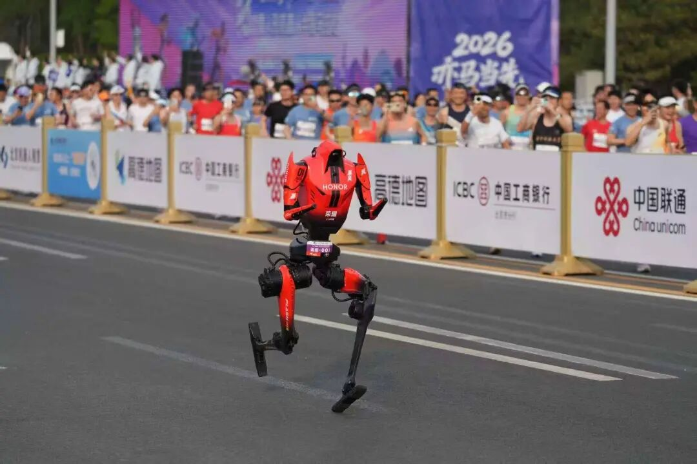

荣耀机器人 “闪电” 参加马拉松比赛。

**晚点****：荣耀夺冠牵出一个跟未来行业走向相关的问题。有人认为，如果长于本体的公司今年无法 IPO，无法到一个资源充裕的相对安全状态，接下来像荣耀这种资源更多的终端大厂——手机、汽车——他们的人形本体进入市场后会更有竞争力，因为这些公司在大规模制造上更有经验。你怎么看？**

**陈哲** ：荣耀这次的成功，预示了未来这个市场的竞争格局：一个有高端制造经验、很强组织能力的团队，在足够的资源和人才密度下，可以快速拿出非常有竞争力的人形机器人产品；在运控、导航算法上，大厂的水位也不差；至少对单纯追求性能的马拉松而言，荣耀的能力不差。

而在中国，拥有荣耀这样组织能力、人才能力和资金能力的大厂还蛮多的，像小米、小鹏、理想也已经开始严肃投入。所以人形机器人作为一个高端制造加上复杂算法、复杂软件系统的行业，正在从单一技术见长的创业公司视角，演变成一种系统工程和系统作战能力的竞争。

**晚点****：25 年那次冠军是北人天工，半马两小时四十分钟跑完，第二名松延动力三小时三十七分钟，差了整整一个小时。这一次自主导航类别里，荣耀的三个机器人成绩都在 50 分钟左右，而且咬得很紧，从遥控变成了自主导航。你怎么评价这个进步速度？**

**陈哲** ：进步速度非常快：一年左右成绩提高了三倍多，而且是在这么长的距离、多个机器人同时参赛的前提下，实现了相当高的可靠性和一致性。相比去年很多机型磕磕绊绊，今年更多机器人能顺利地完成全程，硬件、控制和自主导航层面都看到了非常快的进步。

它还反映出另一层意义：如果大家严肃地投入资源，很多问题在今天的技术架构下是可以解的。可能更大的问题在于，此前并没有人对人形机器人的 Locomotion 性能极限提出要求，所以不会专门为马拉松这种长达一个多小时、比拼最高速度的任务去做整个硬件和系统的优化。

**晚点****：但这类比赛和演性质的展示长久以来有个疑问——它有什么用？这里诞生的需求是对机器人的真实需求吗？**

**陈哲** ：我认为马拉松作为一种极限运动性能的测试，本质上是人形机器人技术的练兵场，是一个 benchmark。一个人形机器人要顺利完成 20 多公里的半马，需要非常好的全身运控能力，要处理应激场景和地面各种不规则障碍物，还要长时间无故障运营，同时解决供电、散热等系统问题。当我们能熟练掌握人形机器人各种能力的边界，到量产时就有大量系统经验和设计经验可以利用。

这就像 F1 赛车从来不是为了卖车，而是不同汽车公司展示最新技术、突破技术边界的尝试，其中很多技术会逐渐被引入量产产品。

**Figure AI 的 200 小时直播：为何物流是人形机器人的好场景？**

**晚点****：你排在第二的进展是 Figure AI 的超长时间连续直播。和马拉松不同，它发生在真实物流产线上：从 5 月 13 日开始，三台 Figure 连续直播了 200 个小时，站在流水线旁把包裹翻面、把标签翻到正面，速度做到了差不多 3 秒一个。为什么你认为这次直播展示很重要？**

**陈哲** ：Figure 这次的包裹拣选，无论从观赏效果还是实际工业价值，都算是一次 0 到 1 的突破。我们很长时间都在讨论：人形机器人到底能做什么样的工作、在什么场景下能有效替代人？物流的包裹分选本身就是一个非常合适的场景——它需要一定的泛化性和通用操作能力，而且工作连续、长时间，非常不适合人类长期去做。Figure 是全世界第一个把这样一个场景通过直播向全球大众展示的公司，示范意义非常明显。

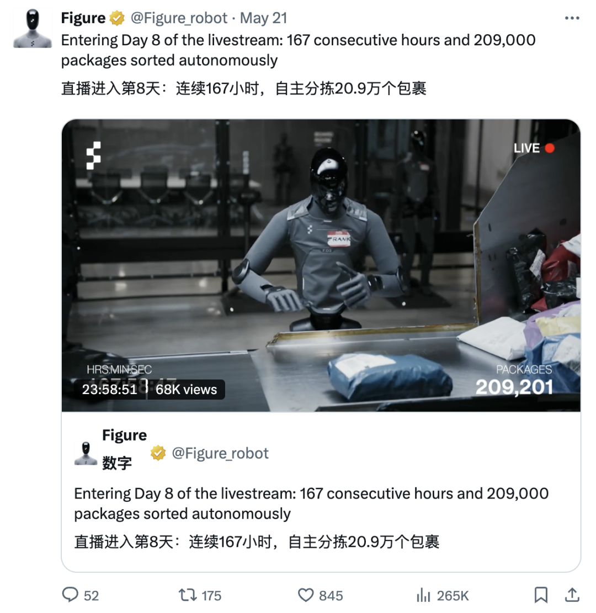

Figure 直播分拣包裹。

**晚点****：直播里机器人站在固定位置没动，但用的是带双足双臂的全人形。你觉得这是一种冗余吗？**

**陈哲** ：在快递分拣中，包裹由传送带快速投递，绝大部分情况确实只需要双手拿起、翻面，这也是 Figure 固定在那里的原因。但现实中会有很多意外：传送带速度过快，物体过轻，或者是球形、会滑动的，直播里我们确实看到一两个物体从台面滑落到地面。这种意外出现时，只有人形机器人加上具身模型的通用泛化能力，才可能解决无法穷尽的长尾问题。

**晚点****：同样的问题，四五年前不就有机器视觉加工业手臂的公司试图解决了吗？中国邮政四五年前就陆续和很多机器人公司合作，做的就是这种方案。**

**陈哲** ：但一直没有真正工业落地。传统机械臂方案：运动控制加深度学习图像识别，再加一个工业手臂——很难解决好这个问题。我们到底在解决什么？是当快递包裹被快速运过来时，能快速扫描到有二维码、条形码的那一面。快递包裹往往是软体，贴在上面的二维码非常容易被遮挡或形变。人会用双手做灵巧操作，把二维码翻面、展平——这两个动作在四五年前的技术栈下基本无解。这也是为什么不管是 Figure 还是星动纪元的展示，都用到了灵巧手。

四五年前想解决这个问题的公司基本还在用吸盘，因为吸盘在当时是更通用的方案，但吸盘只能做简单的 pick and place，没法两手操作。就像我们之前看 Pi 和 DYNA 做的叠衣服 demo，deformable（可形变）材料的操作其实非常适合今天的具身模型，你没法用一个简单的固体模型去建模它的空间几何和操作点，必须有一个具备泛化和理解能力的自适应模型。

**晚点****：包括你投资的海柔、已经上市的极智嘉，这些仓储物流自动化公司其实都在解决标准化场景。为什么到今天物流仍然是人形机器人非常大、非常有价值的场景？**

**陈哲** ：因为在标准化的包裹、纸箱之外，还有大量非标的包裹和拣选需求没被解决，比如电商仓的商品类型多样、柔性强。有拣货、打包，也有快递分拣的需求。Figure 和星动纪元选这个场景非常聪明，因为它确实是老技术栈、非人形方案很难流畅解决的问题。

**晚点****：直播里有人质疑机器人的扶头动作是遥操的，而 Figure 官方说是 Helix 02 模型自主完成的。**

**陈哲** ：遥操根本不是争议点。所有人形机器人真正进入部署场景之前，都有长时间的遥操作来收集数据、纠正动作。哪怕相当一部分时间需要人类介入，也不能削弱这件事本身的意义。

**晚点****：未来真正进入工业长期部署，可能会有点类似自动驾驶——后台一个真人管着数台机器人。**

**陈哲** ：当然。远程接管对 Robotaxi 已经是 norm，我们看 Waymo 和国内 Robotaxi 公司时都会衡量接管效率，即一个人能盯多少台。对全自主运营的人形机器人来说一定也是这样。

但工业、物流场景可以有人在后台盯着，真进家庭场景就有隐私问题，对全自主能力的要求又更高了。这也是为什么人形真正进家庭的难度，无论隐私还是数据分布，都比工业场景更大。

历史上真正成功的 to B 机器人，基本都在有大规模部署量、足够高吞吐率、作业环境和需求比较一致的场景里，比如极智嘉、海柔、Kiva system 这些都在仓储自动化领域。Figure 找到的物流分选场景非常好——它在之前的机器视觉加工业臂时代并没有被很好地解决。

**晚点****：去年和今年宇树两次上春晚，让中国大众对人形机器人有了不少认知。你觉得 Figure 这次直播在海外出圈吗？**

**陈哲** ：在 X 上反响蛮高。同时期还有件有意思的事：几天前在美国达人秀上，来自成都的舞者吴宇飞和 8 台宇树 G1 做了一段现场舞蹈表演，获得全票晋级，掀起全网讨论。它和 Figure 一样，都让美国普通百姓通过直观的方式，看到人形机器人怎么进入工业和商业场景。之前很多人看到中国春晚的机器人表演，还会怀疑是不是 AI 生成的、是不是录了很多遍。

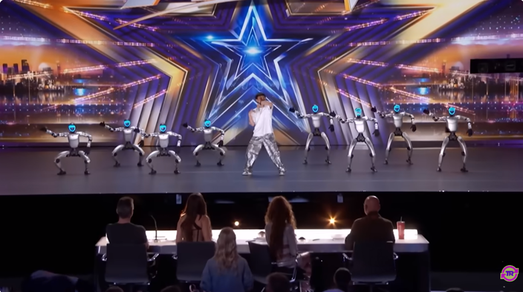

吴宇飞和 8 台宇树 G1 在美国达人秀上表演舞蹈。

**晚点****：说回国内，星动纪元在物流上和中国邮政宣布了新合作，去年 11 月也发过邮政分拣的 demo。国内离真正落地大概还有多远？**

**陈哲** ：从技术成熟度讲已经相当成熟。我了解到，星动纪元在快递分选这个场景里，不光在中国邮政，也在顺丰做了长时间测试和训练，已经能实现人形机器人全自主的分包、翻面、扫描等一系列工序。这很好地体现了中国公司在人形物流工业场景的落地，完全不亚于美国公司。

**晚点****：你投过的海柔、XYZ 这些在物流深耕比较久的公司可以往这个方向拓展吗？**

**陈哲** ：当然可以。这回到 to B 科技公司一个底层问题：很少有技术本身具有垄断性，更关键的是你的产品要嵌入一个更大的运营体系——比如快递、仓库的物流自动化。行业认知经验、和客户系统的耦合，都会变成非常重要的壁垒。所以在上一个范式里已经取得成功的 to B 机器人公司，都有机会把人形和具身大脑应用到还未被解决的场景中。

**晚点****：上一批公司是不是融资上会差一些？因为没那么强的新噱头，但已经有相当体量的收入了。**

**陈哲** ：上一波 to B 机器人公司基本都已进入 IPO 或 Pre-IPO 阶段。虽然他们在一级市场讲具身概念会被觉得是家老公司，但真正 IPO 之后能获得的资源和能力，有可能远远大于今天还在一级市场的公司。比如做送餐机器人的普渡，现在已经是商业清洁里非常头部的公司。仓库里还有大量员工、物业里还有大量清洁工，对今天简单自动化没覆盖的场景，对这些公司都是很好的延展。

**晚点****：上次我们还聊了一个细分趋势：把 Locomotion（运动控制）和 Manipulation（精细操作）结合起来，也就是全身的运动控制。比如包裹分拣在 corner case 下就需要全身控制能力，也有新公司专门做这个，比如李弘扬老师的源策未来。**

**陈哲** ：整个具身市场过去两三年主要在关注操作智能。之前说到机器人的 Locomotion，会自然觉得那是一种小脑能力，跟大脑的认知、决策和操作没有直接关系。但随着 Locomotion 和 Manipulation 逐渐成熟，我们发现有机会用一个更一统的架构同时训练移动和操作能力。在这个前提下，那些真正拥有很强运动控制能力的团队，价值会被放大。这个季度我们不光看到很多新公司，也看到一个明显趋势：越来越多公司在收集全身运控的数据。

**晚点****：之前大家采的是什么数据？和现在有什么区别？**

**陈哲** ：具身智能整体的瓶颈就在数据，每个周期模型范式的迭代本质上就是数据范式的变化。通过看数采公司在做什么，能提前预判行业往哪走。

两年前最火的是 ALOHA，本质上是真机遥操作数采。经典 ALOHA 方案涉及四个机械臂，人操作其中两个、直接控制另外两个，构型完全同构，遥控那只手臂上的动作都能被另一只克隆复制。这是 Tony Zhao 跟梓鹏在 23 年发表的工作。

到去年左右，出现了迟宬他们做的 UMI 方案：用人手持一个两指夹爪，是一种无本体的数据采集方式，好处是成本更低，一个数采人员拿着两个夹爪就能在很多真实场景里采集。

到去年底，大家又引入 Ego-centric（第一视角）视频，戴一个头环或头戴摄像头收集大量第一视角操作视频，好处是多样性暴涨、可以应用在非常广泛的场景里，而且对人操作任务的干扰尽量小。它的核心是第一视角视频，可以搭配 UMI 夹爪、数采手套，也可以空手。

**晚点****：所以它的量和多样性都会提高很多。那英伟达的全身动捕 SONIC，和电影里在人身上打点的特效动捕区别是什么？**

**陈哲** ：去年底英伟达 SONIC 全身动捕工作出现后，越来越多团队能通过动捕给人形机器人做大范围数据采集，也能把人的各种动作、舞蹈更快迁移到人形上。你有一些大概的骨骼点，用外部 camera 采集，然后要把这些骨骼点映射到一个人形机身上，也就是怎么做 retarget。SONIC 是一个开源技术栈，做得特别好又很简单，大家能很快迁移上去。

这里很大一部分原因也是宇树做好了，不只是硬件，开源市场里很多人围绕宇树 G1 做了参数优化，所以捕捉到一个人的运动骨骼信息后，能很快迁移到 G1 上。所以今年我们看到更多想做全身动捕、并在此基础上做 Manipulation 的尝试，也看到很多公司开始想办法采集灵巧手的数据。本质上，我们今天采集的数据，可能就会转换成三个月、六个月后模型上的突破。

**灵巧手与灵巧操作：舞肌可能成为灵巧手领域的 G1**

**晚点****：第三个主题是灵巧手和灵巧操作。你刚去维也纳参加了 ICRA，舞肌也有比较多展示。第二季度灵巧手有哪些变化？**

**陈哲** ：这次 ICRA 有非常多中国厂商参展，尤其在灵巧手领域。以舞肌为代表发布了新一代直驱灵巧手，曦诺、临界点等公司也发布了新一代高自由度产品。星动纪元的高自由度灵巧手也发了——他们邮政合作用的是自己的 XHand，应该是中自由度的手，但在 ICRA 发的是 21 自由度的旗舰款。

在 ICRA 发布灵巧手的公司蛮多，但舞肌的二代手显著获得了更多关注和认可。今年的情况跟 25 年很像。25 年 ICRA 大家印象最深的是 Sharpa 发布高自由度灵巧手，这一届就是舞肌的二代手。

**晚点****：上次我们聊到 Sharpa 的手是 22 个自由度、5 万美元左右，很多全球前沿研究室在用或在等。舞肌二代手是什么情况？**

**陈哲** ：舞肌的二代手是 20 个自由度。有些灵巧手标称自由度更高，但有些自由度里并没有动力。我们一般把灵巧手自由度分主动和被动，被动自由度名义上更高，但不能主动控制，会在被别的关节牵扯时被带过去。对高自由度灵巧手来说，20 个自由度左右基本就能实现人类掌内需要的各种操作。这也是个工程上的 trade-off，取决于技术方案是直驱还是绳驱。全自由度的直驱灵巧手，基本上就是每个自由度上都有一个电机。

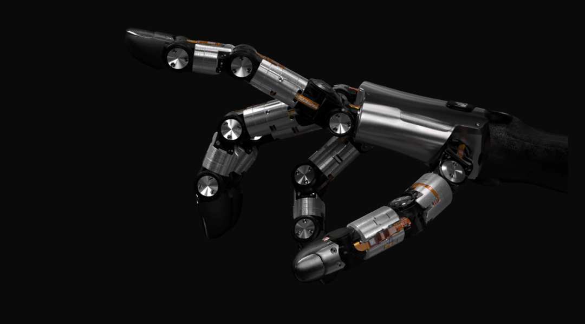

舞肌二代手。

舞肌和 Sharpa 可能是全球做直驱高自由度灵巧手最领先的两家。他们去年的一代手反响很好，但有不少工程问题：比较严重的散热问题；结构没有反驱能力，关节不能很自由地反向掰动，在强冲击环境下容易损坏，对力的响应和控制也不够灵敏。

这次的二代手在没有增加重量的基础上，实现了更好的反驱性能，也大大改善了散热。现场有非常多观众上手去试、去感受这个手的灵巧性和反驱性，对研究人员很有吸引力。

而且，把舞肌和 Sharpa 的手 side by side 放一起，舞肌大概只有 Sharpa 一半的体积。目前大多数高自由度手，除了舞肌二代手和曦诺未来 Flex 2 之外，体积普遍比成年人的手大 1.5 到 2 倍左右。这意味着很多基于人手学习的操作策略，很难在一个体积过大的手上复现。

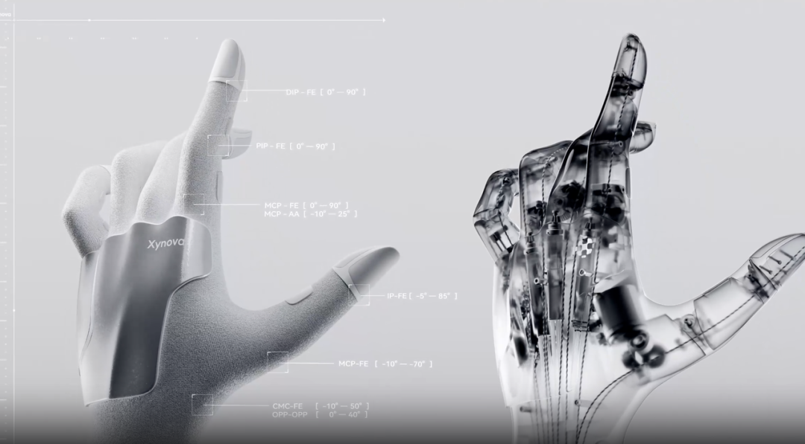

曦诺未来 Flex 2

**晚点****：研究人员去看灵巧手，怎么看出门道、判断是不是自己需要的？**

**陈哲** ：主要看手的体积、灵活度、反驱性和机械性能。其实就跟我们看宇树机器人一样——大家需要的是一个好的硬件载体，才能在上面完成大量控制工作。这次舞肌获得积极反响，也因为 ICRA 主要是个学术会议。过去一两年我跟很多海外研究人员交流得到一个认知：大家完成了以夹爪为核心的 VLA 研究之后，发现硬件限制导致很多更复杂的任务无法完成。

灵巧手不是新领域，全世界已经发展了三四十年，但直到今天也没有特别成熟、便宜的硬件方案，让全世界研究员能在这个基础上快速研究和试错。舞肌今天的定位比较像宇树：专注于把一个低成本、高可靠性的硬件设备做到足够耐用，让大家在这个基础上做大量研究。这也是为什么过去一两个月，非常多美国和中国的创业公司都发布了基于舞肌灵巧手的灵巧操作模型或工作进展。

**晚点****：现在高自由度灵巧手全球的市场规模是怎样的？**

**陈哲** ：今天灵巧手市场分低自由度和高自由度。低自由度手——无论第三方公司（像灵心巧手、强脑）生产还是智元等自产，一年市场规模大概在小几万只，基本和人形机器人的数量成正比。卖得最多的应该是灵心巧手，还有做连杆的因时量也大，因为很多最早做残疾人市场的都做这个。已经有相当出货量的公司不少，包括因时、灵心巧手、强脑、傲意，以及智元拆分出来的临界点。低自由度手很大的场景是配合人形机器人销售，无论表演还是简单抓取、pick and place。

高自由度手以 Sharpa 和舞肌为代表，主要面向全球灵巧手操作科研市场。这个市场出货量还比较小。去年 Sharpa 真正量产前，市场上几乎没有能买到的量产高自由度灵巧手，头部目前在几千只水平。但因为技术含量高、对算法和数据都有影响力，是大家竞争的焦点。

**晚点****：灵巧操作的模型这块有什么进展？**

**陈哲** ：今年 5 月，Genesis 发布了用定制五指手做的灵巧操作模型。Genesis 是 24 年成立的，一开始做机器人仿真环境，一年多以前开始专注灵巧操作和机器人全栈系统开发。我认为他们 5 月份的工作代表了目前用高自由度灵巧手做操作的 SOTA。

他们公开说采集了大概 20 万小时数据，相信相当一部分是 Ego-centric 数据，也有一些通过遥操作或数采手套获得的真机数据。从 demo 可以看到，他们用舞肌的手实现了旋转魔方、处理食物烹饪、弹钢琴等一系列灵巧操作。

**晚点****：他们展示的做菜步骤还挺长的，有 20 个步骤。你觉得这是什么思路？**

**陈哲** ：灵巧手操作模型今天还处在比较早期的阶段，很多操作其实比较像两年前我们用 ALOHA 做真机遥操。如果有比较高质量的人类完成某个任务的数据，无论动捕手套、外骨骼还是其他方式，采集到足够数据量，就有很高的置信度把这个动作重现，也就是 behavior cloning（行为克隆）。

因为之前市场上完全没有高自由度灵巧手供给，所以今天很多做模型研究的公司，还处在比较初级的获得真机数据的阶段。可能之后随着 Ego-centric video 技术提升，或者更轻便的类似 UMI 的方法，让用户更快捷地采集高保真手部操作数据，那时才有可能训练出更泛化、通用的灵巧手操作模型。

在高自由度灵巧手操作上，市场上还没有特别清晰的方法去获得足够高保真的数据：到底是纯粹的 Ego-centric video only 就能解决，还是像当年 G1 跳舞用一个非常好的仿真（Isaac Sim），或者要靠很好的动捕设备（手套、肌电手环、外骨骼），目前还没有共识。但我们知道，只有数据问题得到充分解决，才有可能训练出非常泛化的灵巧手操作模型，而行业正快速往这个方向推进。

**晚点****：数据是 AI 进展的三要素之一。你觉得灵巧操作的数据最后会在哪？这个问题也可以等价于：灵巧操作这个能力，最后是软硬一体、迭代更快的灵巧手硬件公司能更好做出来，还是做具身大脑、大脑小脑融合统一模型的公司？**

**陈哲** ：在 ALOHA 和 UMI 时代，其实已经诞生了非常多数据采集公司，开始服务各种具身大厂或创业公司，比如简智、光轮，美国也有类似的。UMI 本质上是个简单的平行夹爪，对执行器硬件依赖比较低。但高自由度灵巧手的数据，如果不控制手本身的结构和设计，作为第三方去采集就会非常受限于想映射的本体形态——很多自由度、关节上的特征并不容易 transfer 或 retarget。今天灵巧手的硬件结构还没有完全收敛：有些公司 22 个自由度，有些 20、21 个，每根手指上的自由度设计和结构都不一样。

跟灵巧手相关的数据高度依赖它本身的结构构型、电机选型和传感器选型。所以如果你是灵巧手厂商，自己设计一套数据采集设备和标准是很 make sense 的；第三方公司很难直接做好。

更关键的问题是：人形公司大概率最终会是一家全栈公司，硬本体、大脑和灵巧手都想自己做。核心挑战在于：是不是还存在一个广泛的、非常大的第三方灵巧手厂商的位子？如果存在，大量数据可能由这些独立灵巧手公司提供；如果不存在，这些数据就应该由人形本体厂商提供。

**晚点****：我本来想找类比，结果发现灵巧手挺难找的——它既是传感器，又是个执行器，对数据形态和标准要求还蛮高。**

**陈哲** ：举个例子：很多厂商的算法并不依赖具体的激光雷达型号，不同激光雷达采集的点云都能通过一条管线训练进更大的模型，所以激光雷达公司在数据上没有很高话语权。

但灵巧手的数据维度和格式跟硬件设计有很大关系，今天市场上也没有特别成熟的方案。而且灵巧手工程复杂度非常高，马斯克一直说它可能占了整个公司 50% 的工程投入，这导致很多公司其实没有能力在自己的本体上做出 SOTA 的灵巧手。如果这种情况发生，是不是一个第三方公司反而有更好的位子？

拿智驾来比较：除了蔚小理、特斯拉有全栈能力，还是有大量公司采购英伟达或地平线的整套方案——涉及数据的清洗、采集、标注、训练。所以长期来看，灵巧手和人形本体的关系，可能是一个长期博弈、长期共存的关系。

**晚点****：还有一个会持续出现的话题——绳驱和直驱的选择。ICRA 上曦诺未来做的是混合方案，Optimus 第三代 G3 也披露了细节，手部是 22 自由度，依然用绳驱。**

**陈哲** ：这次 ICRA 另一个重要发布就是曦诺未来的 Flex 2 混合方案灵巧手。曦诺拥有自研电缸和机器人关节核心零部件的能力，在此基础上做出了一款混合驱动高自由度灵巧手。

它的混合体现在：大量需要重载（抓握这种大力量）的能力，通过前臂里的电机以绳驱方式实现，因为电机放在前臂空间更大；同时掌心内也有微型电机，提供指节上比较灵巧的直驱操作能力。所以它叫绳驱加直驱的混合方案，从原理上有可能同时拥有两重优势。

绳驱本身一个更大的问题是：为实现高自由度，可能需要非常多的腱绳穿过狭小的腕部空间，组装和维修都非常头疼。曦诺的混合方案就是把一部分腱绳换成掌心内的电机，只需要更少的腱绳穿过腕部。如果思考人手的真实结构，抓握力大量由前臂肌肉实现，但掌心也有一些小肌肉控制细微动作——这个混合方案很接近这种结构。

顺带一提，这次还有一家公司源升智能，绳驱方案不带前臂，把所有绳驱都做进手掌里。所有需要做带前臂绳驱方案的公司，最大问题是要和本体厂商有更深入的耦合和集成，没法像标准手掌产品那样快速切换。比如宇树或智元的人形机器人不带手掌，可以快速切换其他公司的灵巧手；但需要前臂集成的公司，商业上更需要和本体厂商做深入定制。这也是为什么曦诺过去一段时间拿到了国内非常多大厂战投（理想、京东都投过）——基本所有大厂做人形研究时，灵巧手都采用了类似特斯拉的绳驱方案。

**晚点****：上一次聊，你自己是更看好直驱的，但现在很多大厂在继续做绳驱方向。**

**陈哲** ：我跟国内很多大厂研究人员聊过，对所有大厂而言，follow 特斯拉的绳驱路线是比较直接的选择。他们对本体有控制权，同时特斯拉还在做这个方向，让大家去选一个不同方向，对工程师是一个不愿意承担的风险：万一特斯拉是对的，你却去试新方向，谁来承担这个错误的责任？

但我觉得对一个独立的灵巧手公司来讲，做全直驱方案可能是更好的路线。因为如果你需要深入定制绳驱方案，大概率会变成大厂的一个定制公司，很难独立做成标准化的产品公司。

至于 Optimus 为什么还在坚持绳驱，最底层的原因是马斯克非常相信第一性原理，认为绳驱更接近人类的生物特征。但事实是他的 V3 手一直在 delay，什么时候能规模化生产还未知——今天灵巧手研究还很早期，我们很难说产业界选的绳驱方案就一定能量产、能规模化。

经过这个季度的进展，我对直驱潜力更大的判断应该是有所加强，因为现在灵巧手研究上最新的突破，还是由全直驱手实现的，无论舞肌还是 Sharpa。谁能更快地提供可靠、稳定、廉价的灵巧手供给，谁就能更快成为这个行业的事实标准——也就是更多的算法和软件会围绕你的硬件架构来设计。

**晚点****：说到这，我想到 OriginFlow，做肌电的一家公司。**

**陈哲** ：用肌电控制灵巧手、捕捉人手数据并不是新想法。十几年前加拿大滑铁卢就有一家公司推出过 Myo 手环专门做肌电控制，杭州的强脑也有一些用肌电控制低自由度灵巧手的尝试。

最近大家更关注，是因为随着算法进步，我们采集大量数据做训练、做 fitting 的能力显著提升，所以大家好奇：通过新的肌电方法，能不能比较高精度地还原手上每个关节的位姿、操作和对力的反应。

**世界模型：英伟达发布 Cosmos 3，中国世界模型融资热**

**晚点****：先聊你列的最重要进展——英伟达的 Cosmos 3，这是一个什么样的成果？**

**陈哲** ：我认为 Cosmos 3 是这个季度世界模型的标杆，因为它算是市场上第一个提出全开源 Omni-model 的。Omni 是全能的意思——它可以原生处理不同的 input 模态，包括文本、图像、视频、声音、动作，也可以输出这些模态，这可能是行业第一次这么实现。

按英伟达自己的定义，Cosmos 3 是一个全能的 world model，可以做不同的预测或生成任务，也可以像一个 VLM、或像一个 VLA 一样去输出文字、图片，或者对机器人的操作。

**晚点****：它技术上有个比较重要的突破叫 MoT（mixture of transformer），是两个 transformer 的结构：一个自回归 transformer 做 reasoning，一个 diffusion transformer 做生成。这个新架构反响怎么样？**

**陈哲** ：从概念上讲是一个非常理想的架构。很长时间以来，做语言模型研究和做图片、视频生成研究其实是两套不同架构。一个模型更善于处理离散信号（文字、离散 token），另一个 diffusion 更善于处理连续序列、图片、视频，很长时间这两个模型是孤立的。

Cosmos 3 用了一个巧妙的分工：自回归模型和 diffusion model 各是一个独立的 transformer，但中间有 share 的 attention 机制，让它们的状态相互影响，相当于把两种很不一样的模态缝合到了一起。一个 input 会被两条管线动态调节和处理，这也是为什么这个模型本身比较庞大。从架构原理上讲，这是很创新的。

**晚点****：它统一了理解和生成，这是之前大家一直想做到的。和之前的 Cosmos 2、1 相比区别是什么？**

**陈哲** ：其实没有一个独立的 Cosmos 2 品牌。Cosmos 最早是 25 年 CES 发布，去年和今年初有过迭代。之前其实是几个独立的模型：独立的 predict、transformer 和 reason 模型，这次相当于把它们缝织进了一个统一架构。在 Cosmos 3 之前还有一个 Cosmos Policy 子模型，是用之前的 Cosmos 加上一个动作 head，让它能直接输出机器人操作；这一次是把大家统一起来了。

在英伟达的 scope 里这是一个更大的 picture：Cosmos 3 是为英伟达的芯片和算力平台做优化的，同时英伟达也想推广它的一套机器人开发套件。它当然也可以用在自动驾驶，因为它是一个通用的世界模型，只是可以输出不同模态——不同组合下，两个 transformer 的激活程度不一样。比如图片到文本，可能只需要自回归 transformer；文本、图片到动作和视频，就需要激活下面的 diffusion model。我相信其他大公司、包括中国大厂之后也会开发出类似思路。

**晚点****：哪怕收缩到和 Robotics 相关的领域，也有很多不太一样的东西都被叫做世界模型，你会怎么分类？**

**陈哲** ：我用 6 月份英伟达那篇世界模型官方综述里的分类，分成三种。

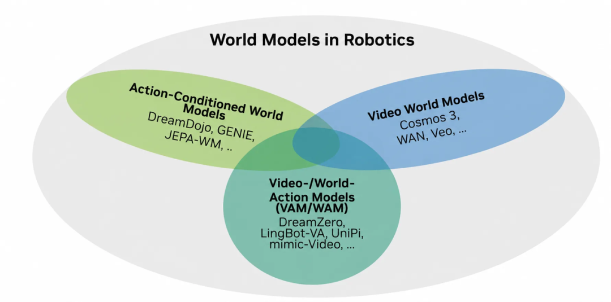

英伟达对机器人领域世界模型的分类。其中 DreamDojo、Cosmos 3、DreamZero 来自英伟达；GENIE、Veo、UniPi  来自 Google；WAN（通义万相）来自阿里，LingBot-VA 来自蚂蚁；JEPA-WM 来自 Meta FAIR，来自，mimic-Video 来自 Mimic Robotics。

最底层叫 Video World Model，代表是 Google 的 Veo、阿里的 Wan，本质底座是一个视频生成模型——根据条件或描述生成视频，也就是对未来状态的预估；英伟达自己把 Cosmos 3 也放在这一类，因为它是个万能模型。

第二种叫 Action-Conditioned World Model，前提基于你的动作——给定一个动作，在这个条件下生成世界模型，比如 DreamDojo、Genie、JEPA。DreamDojo 其实是一个世界仿真器，但它的 input 是你的动作、你想对环境产生什么变化，模型在训练中会基于真实物理变化记录这些动作对环境的影响。这里的动作具体指物理世界的动作，不过一段文字指令也可以被视为一种 action。

第三类是 World Action Model，WAM，就是现在特别火的方向——核心是通过这个模型生成机器人的动作，可能同时也能生成未来的图像或视频，所以它更是一个 policy。不管是 DreamZero 还是蚂蚁的 LingBot-VA 都属于这个定义。在具身领域我们更关注机器人怎么响应和操作，所以 WAM 是目前最关注的方向。

**晚点****：你前面说跟一些做 LLM 的人聊，他们对 VLA 和 world model 被对立起来觉得很费解。**

**陈哲** ：对，在他们的想象中，最好的模型就应该是个 Omni-model，也就是 Cosmos 3 这个方向。所以我认为 Cosmos 3 代表了大家对这种模型的一种终极思考：作为一种智能模型，它就应该 take 不同的模态、也能输出不同模态。

今天的 VLA 更擅长生成指令、生成动作，而 world model 作为以视频为 backbone 的模型更擅长对状态的预测，这两种能力如果巧妙结合，从终极性能来讲肯定更好。这也是为什么 GEN-1、π0.7 都开始融合一些 VLA 和世界模型——它们本身也不是谁替代谁的关系。

**晚点****：现在世界模型成了非常火热的创业风口，国内出现很多新公司，有些今年才成立就成长为 10 亿美元估值的独角兽，好几个创始人都非常年轻。**

**比如比较火的有 Genesis、LiberAI 这样偏具身的智能公司；也有流形空间（Manifold）、逆矩阵、模式星空等也跑得很快。我 4 月初跟其他投资人聊，那会儿已经有人整理出 49 个世界模型公司。还有成立较早、目前估值较高的极佳视界（23 年成立），其余大多是 25、26 年成立的中国公司。海外方面有上季度 GTC 期间宣布融资 4.5 亿美元的 Rhoda AI，之后英伟达 GEAR Lab 和 DreamZero 团队的 Joel Jang 也出来在美国创业。**

**陈哲** ：具体的公司很难列全，world model 是一个蛮大的概念，太多公司都能贴上这个名字，所以很难判断每家到底做的是纯粹的 world model，还是相关性有多大。

World model 为什么有这么大的冲击？本质上是因为我们看到 VLA 这种方法：一个 video-language model 加上动作序列，迭代下来遇到了一定的性能瓶颈。而用视频生成路线来做机器人 policy，其实早在 23 年就有工作尝试，比如字节做的 GR1、GR2 就是 video action model 比较早期的尝试。但因为 VLA 能更快给出一个 60 分的答案，典型代表就是 π0 的发布——它开源、又代表当时的 SOTA，所以很多团队快速跟进。

VLA 抽象来讲本质上是一种行为克隆：把一段文字、图片描述和一段机器人运动信号建立联系，反复试教就能让 VLA 输出类似的关节信号。但这条路线泛化性局限非常明显。而视频生成路线可以用到更海量的数据 knowhow，里面包含大量物理先验知识，原理上很有吸引力。只是 23 年最早尝试时，没有一个像 Wan 这样预训练好的开源视频模型，也没有 diffusion policy、flow matching 这些能生成比较好的关节序列的方法，这些是 24、25 年才逐渐成熟的。所以 world action model 的很多基础 recipe 三年前就有了，但能力是到 25 年底、26 年初才逐渐释放。

今天 SOTA 的视频生成模型：可灵、Seedance、Veo 3，对物理、对常识的理解都到了很好的状态，用它来做机器人预测和策略理论上就能得到很好的效果。这一系列要素的出现，是这个概念在 26 年突然爆火的原因。

**晚点****：看到这么多公司融这么多钱，作为投资人，你是什么心情？**

**陈哲** ：因为大家在大模型里赚了一些钱，赚了钱的人会把更多钱投进去，没赚到钱的人也会在这一波补票，这是估值能在非常短时间内涨这么多的诱因。

但从更长角度看，在具身领域不管硬件还是模型，中国公司都有非常好的资源和能力，国家也有非常多的支持和战略投入，对于立志成为这个领域世界级公司的创业公司是非常好的机遇。这到底会不会像当年的电动车浪潮，可能 100 多家公司分别成立？I don't know，但一波大浪肯定会有大量人才和资金涌入，这也反映了这次变化来得有多么剧烈。

**Gen-1 和 π0.7 发布，不被 “VLA” 标签框定**

**晚点****：最后一个 Top 5 进展是被世界模型反衬得有点过时的 VLA。你提到两个具体进展：Physical Intelligence 的 π0.7 和 Generalist 的 GEN-1。先说 π0.7，你看到的启发是什么？**

**陈哲** ：给他们贴不贴 VLA 标签可能都不是最重要的，我提到他们是因为他们是现有模型公司这个季度蛮有启发性、创新性的突破。

Pi 是一家非常创新、稳步迭代的公司，从 0.5、0.6 到 0.7 每个版本迭代都很明显。0.7 和之前版本最大的区别是，它在一个传统 VLA 的基础上，接上了一个轻量的世界模型。这个轻量世界模型可以提供对未来任务图像的预测，用这个预测来影响生成模型去生成相应的动作——比如我要去拿杯子，当手只动到某个位置时，它会生成未来几帧应该是什么样子，比如物体和我之间的位置关系、它的形变，再用这个未来子目标图反馈到 VLA 的生成过程里。

**晚点****：这好像挺符合人的直觉。比如你要扔一个纸团到有点距离的垃圾桶里，会脑补一下轨迹。**

**陈哲** ：对，我们的脑补就是用什么样的力、角度可能导致什么结果，所以会根据脑补去调整。Pi 一直在引领 VLA 研究前沿，比如 0.6 时提出了类似长时间 agent 规划的能力——用文本记录的方法把当前状态做持续性存储，根据之前观测到的状态来规划具体动作。这些小改进在 Pi 每个版本里都非常引领行业。

**晚点****：再聊 Generalist 的 GEN-1。我自己体感是，国内从业者对 GEN-1 的讨论度比其他模型更高。**

**陈哲** ：它有几点显著突破。第一，把大家觉得比较慢的 VLA 执行速度显著提高了，不再慢悠悠地执行任务。第二，在一些比较复杂的长程任务里，他们宣称实现了非常高的准确度——有几个任务从百分之六十几的平均成功率提到了 99%，反映了模型在任务能力上的显著跨越。还有一点大家非常关注：他们自己采集了 50 万小时的真实世界交互数据，是一种 UMI type 的无本体数据采集，非常高效。同时，他们用这 50 万小时数据，在没有一个 pretrain 的 VLA 基础上，相当于自己训练了一个端到端模型。

这点体现了团队对自己技术路线的高度自信，以及模型有比较强的 scaling 能力。他们在报告里也清晰展示：从 1 万小时、几万小时到 50 万小时，泛化性和能力都能得到显著提升，这其实是在展现 Scaling Law 在这上面是否有效。Generalist 一直宣称自己找到了 Scaling Law 的钥匙。

**晚点****：你说他没有在一个 VLM 上微调、展现了团队非常有自信，是因为这个做法很罕见吗？**

**陈哲** ：研究界容易出现路径依赖，尤其当某些方法被证明有成效时。国内很多模型团队因为 Pi 开源，会在 Pi 基础上做大量后训练和微调，喜欢拿它作 benchmark，证明 “我比 π0.5 增加了多少性能”。这一方面说明 Pi 在引领行业标准上的影响力；另一方面也说明，要独立开创一个新技术方案、投入这么大数据量去采集训练，是需要相当大勇气和决心的。

**晚点****：所以对同为美国公司的 Generalist 和 Pi，他们相互之间都不屑去 follow 对方。**

**陈哲** ：美国的创业环境整体非常奖励创新，你很难见到两三个团队讲一模一样的故事，很多团队想方设法在技术上、路线上找到差异化，投资人也会奖励第一个做这件事的人。

美国的巨头公司非常多、非常活跃，本身就有大量创新业务和前沿实验室，很多很好的工作本来就来自 Google 、Meta、亚马逊。所以在美国做硬科技创业，如果不能做出有差异性、有创新性的事情，就很难获得加速度、很难被 acquisition——而被大企业收购本来就是美国硬科技创业很正常的 exit。

所以你会发现美国有些公司可能是 “为了创新而创新 ”，因为大企业的创新本身就很有竞争力，只做更便宜的、同样的东西，就很难获得溢价。

**晚点****：从 GEN-1 目前的公开信息，能看出 Generalist 对世界模型的思路吗？**

**陈哲** ：他们其实比较排斥把自己定义成世界模型或 VLA。Peter Florence 专门写过一篇文章，大意是说他们的做法既不是把动作粘到 VLM 上变成 VLA，也不是一个世界模型，而是完全按照物理交互的原生数据去训练。这是为什么他们采集的几十万小时数据可以直接用来训练一个 transformer network，而不需要依赖一个 VLM 或 video generation model 作为 backbone。

具体细节不知道，因为没开源过。但思路是一样的，因为这群人是从 Google 出来的。在最早 Google 那个开山的工作 RT-1 里就展示过：RT-2 是 VLA 这个风潮的起点，而在它之前的 RT-1 训练了一个中等 size 的 transformer，input 是文字描述、一些动作图片和关节序列，output 是在线生成关节序列，backbone 就是一个独立训练的 transformer。

**Google 想做具身领域的安卓，OpenAI 官宣 Robotics 团队**

**晚点****：这个季度 Gemini Robotics 也发了新模型，4 月叫 ER 1.6，但你没把它排进 Top 5。你怎么看 Google 在这块的成果和影响力？**

**陈哲** ：Google 的 Gemini Robotics 还是一个比较大的部门，推进的研究比较多。ER 1.6 全称 Embodied Reasoning 1.6，你可以想象成一种更好的 VLM——它并不能直接输出机器人的控制或 policy，而是相当于在 VLM 上提供了更多对空间和任务的理解、reasoning 能力，更好地通过图片、视频对物理环境进行描述和推理。它的对比对象是直接跟 Gemini Flash 3.0 比的，本质上就是一个通用模型，只是训练了更多对物理环境的理解。

Google 想做这个领域的安卓：偏大脑、偏 API、偏软件的位置，发挥自己在语言模型方面的优势，把空间推理封装成可被调用的产品。ER 1.6 发布时提到了一些合作，一个载体落在波士顿动力的四足机器人 Spot 上：Spot 出货量应该有几千只，真正用到了工业巡检，比如油气田场景——机器狗需要上下楼梯、进复杂地形，去检查传统阀门和仪表盘上的数字，也会检查有没有异常值。其他合作方还有 Apptronik（之前开发有一些 delay）和思灵的人形机器人 AgileONE。

ER 1.6 代表了大厂对这个问题的一种态度：如果能用通用模型把问题解决，那最终可能它真的只需要训练一个 Omni-model 来解决所有事情。更底层的问题是：我们到底有什么理由相信，很多年以后，所谓 embodied AI 的模型不会由 Anthropic、OpenAI 或 Google 这样的通用模型大厂来提供？如果 Omni-model 这条路线最终被证明有效，那机器人对空间的理解、对动作的预测，是不是都可以被融合进一个更大的通用模型里？

**晚点****：有一种反方观点：这种模型形成过程中需要大量硬件参与、需要硬件去收集数据，而很多通用模型公司不做、或非常不擅长这部分。**

**陈哲** ：今天的确可能不擅长，因为没有为这件事优化。但大模型公司花了几十亿、上百亿美金在做各种语料和数据标注，只是主要是文本和图片数据。

**晚点****：OpenAI 5 月底更正式地官宣了 robotics team。Sam Altman 发推说在找顶尖全栈人才（硬件、系统、机器学习等），短期场景是给自己造 AI 算力的基础设施，长期愿景是做一个每个人都会用上的机器人。团队 leader 是 Aditya Ramesh，DALL·E 的作者，纽约大学本科毕业就进了 OpenAI，并没有读博士。**

**陈哲** ：OpenAI 的 Robotics 团队就是基于他们之前做 DALL·E、做 Sora，也就是做图片、视频生成的团队建立的。OpenAI 内部对 Sora 的定位一直认为它就是一个世界模型，Ramesh 之前带的团队在推特上的名字就是 World Simulation Research。所以 OpenAI Robotics 今天这么高调成立，实际上就是看到了这一系列技术的拐点或突破。

**晚点****：你觉得他会投入多少？之前 Anthropic、Claude Code、Claude Cowork 这些强势增长给 OpenAI 压力比较大，有段时间他把 Sora 2 也关掉了，有收缩和重新聚焦的趋势。他真的会把 Robotics 当一个重点吗？**

**陈哲** ：我想分享一个观察：今天哪怕最大的 embodied AI 研究团队，真正涉及的算力和模型规模，相比旗舰的视频生成模型、更不用说旗舰的语言模型，都是一个非常小的量级。以 Cosmos 3 为例，它应该已经代表了今天 embodied AI 训练投入的最高算力预算，大概在万卡级别，这已经是整个具身研究算力的天花板了。所以对 OpenAI、Anthropic 这种头部 LLM 公司来讲都不是特别大的预算，一个类比是蚂蚁的灵波团队，LingBot-VA 应该也就在万卡级左右。

OpenAI 想做全栈，是因为机器人研究离不开硬件：研究还很早期，脱离硬件就很难得到验证。我知道 OpenAI 会把灵巧手作为一个特别大的投入方向，他都要进这个市场了，不可能再去搞夹爪。考虑到他们有相当大的算力，也能吸引非常顶级的研究员，我还是很期待他们在未来一段时间拿出一些行业 SOTA 的进展。

**宇树上市、落地节奏与下季度展望**

**宇树定下估值锚点：本体会分化，大脑可能寡头化**

**晚点****：二季度宇树正式科创板 IPO 过会，接下来很快会登陆科创板。头部公司这一批上了之后，后面的公司会怎么样？**

**陈哲** ：宇树上市对具身行业的发展和投资都是一个标志性事件，给今天所有头部具身公司定了一个估值锚点。通用型机器人一定会出现非常大的公司，因为人形机器人本来就是非常通用、非常 general 的产品。但因为人形今天在物理上还有蛮多限制——功率密度、电机密度、电池密度、重量、体积。哪怕长期普及之后，可能也会分化出不同的人形机器人服务不同场景：小型机器人在娱乐表演甚至科研，大型机器人在需要重载、搬运、大 payload 低速的场景。所以本体不一定是 winner take all，但大脑有可能。

**晚点****：就是如果 Omni 模型这条路线成立的话。**

**陈哲** ：如果有一个超级模型的能力显著比别人高。这件事我们在 Anthropic 身上已经看到非常强的端倪：它可能不是 winner take all，但至少是一个寡头化的现象。

它反映的更底层的问题是：大脑作为一个智能产品，智能一定是两极化的——要么追求最好的智能，要么追求一个 OK 的智能。而模型本身是一个边际成本很低、可以被开源共享的产品，所以长期来看，智能模型大概率会分为高水平的开源模型和顶级水平的闭源模型，没有其他模型的生存空间——如果一个闭源模型的能力超不过 SOTA 的开源模型，它就没有存在价值。如果这个格局对语言模型成立，我认为对具身模型，终局很可能也是这样。

**模型创业公司的终极拷问**

**晚点****：那谁在提供高水平的开源模型？是 Google、英伟达这种想做生态的大公司吗？**

**陈哲** ：很可能。在语言模型里，目前不就是千问、DeepSeek 这样的公司在提供吗？

我们跟一些具身模型公司创业者讨论时有一个两个挺难回答的终极问题：第一，你如何跟一个最好的开源模型竞争——它大概率由英伟达这样的公司提供，因为它的商业模式不依赖模型变现，而是算力变现，所以可以把模型开源。第二，你怎么跟寡头化的、最头部的私有模型竞争——这个供给大概率来自 Google 、阿里、字节、Anthropic。

**晚点****：有创始人给过你比较有说服力的答案吗？**

**陈哲** ：这个问题在当年 Anthropic 创业时也被投资人反复问到过，但 Anthropic 成为了 Anthropic，OpenAI 一开始可能也很难回答。

客观说，今天具身智能创业和投资的热潮，跟上一波语言模型创业公司的成功是有关系的。我们已经有几家大语言模型创业公司成功上市，给投资人创造了丰厚收益，所以很合理地推断具身模型里可能也有同样机会。但创业的挑战是，如果所有人都这么想，市场一定会出现过度竞争、过度投资，最终的赢家还是比较稀缺的，回报预期会被大大压缩。

**落地节奏：中美与软硬件的差异，但周期在缩短**

**晚点****：宇树作为中国第一家要上市的具身公司，其实已经盈利很多年了，但大部分公司还处在前期探索。关于落地节奏，这个季度你有什么新想法？**

**陈哲** ：可能要从两个维度看：中美的差异，以及硬件公司和模型公司的差异。

以美国领先公司为例，无论 OpenAI 还是 Physical Intelligence，都符合一个典型的美国前沿创新 pattern：一群非常聪明、有愿景的人才聚在一起，对一个有巨大潜力但长期不确定的方向持续投入。美国的环境也提供了比较好的早期孵化：OpenAI 从 15 年成立到 22 年底 ChatGPT 出来前，其实一直没有明显的商业化进展，但不妨碍它吸收大量人才和资源。

今天 Physical Intelligence 也在做同样的事，不断发布甚至开源领先模型，但 so far 也没看到特别清晰的商业化时间表。基本所有美国公司现在都有这个问题，包括 Figure，它现在也没有任何一单确切、真正被验证的落地收入，只是会对外展示一个 “我要落地” 的姿态；姿态跟事实还是挺不一样的。

国内本质上是大家对这种长期不确定性探索的容忍度非常差，所以你一定更需要做出这样的姿态，而且最好是个事实。在中国今天的挑战是：如果我跳出来说，明确告诉投资人 10 年之内绝对不做商业化、不做落地，那你怎么获得足够资源、吸引足够人才、在资本上有好反响？

**晚点****：我想到一个办法，就是你是梁文锋，很有钱。**

**陈哲** ：对啊。所以我一直觉得 DeepSeek 是一家非常稀缺、非常不一样的公司。当你自己足够成功、对这件事有足够信仰。客观讲，OpenAI、DeepMind 本来就是一群 billionaire 的尝试，OpenAI 本来就是一个非营利公司，商业化和盈利本来就不是这种公司开始时的目标。

所以今天更大的一个分歧在于，我们认为具身整个研究和行业发展到底到了什么阶段。如果它像当年的自动驾驶，至少需要 10 年甚至 15 年才能规模商业化（Waymo 实现了商业化但还没盈利）——还有没有人愿意创业和投资？而如果判断 5 年之内就能商业化和盈利，那会有更多人愿意投。所以一个很底层的问题是：大家对这个周期的判断是有差异的。

**晚点****：你目前对这个时间的判断，是在缩短还是变长？**

**陈哲** ：相比去年，这个周期肯定在缩短。因为一些基础要素在快速成熟，而且语言模型领域的进展让大量能力、算力、数据能迁移到具身领域。这也是为什么我们把 Figure 和星动纪元用人形机器人做快递分拣单独拿出来说——因为我们至少看到，在这样一个场景里，一个通用型人形机器人用新的算法技术栈可以更好地解决问题，是有实际落地可能性的。

**下季度展望：未来 6 个月是大厂入场的最后窗口**

**晚点****：你对下一段时间行业里的变化有什么展望？**

**陈哲** ：有一件事我最近反复思考，认为会变得更主流：人形机器人作为一种形态，未来一两个季度可能有更多产品在具体场景落地和商业化，也有更多公司进入这个市场、宣布他们的人形产品计划。

当然从宣布计划到发布产品，至少有 1 年到 1 年半的时间。我的设想是：未来 6 个月是进入这个游戏的最后窗口。如果你不在 26 年启动，那么等到 27、28 年人形真正开始广泛落地时，你就没有身位了。

**晚点****：国内主流手机、汽车厂商多少都已布局人形机器人，字节、腾讯、阿里等互联网大厂在全栈方向上可能有哪些动作？**

**陈哲** ：对这类大厂来说，可能更好的对标是像 Pi 和 Anthropic 这样的模式，因为他们太擅长做模型了，模型的商业模式跟他们本身能力高度相关，这也是为什么今天国内大语言模型里字节、阿里都非常领先。

在中国做具身创业还有一个悖论：除了你很难做一家 10 年没有商业化、没有收入的公司，投资人和资本市场也更难容忍一家公司不是全栈、或者有大量能力依附于其他客户。这导致的结果，也是我们正在看到的，就是所有的具身大脑公司都在宣布他们在做机器人本体。

**晚点****：我前段时间采访许华哲，他有一个非主流的想法：不应该所有事都在公司 in-house 做，有些事应该交给生态。**

**陈哲** ：我认为这件事可能是对的，也是一个非常美国式的想法。站在他创业的角度，如果你做全栈的 timing 已经太晚、没有特别好的身位，那就在你的细分领域里做到行业最好，这是有价值的。我觉得最终的大赢家大概率还是有全栈公司的机会——苹果、小米、华为这样的公司在具身时代也会存在。

但很有意思的是：今天市值最大的几家公司其实不是全栈公司，比如英伟达不是，Anthropic 或 OpenAI 最终上市了可能也不能叫全栈公司。所以到底全栈是终局，还是水平分层是终局？我觉得长期都会反复摆动，它本质上是一种博弈和竞争的关系。

包括很多投资人会 challenge 宇树，认为它只是一家硬件公司，没有 AI、没有模型。我其实不太认可这个 challenge。如果假设宇树未来一直是一家硬件公司，那它也是一家很赚钱的硬件公司；我不觉得有什么原因它不能长出自己的软件或 AI，如果公司从战略上真的想做这件事的话。

题图来源：Figure AI 5 月中旬的直播。

**-****  FIN -**

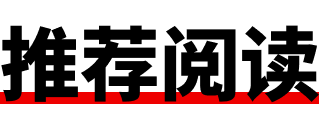[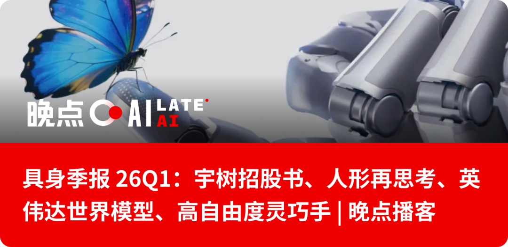](https://mp.weixin.qq.com/s?__biz=MzkzMzM4NTIyNQ==&mid=2247484955&idx=1&sn=875279c4a8fb195b0d1db4ec0fe788a4&scene=21#wechat_redirect)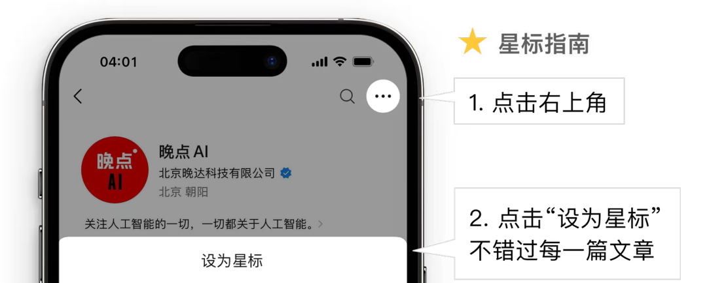
