# 中金 | 国产算力系列一：超节点，迈入国产AI下一站

> **原文链接**：https://mp.weixin.qq.com/s/BDQewT9YCOinokoUJ1BckA

- **公众号**：中金点睛
- **作者**：温晗静 何欣怡等
- **发布时间**：2026-08-27 00:00:00
- **抓取时间**：2026-11-13 14:44:28
- **正文长度**：12018 字 | **图片**：18 张（已本地化）

---

**中金研究**

在大模型参数规模、推理并发、显存占用和功耗密度持续提升的背景下，AI服务器已经从拼单卡性能转向机柜形态。展望2027年，随着算力卡供给/推理需求/模型参数/方案技术等方面的条件逐渐成熟，超节点具备放量基础。而围绕机柜形态的演进，我们认为将在芯片/互联/ODM等多个环节实现价值量跃迁。

**[点击小程序查看报告原文]()**

**Abstract**

**摘要**

超节点的价值在哪里？随着AI发展步入推理时代，2027年进入超节点放量元年。1）在需求端：国产大模型迭代加速，K3为代表的开源模型迎来了质变；推理需求增长带动的ARR提升/token增长，CSP资本开支持续上修。2）在架构端，MoE架构模型参数大之后超节点成为了必然选择（参数存储需要），另一方面模型性能和集群规模存在非线性关系，超节点在互联、存储等方面亦随之优化。3）在供给端，超节点以集群算力弥补单卡单板。

超节点市场规模有多大，哪些环节将受益？我们综合自上而下（capex视角）及自下而上（供给瓶颈视角）测算结果2026/2027年国产超节点机柜的市场规模约为759/2,256亿元，对应等效64卡机柜出货量约为0.69/2.38万柜。从架构设计变化的思路看，互联和ODM的价值量跃升明显；此外，还需考虑实际生产中的瓶颈环节，包括算力芯片/HBM/交换芯片/PCB/Drmos等。

**超节点方案有哪些类型？** 超节点方案的选择兼顾成本和实际部署效率。当前国内超节点路线整体呈现“多规格并行、国产芯片适配、推理先行、训练跟进”的特征。与英伟达通过NVLink生态闭环推进不同，除昇腾外，国内方案更强调开放协议、芯片异构兼容、整柜交付、TCO优化以及与自身云业务和模型体系的绑定。

**风险**

CSP资本开支不及预期，国产AI芯片量产与认证进度不及预期，产业链新技术良率爬坡不及预期，部分环节竞争压制毛利率。

**Text**

**正文**

在大模型参数规模、推理并发、显存占用和功耗密度持续提升的背景下，AI服务器已经从拼单卡性能转向机柜形态，海外如英伟达、AMD、谷歌等均在2025年起陆续推出机柜（超节点）方案。**在推理时代，超节点方案是MoE稀疏模型进行大规模推理的必然选择。**

聚焦中国看，在特定模型架构（如MoE）和大型集群推理场景下，通过协同设计实现局部优势的突破，是中国AI服务器的发展思路。展望2027年，随着算力卡供给/推理需求/模型参数/方案技术等方面的条件逐渐成熟，超节点具备放量基础。而围绕机柜形态的演进，我们认为将在芯片/互联/ODM等多个环节实现价值量跃迁。

**超节点的价值在哪里？**

**国产开源模型迎来拐点，超节点成为模型部署最优解**

**超节点是通过高速互联协议与专用交换芯片构建的高带宽域（High-Bandwidth Domain），将数十至数百颗GPU芯片在逻辑上整合为统一编址、低延迟、高带宽的协同计算系统，目的是扩大scale-up域。** 国产超节点的出现，是中国开源模型参数规模、推理并发、显存占用和功耗密度共同抬升之后，AI基础设施从“购买更多算力”转向“释放有效算力”的必然结果。一方面国产服务器架构将沿袭英伟达等从8卡向更大的scale up域如NVL72探索的路径；但另一方面国内的特殊条件限制，也带来了在互联和架构设计上的新变化。

**需求端：中国大模型加速追赶海外，进入推理时代**

**国产大模型迭代加速，开源模型质变。** 进入二季度以来，国产模型发布速度加快，以K3 为代表的模型在fable5基准上实现能力收敛。同时近期开源模型叙事的兴起，也引起了市场对模型降本的讨论。在基础模型能力提升的背景下，通过 post-training、harness和online learning等方式，在一定程度上开源模型能够追上头部闭源模型的能力，并体现出中国在推理成本方面的优势。

图表1：国产开源模型能力快速提升

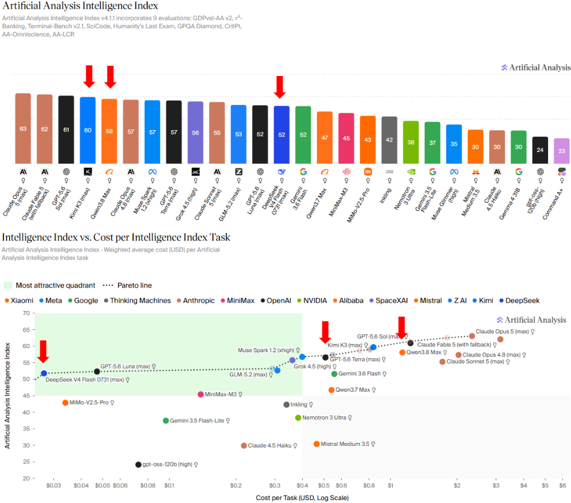

注：截至2026年8月12日
资料来源：Artificial Analysis，中金公司研究部

**Token消耗量/ARR快速增长，推理需求快速增长。** 一方面是前述模型的快速追赶，另一方面是推理需求增长带动的ARR提升/token增长。从chatbot到agent，任务轮次提升带来的token消耗量持续放大；同时企业端agent的潜力也得到关注。

近期我们看到国内云厂商capex持续上修，形成了后续讨论超节点放量的背景。**在模型参数继续扩大，推理需求旺盛的背景下，服务器架构的变化就有了客观的条件和需求基础。**

**架构端：MoE架构成为主流，超节点成为集群推理的必然选择**

**MoE架构成为主流，模型性能和集群规模存在非线性关系。** 当前在全球范围内，MoE架构通过用极少的计算代价换取极大的知识容量，已经成为推理领域的主流架构，由于单卡无法容纳庞大的权重参数，因此超节点成为了必然选择。但稀疏性（仅K/E的专家激活，导致参数计算不匹配）的特点下，模型性能和集群规模并不是线性关系：假设专家数量为N，当N小于集群卡数时，部分卡会空闲；当N远大于卡数时，单卡需托管多个专家，增加通信开销。因此在设计集群时，配合全互联架构，需要让专家可以“一专家一卡”甚至“一专家多卡冗余”，最大化硬件利用率。

**MoE的稀疏性导致了两大挑战：参数和计算的不匹配，稠密和稀疏的不匹配。** 从而产生了内存墙、通信墙、计算墙三大问题，需要三方进行耦合，因此后续的架构设计均围绕这两个问题展开解决。

**►  **内存墙（GPU放不下）：所有专家参数、梯度和优化器状态必须常驻内存，动态路由造成了不可预测的内存峰值。

**►  **通信墙（数据传输慢）：专家并行的all-to-all通信量会随着token数量、top-k和隐藏维度增长。同时在同一个Transformer块内，注意力层需要高TP处理大的QKV矩阵，高CP处理长序列；但是MoE层需要高EP分布大量专家，低TP保持完整专家宽度。

**►  **计算墙（GPU利用率低）：专家数量多但负载不均衡，MoE的稀疏性导致大量小GEMM和额外的kernel launch开销，降低了GPU的利用率。

基于上述对MoE架构的分析可以看出，一方面模型参数变大之后超节点成为了必然选择（参数存储需要），另一方面模型性能和集群规模存在非线性关系（存在挑战），因此超节点在后续的优化和调整，也主要围绕上述三大方向演进。

**案例：Kimi K3 作为2.8T参数MoE模型，客观上需要在超节点进行部署。** 首先，2.8万亿参数按照FP4权重量化后仍需1.4TB显存，超过常规8卡服务器的上限，长上下文也会放大KV cache、显存容量和显存带宽压力。其次，MoE架构下的专家并行（EP）模式带来高频All-to-All通信——K3模型拥有896个跨节点的专家模块，单次推理的token需要被路由到16个专家，且路由结果呈现不可预测的稀疏多播特征，这对互联带宽、延迟和动态调度能力提出了远超传统架构的要求；传统8卡服务器的机内NVLink互联带宽与跨服务器PCIe/外设网络带宽存在数量级差异，千卡、万卡集群下会遇到通信开销、网络拥塞等约束，造成计算单元等待同步，而超节点的本质就是把一部分机间通信尽量收敛到scale-up机内。这也是为何月之暗面官方建议将K3模型部署在64卡及以上AI卡组成的超节点上。

图表2：主流国产AI模型参数量趋势

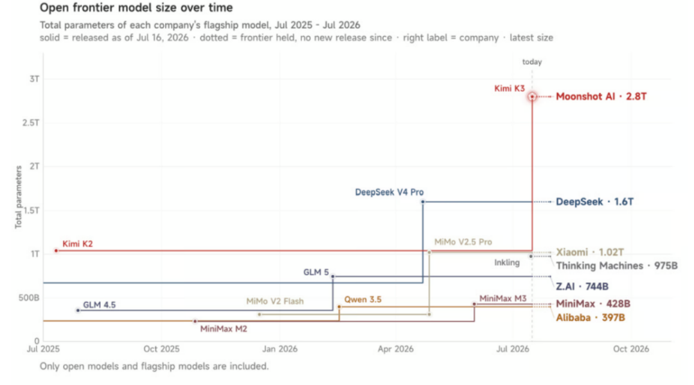

资料来源：Kimi技术博客，中金公司研究部

图表3：以MoE模型的Prefill阶段为例，超节点缩短通信时长，并在调度层面将更多算子资源释放给计算任务，提升AI芯片效率

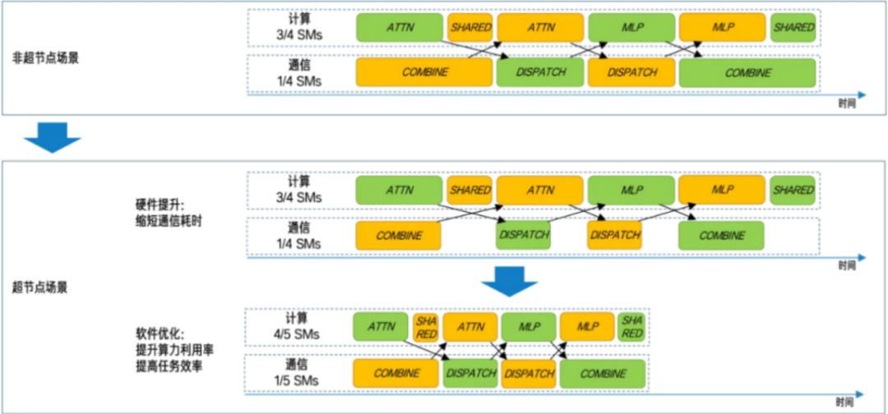

注：SM（Streaming Multiprocessor）算子资源
资料来源：百度智能云官网，中金公司研究部

**
**

**供给端：超节点方案渐趋成熟，国产算力卡供给有望改善**

从供给端看，在出口限制、单卡算力限制等因素影响下，国产算力卡加速发展，超节点方案具有现实可用性。在H20、H200等海外加速卡仍由于政策原因出口受限的背景下，为确保系统交付能力，国内CSP资本开支流向“国产卡+超节点”是必然趋势。

**超节点是以集群算力弥补单卡单板。** 从总体性能视角看，国产芯片如果只按单卡对单卡，很难在短期内完全弥合差距；但如果从系统层面设计，把32/64/128/384乃至1024张卡组织成超节点，就能用更大的scale-up域来弥补单卡短板，例如，华为CloudMatrix 384在算力总量、HBM总量和scale-up带宽等方面超过英伟达GB200 NVL72。

图表4：华为昇腾910C CloudMatrix 384以系统弥补单卡性能

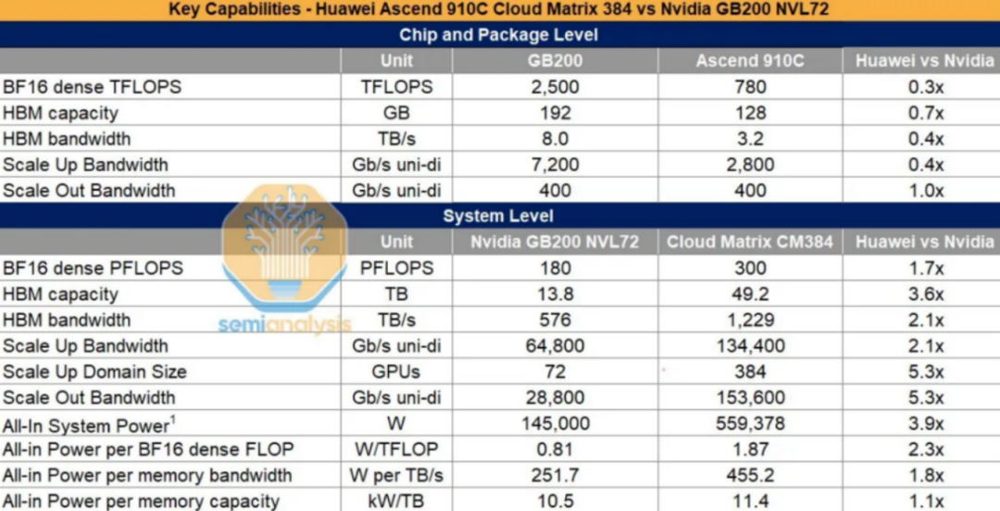

资料来源：SemiAnalysis，中金公司研究部

**海外案例：英伟达从8卡到NVL72，训推效率大幅提升**

英伟达的NVL72是全球最早的机柜方案，并此后开源给OCP组织，因此我们看到的国内各大CSP超节点方案，均和NVL72有一定相通之处。从英伟达架构的演进，也能看出超节点的设计思路和好处。

**通过扩大高带宽scale-up域，单卡吞吐量获得显著增益。** 根据英伟达官方披露[1]，其对比了GB200 NVL72液冷机柜和9台HGX H100风冷服务器（均为72卡，前者统一采用NVLink，后者在8卡间采用NVLink、跨服务器采用InfiniBand）针对GPT-MoE-1.8T模型的训练和推理表现。在AI训练方面，GB200 NVL72的训练速度为同样数量H100的4倍；在AI推理方面，GB200 NVL72中单颗GPU实现的推理速度（单GPU每秒输出Token数）为单颗H100的30倍。尽管其中涉及了GPU算力提升、NVLink通信升级、热等方面的同步改善，但也体现出大Scale-up域带来的算力利用效率提升。

图表5：GB200 NVL72 vs 9台8卡HGX H100：GB200的实时吞吐量是H100的30倍

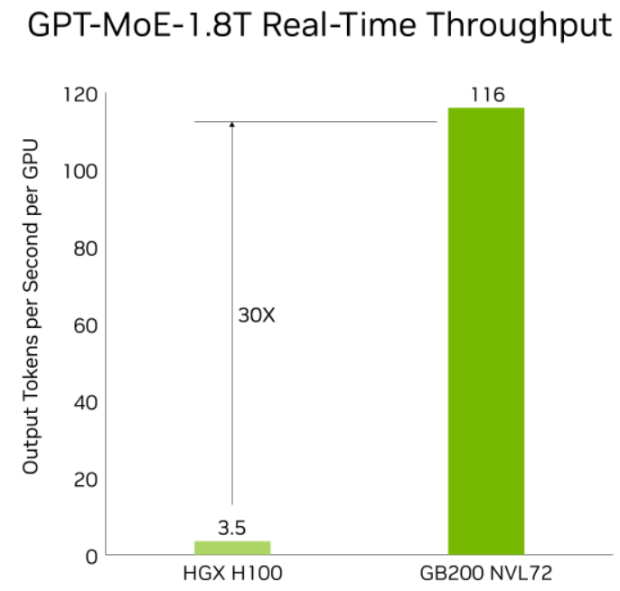

注：基于50ms token到token延迟，5000ms首次实时token延迟，输入序列长度32768，输出序列长度1024
资料来源：NVIDIA官网，中金公司研究部

**超节点市场规模有多大，哪些环节将受益？**

**市场规模测算：2027年超节点市场规模有望超过2000亿元**

**CSP CAPEX高速增长，国产算力基础设施建设需求旺盛。** 伴随国内四大CSP的资本开支高速增长并不断上修，以及超节点落地交付能力的提升，我们认为2026年起国内超节点投资主线将由“方案验证”进入“规模交付”。

**自上而下，Capex视角对超节点的需求有多少：** 我们预计2026/2027年国内CSP CAPEX有望增加至9,000/14,550亿元，分别同比增长129%/62%，其中投入AI芯片及服务器采购的资金比例为70%，由此我们计算得国内AI服务器总采购需求。我们假设2026/2027年超节点专项Capex占AI服务器总Capex的24%和41%，得到2026/2027年国产超节点市场规模分别约800/2500亿元，对应机柜数0.65/1.39万柜（考虑128卡占比逐步提升）。

**自下而上，算力卡视角看超节点瓶颈环节供给有多少：** 根据IDC，2025年中国市场AI加速卡总出货量约为400万张，其中英伟达占比55%（较2024年95%占比大幅下滑），中国本土厂商总出货量约165万张。考虑到出口限制政策不确定性，我们仅计算国产卡对应超节点市场规模，我们预计2026/2027年国产AI芯片出货量分别达到368/608万张。较多厂商在2025年推出超节点产品，我们认为2026年有望成为超节点放量元年，假设2026/2027年国产AI芯片中以超节点形式出货的比例为12%/25%，统一按照64卡单柜计算，2026/2027年超节点出货量约0.69/2.38万柜。我们按照64卡超节点单柜1100万元并假设年降，计算得2026/2027年国产超节点机柜的市场规模约为759/2256亿元。

**我们认为当前国内CSP对AI基础设施投资规划较积极，而国产超节点出货量更多受到国产AI加速卡的限制，因此我们采用“供给角度”测算结果，即2026/2027年国产超节点机柜的市场规模约为759/2256亿元，对应等效64卡机柜出货量约为0.69/2.38万柜。**

图表10：超节点供给测算

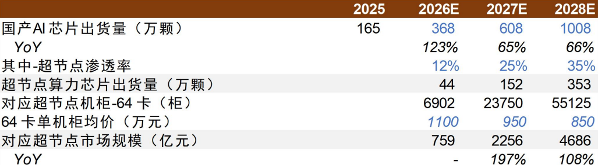

资料来源：IDC，各公司年报及公开业绩会，彭博社报道，中金公司研究部

**对超节点价值量变化的分析，来自于对架构变化/瓶颈优化到硬件系统设计的变化。** 从变化的思路看，互联和ODM的价值量跃升明显；此外，还需要考虑在实际生产中的瓶颈环节，包括算力芯片/HBM/交换芯片/PCB/Drmos等。本文重点分析ODM及PCB/连接器两个环节。

**ODM/OEM：从白牌服务器转向高复杂度整柜交付，组装测试附加值提升**

**整机柜组装复杂度提升，ODM/OEM厂商量价齐升。** 相较于传统服务器，超节点机柜的组装测试环节分工细化，涉及L1~L12共12个流程（L6主板集成，L11机柜组装和测试，L12多机架扩展）。传统服务器主要考验主板设计、散热设计、组装测试和成本控制能力，而超节点要求厂商同时具备计算节点、网络节点、背板/线缆连接、液冷、供电、整柜测试、信号完整性、系统级burn-in和客户现场交付的能力。工序拉长驱动组装测试附加值提升，同时，系统复杂度提升大幅增加了组装测试的壁垒，参考工业富联云计算业务2025年（GB200 NVL72交付）收入同比增长89%、毛利润同比增长116%，我们认为国内从8卡服务器转到超节点的过程中，组装测试环节的附加值和盈利能力均有望实现提升。

**我们测算2026/2027年国产超节点ODM/OEM市场规模有望达到759/2256亿元。** 上文我们计算得2026/2027年国产超节点机柜的市场规模约为759/2256亿元，在Buy-sell模式下，该数值即为ODM/OEM市场规模。由于超节点复杂度提升，我们认为其组装毛利率有望高于AI服务器，同时考虑一定竞争，假设两年分别为7%/6%，计算得到2026/2027年ODM/OEM附加值（毛利润）空间为53/135亿元。

图表6：国产超节点ODM/OEM市场规模测算

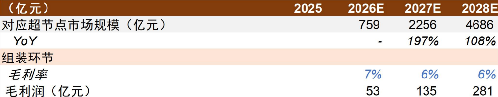

资料来源：IDC，各公司年报及公开业绩会，彭博社报道，中金公司研究部

**
**

**当前国产超节点ODM/OEM厂商呈现头部集中、客户绑定的竞争格局。** 根据灼识咨询，按2024年中国数据基础设施业务收入计，中国前六大数据基础设施厂商的份额占比62%，其中浪潮、新华三、超聚变、华勤也是目前国内CSP大厂的超节点主要供应商。我们认为形成当前格局的原因有二：第一，上述厂商是国内少数同时拥有计算节点和网络节点设计能力的厂商，在整机架构设计、高速互联设计、大功率供电设计及液冷散热设计上也具备全栈自研设计能力；第二，CSP重视交付稳定性和产能保障，且国内CSP超节点方案各有不同，也需要ODM/OEM紧密配合设计和验证，因此早期通过样柜和小批量验证的厂商会形成先发优势。

图表7：ODM/OEM厂商超节点进展

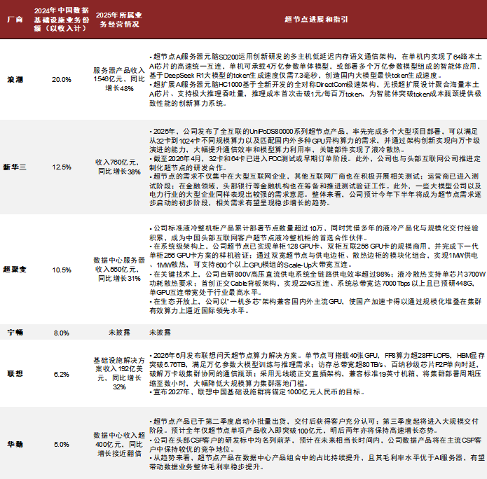

资料来源：华勤技术港股招股书，超聚变招股书，各公司年报、投资者调研活动记录，中金公司研究部

**PCB &连接器：Scale-Up通信链路增加，三类硬件架构并存**

**Scale-up通信需求增长，PCB/连接器量价齐升。** 超节点把AI芯片之间的Scale-Up通信从“机内少量高速连接”扩展为“整柜级海量高速连接”，英伟达GB200 NVL72使用高达5184根铜缆以及NVLink Switch Tray和Cable Cartridge，这意味着PCB/高速连接器和线缆不再是低价值辅料，而是决定系统带宽、时延和良率的关键部件。

**从当前方案看，目前存在三类主流硬件互联架构：线缆背板单面横插、有中板正交、无中板直接正交。从高速信号的载体看，也分为PCB和铜缆两大路线。** 除了AI芯片到Switch的高速互联链路数量增长，我们还看到其他趋势：

**
**

**►  **速率提升：随着SerDes从56G到112G、224G演进，PCB/连接器和线缆的价值量提升。

**►  **正交架构：在阿里AL128等方案中，GPU节点与Switch节点采用正交互联架构，减少了线缆的使用，但依然需要大量高速背板连接器。

**►  **光铜混合：现阶段大部分国产超节点依然采用柜内电互联、柜间光互联的方案，但也有部分方案如新华三UniPoD S80000在柜内采用NPO/CPO交换机。根据阿里技术文章，超节点服务器的ScaleUp互连采用光互连技术的时机大概是在ScaleUp互连域达到256卡、serdes速率达到448G、且光互连的端到端成本降低到与电缆的端到端成本相当时。在这种趋势下，传统高速电连接器部分被替代，而高端近芯片连接器和光连接器增量出现。

图表8：国产超节点PCB/连接器架构形态与划分

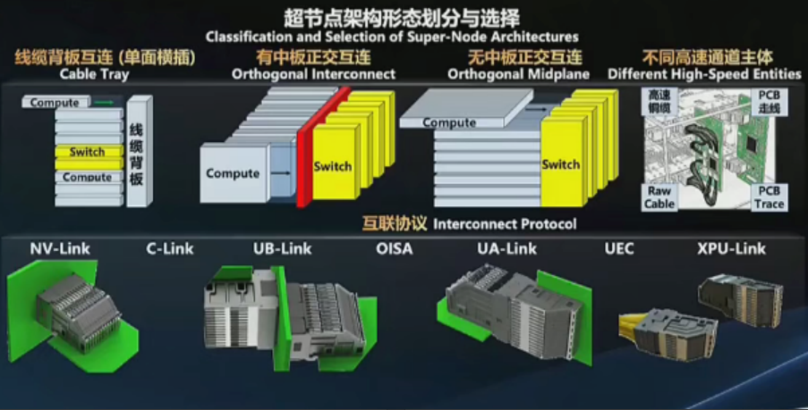

资料来源：2026 OCP China Day，中金公司研究部

**我们测算2026/2027年国产超节点连接器市场规模有望达到19/71亿元。** 我们按照连接器占整机比例约3%计算，64卡机柜的连接器价值量约28万元，考虑到互联速率提升以及正交架构等技术升级，我们假设单机柜连接器价值量年增，基于2026/2027年等效64卡国产超节点机柜数0.69/2.38万台，计算得到2026/2027年连接器市场规模有望达到19/71亿元。而在PCB环节，由于不同方案采用PCB规格差异较大，因此本文暂未进行价值量测算。

图表9：国产超节点连接器市场规模测算

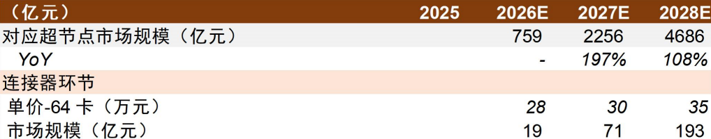

资料来源：IDC，各公司年报及公开业绩会，彭博社报道，中金公司研究部

**国产厂商正从112G演进至224G。** 服务器高速连接器格局相对集中，一是高速背板和线模组需要客户长期验证，不可能随意切换，二是112G/224G时代信号完整性和良率门槛高，三是超节点项目初期客户更看重稳定交付。相比海外龙头已经具备成熟224G产品，国内连接器厂商仍在推进224G的样品试制和客户认证，但我们认为国内厂商的优势在于本土AI超节点快速响应和深度国产替代的先发布局，有望逐步提升份额。

**超节点方案有哪些类型？**

**部署超节点需要考虑哪些问题？**

作为集高密度芯片、内存、网络、电源、制冷于一体的系统级产品，超节点数十 U 的整机柜形态、海量组件的复杂性与高昂的初期投入，要求企业在选型时，必须将评估重点从理论性能转移至实际部署的效率与可靠性。

**我们看到国产超节点的设计主要存在以下特征：1）注重兼容性：** 除了华为以外，其余超节点具备相对较强的兼容性，包括对主流国产AI加速卡的支持，以及对主流Scale-Up互联协议的兼容等。**2）风液混合、零线缆等工程设计：** 散热方面，液冷是保障XPU稳定性的核心，但全液冷方案对机房管路要求较高，因此风液混合冷却方案成为兼顾效率与兼容性的选择，降低对基础设施的改造要求。互联方面，NVL72超节点铜缆线多达5184根，而华为、曙光、阿里等超节点选择了正交无背板架构，简洁线缆部署，降低了系统故障风险。**3）模块化减负：** 一些超节点产品采用了 “1U一节点”设计，在进行故障排查或硬件更换时，运维人员无需搬动沉重的机架或处理复杂的线缆连接，此外，水、电、网三总线盲插降低了物理操作门槛，大幅降低了维护焦虑。

**超节点路线：多规格并行，侧重推理**

国内超节点路线整体呈现“多规格并行、国产芯片适配、推理先行、训练跟进”的特征。与英伟达通过NVLink生态闭环推进不同，除昇腾外，国内方案更强调开放协议、芯片异构兼容、整柜交付、TCO优化以及与自身云业务和模型体系的绑定。

图表10：国产超节点方案梳理（不完全）

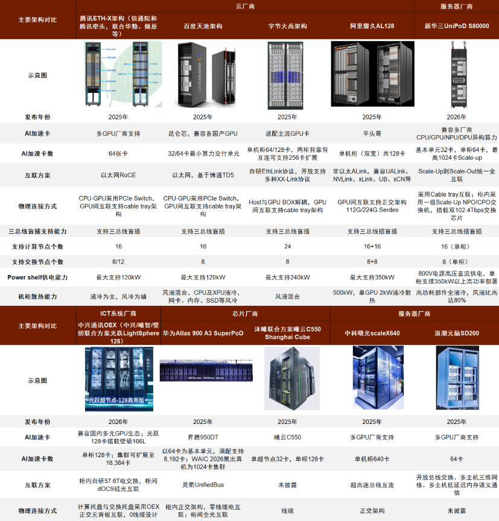

资料来源：紫光股份技术论坛，华为、新华三、中兴通讯等各公司官网及白皮书，中金公司研究部

**
**

**华为：自有芯片+自有Scale-up协议的封闭路线，1,024卡真机体现系统工程能力**

**
**

华为是国内较早将 AI 集群从8卡服务器推进到超节点形态的厂商之一。2025年3月，华为正式推出CloudMatrix384超节点——基于Atlas 900超节点构建的云服务实例；截至2026年7月，CloudMatrix384已商用落地750多套。2025年9月华为全连接大会上，华为发布Atlas 950超节点，真机于2026年7月WAIC上首次亮相，实现业界最大1024卡规模，筑牢Agentic AI时代新一代标杆算力底座。2025年9月，华为还发布Atlas 960超节点，最大可支持15,488卡，公司预计该产品4Q27上市。

图表11：华为CloudMatrix 384超节点组网方案

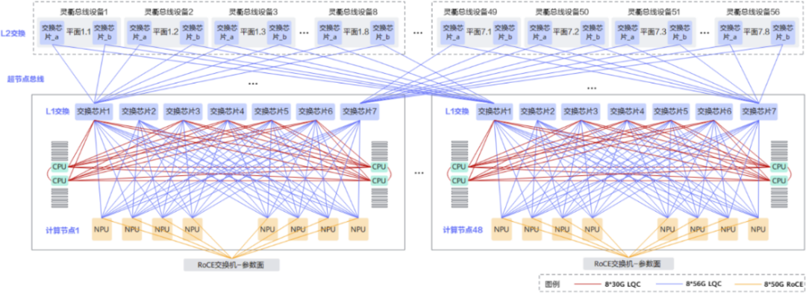

资料来源：华为官网，中金公司研究部

**CSP：采用现有以太网生态，重视降低总体拥有成本（TCO），64卡Scale-up是当前主流交付单元**

**
**

**CSP的核心诉求不是卖硬件，而是为自家大模型训练/推理降本增效，因此更重视单位Token成本、部署效率、故障恢复和资源调度。** 就超节点架构而言，CSP大多采用自研ASIC芯片，但在Scale-up互联上更偏好采用以太网或其他开放协议，以降低对专有互联的依赖，典型代表是阿里磐久AL128、百度天池、字节大禹、腾讯ETH-X。

图表12：阿里磐久AI Infra 2.0 128超节点服务器前后视图

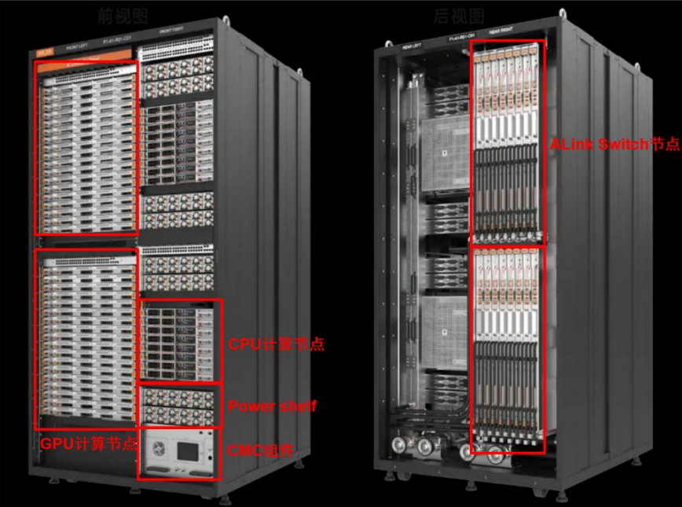

资料来源：阿里云官网，中金公司研究部

图表13：百度天池超节点服务器前后视图

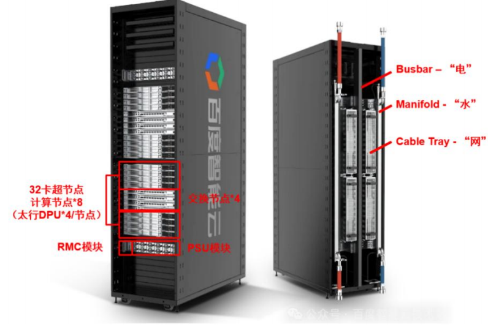

资料来源：百度智能云官网，中金公司研究部

**服务器/ICT系统厂商：开放适配型整机柜/系统集成路线**

**
**

服务器/ICT系统厂商优势在整柜设计、液冷、供电、交付、运维和多芯片适配，代表是新华三、浪潮元脑、华勤技术、中科曙光、中兴通讯等。

**风险提示**

**CSP资本开支不及预期。**

**
**

**国产AI芯片量产与认证进度不及预期。**

**
**

**产业链新技术良率爬坡不及预期。**

**
**

**ODM/OEM低价竞争压制毛利率。**

[1]https://developer.nvidia.com/blog/nvidia-gb200-nvl72-delivers-trillion-parameter-llm-training-and-real-time-inference/

**Source**

**文章来源**

本文摘自：2026年8月25日已经发布的《国产算力系列一：超节点，迈入国产 AI 下一站》

温晗静 分析员 SAC 执证编号：S0080521070003；SFC CE Ref：BSJ666

何欣怡 分析员 SAC 执证编号：S0080525080005

成乔升 分析员 SAC 执证编号：S0080521060004

贾顺鹤 分析员 SAC 执证编号：S0080522060002

陈昊 分析员 SAC 执证编号：S0080520120009；SFC CE Ref：BQS925

彭虎 分析员 SAC 执证编号：S0080521020001；SFC CE Ref：BRE806

**Legal Disclaimer**

**法律声明**

特别提示

本公众号不是中国国际金融股份有限公司（下称“中金公司”）研究报告的发布平台。本公众号只是转发中金公司已发布研究报告的部分观点，订阅者若使用本公众号所载资料，有可能会因缺乏对完整报告的了解或缺乏相关的解读而对资料中的关键假设、评级、目标价等内容产生理解上的歧义。订阅者如使用本资料，须寻求专业投资顾问的指导及解读。

本公众号所载信息、意见不构成所述证券或金融工具买卖的出价或征价，评级、目标价、估值、盈利预测等分析判断亦不构成对具体证券或金融工具在具体价位、具体时点、具体市场表现的投资建议。该等信息、意见在任何时候均不构成对任何人的具有针对性的、指导具体投资的操作意见，订阅者应当对本公众号中的信息和意见进行评估，根据自身情况自主做出投资决策并自行承担投资风险。

中金公司对本公众号所载资料的准确性、可靠性、时效性及完整性不作任何明示或暗示的保证。对依据或者使用本公众号所载资料所造成的任何后果，中金公司及/或其关联人员均不承担任何形式的责任。

本公众号仅面向中金公司中国内地客户，任何不符合前述条件的订阅者，敬请订阅前自行评估接收订阅内容的适当性。订阅本公众号不构成任何合同或承诺的基础，中金公司不因任何单纯订阅本公众号的行为而将订阅人视为中金公司的客户。

一般声明

本公众号仅是转发中金公司已发布报告的部分观点，所载盈利预测、目标价格、评级、估值等观点的给予是基于一系列的假设和前提条件，订阅者只有在了解相关报告中的全部信息基础上，才可能对相关观点形成比较全面的认识。如欲了解完整观点，应参见中金研究网站（http://research.cicc.com）所载完整报告。

本资料较之中金公司正式发布的报告存在延时转发的情况，并有可能因报告发布日之后的情势或其他因素的变更而不再准确或失效。本资料所载意见、评估及预测仅为报告出具日的观点和判断。该等意见、评估及预测无需通知即可随时更改。证券或金融工具的价格或价值走势可能受各种因素影响，过往的表现不应作为日后表现的预示和担保。在不同时期，中金公司可能会发出与本资料所载意见、评估及预测不一致的研究报告。中金公司的销售人员、交易人员以及其他专业人士可能会依据不同假设和标准、采用不同的分析方法而口头或书面发表与本资料意见不一致的市场评论和/或交易观点。

在法律许可的情况下，中金公司可能与本资料中提及公司正在建立或争取建立业务关系或服务关系。因此，订阅者应当考虑到中金公司及/或其相关人员可能存在影响本资料观点客观性的潜在利益冲突。与本资料相关的披露信息请访问http://research.cicc.com/disclosure_cn，亦可参见近期已发布的关于相关公司的具体研究报告。

本订阅号是由中金公司研究部建立并维护的官方订阅号。本订阅号中所有资料的版权均为中金公司所有，未经书面许可任何机构和个人不得以任何形式转发、转载、翻版、复制、刊登、发表、修改、仿制或引用本订阅号中的内容。

