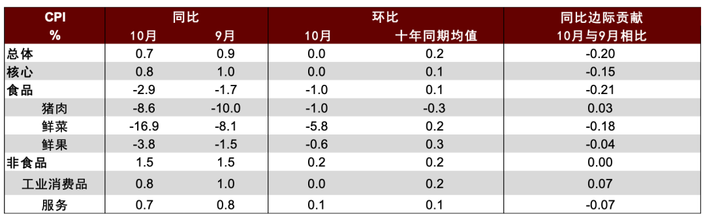
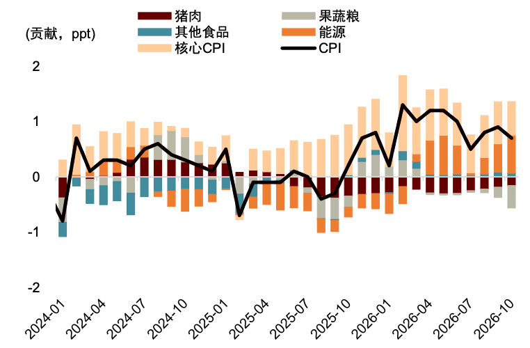
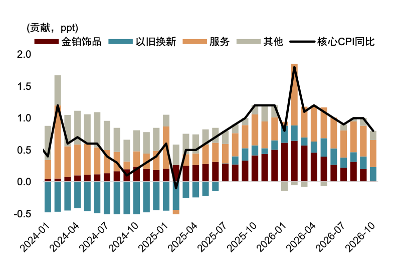
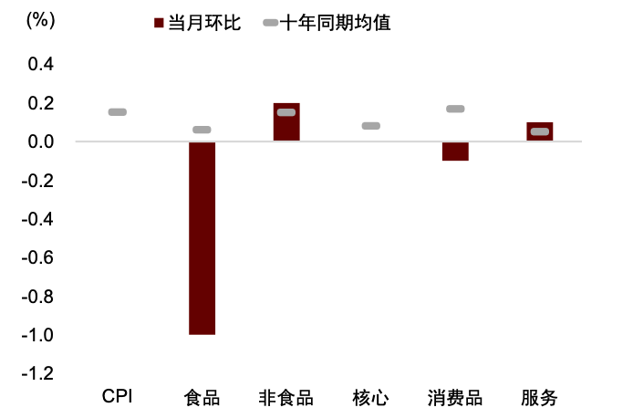
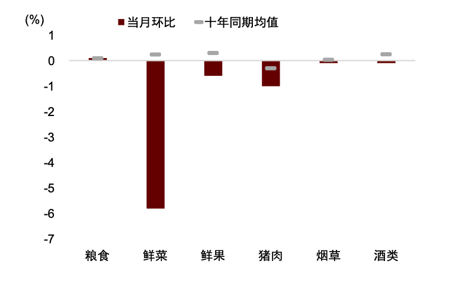
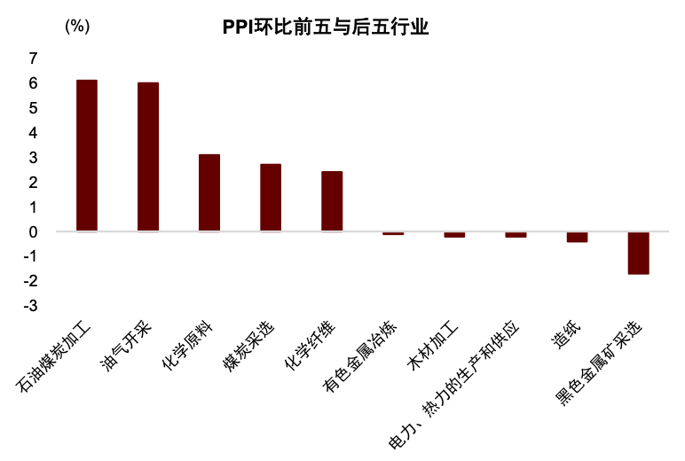
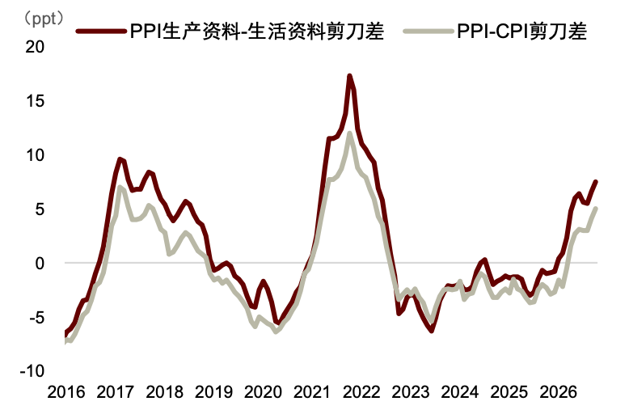

# 中金：PPI同比拐点或已现——2026年10月物价数据点评

> **原文链接**：https://mp.weixin.qq.com/s?__biz=MzI3MDMzMjg0MA==&mid=2247868920&idx=1&sn=c438119e304efe6679204e2bd17889e9

- **公众号**：中金点睛
- **发布时间**：2026-11-10 07:50:00
- **抓取时间**：2026-11-11 12:02:05
- **正文长度**：6812 字 | **图片**：26 张（已本地化）

---

原创 黄文静 潘治东等 2026-11-10 07:50 上海

我们认为，11月以来油煤价格已有所回落，PPI环比上行动能或进一步减弱，PPI同比本轮高点或已现，未来将趋势走弱，需求不足之下CPI通胀则继续较为温和。

**中金研究**

10月CPI同比由上月的0.9%回落至0.7%，主要是受食品和黄金价格拖累，而能源价格进一步走强，国庆服务亦有所支撑；PPI环比上涨0.7%，涨幅较上月的1.2%有所放缓，同比则由5.0%进一步升至5.7%，能源化工链仍是主要推动。10月生产资料与生活资料价格剪刀差、PPI与CPI同比剪刀差均进一步走阔。向前看，我们认为，11月以来油煤价格已有所回落，PPI环比上行动能或进一步减弱，PPI同比本轮高点或已现，未来将趋势走弱，需求不足之下CPI通胀则继续较为温和。

点击小程序查看报告原文

**1\. CPI同比回落：能源价格继续走强，但食品拖累加大、核心通胀有所降温**

10月CPI环比由上月的0.2%降至0，同比涨幅由0.9%回落至0.7%。从结构看，能源价格继续走强，对CPI同比形成明显支撑；食品价格环比则明显回落，同比降幅较上月有所扩大，是本月CPI同比走弱的主要拖累；黄金饰品价格明显回落、服务价格同比涨幅放缓，核心CPI同比由1.0%回落至0.8%。

**►****能源对****CPI****同比****的支撑****进一步****增强。** 受国际能源价格高位运行及国内成品油调价传导影响，10月汽油价格环比上涨4.2%，同比涨幅由16.6%进一步扩大至22.4%，带动能源价格同比涨幅由7.3%升至9.9%[1]。据我们的测算，相比上月，能源对CPI同比的拉动作用进一步增加约0.17个百分点，为CPI同比继续提供了重要支撑。

**►****肉果蔬价格****均****弱于季节性，****食品****CPI****同比降幅扩大（****10****月****-****2****.****9****% vs. 9****月****-1.7%****）。** 猪肉方面，国庆节后消费需求回落，而生猪供应仍较充足，10月猪肉价格环比下降1.0%；但受去年同期基数较低影响，同比降幅由上月的10.0%收窄至8.6%。果蔬方面，天气条件较为适宜，秋季蔬菜集中上市推动供应明显增加，鲜菜价格环比下降5.8%（vs.十年同期均值为+0.24%），同比降幅由上月的8.1%扩大至16.9%，是食品价格走弱的主要来源；鲜果环比下降0.6%，也弱于季节性（vs.十年同期均值为+0.30%），同比降幅由1.5%扩大至3.8%。我们的测算显示，相比上月，猪肉对CPI同比的拖累边际减轻约0.03个百分点，而鲜菜、鲜果对CPI同比的拖累分别增加约0.18和0.04个百分点。

**►****国庆假期对服务价格形成阶段性支撑****，****黄金价格回落****则****拖累核心通胀****。** 服务方面，国庆假期出行需求增加，推动宾馆住宿、飞机票和旅行社收费环比分别上涨6.5%、3.3%和2.4%，服务价格环比由9月下降0.2%转为上涨0.1%，但假期更多形成短期季节性价格上行，从同比看，服务价格涨幅由0.8%稍有回落至0.7%。商品方面，受存储、算力等上游成本上涨以及产品升级影响，数据存储设备、平板电脑、计算机和手机价格，同比分别上涨45.4%、29.3%、23.0%和16.7%，仍是非能源工业消费品价格的重要支撑；但除部分消费电子外，终端工业消费品需求整体仍较温和，如家用器具、交通工具等价格同比跌幅进一步扩大，扣除能源的工业消费品价格同比上涨1.2%，较上月回落0.4个百分点。此外，受国际金价调整影响，10月国内黄金饰品价格环比下降5.9%，同比涨幅从22.5%大幅回落至4.5%。我们的测算表明，黄金饰品对核心通胀的贡献边际减少约0.18个百分点，或是核心通胀由1.0%回落至0.8%的主要原因。

**2\. PPI同比继续走高，但涨价仍集中在能源化工链**

10月PPI环比上涨0.7%，较上月1.2%的涨幅回落0.5个百分点，同比则由5.0%进一步升至5.7%。其中，生产资料价格环比上涨0.9%、同比上涨7.4%，生活资料价格环比下降0.1%、同比下降0.1%，生产资料与生活资料的同比剪刀差由9月的6.6个百分点进一步扩大至7.5个百分点；与此同时，PPI与CPI同比剪刀差也由4.1个百分点扩大至5.0个百分点，上下游价格、生产和消费价格分化进一步加深。具体来看，

**►****能源****化工****链贡献了****PPI****环比****涨幅的八成以上****，****也****是同比****继续****上行的****主要****推动****。** 10月国际能源价格继续偏强，叠加迎峰度冬备煤和燃气需求释放，推动石油和天然气开采业、煤炭开采和洗选业价格分别环比上涨6.0%和2.7%；上游能源价格向相关中游行业传导，精炼石油产品制造、有机化学原料制造、煤炭加工、燃气生产和供应业价格分别上涨6.8%、6.8%、3.2%和1.5%，据统计局测算，上述六个能源相关行业合计拉动PPI环比约0.61个百分点[2]。从同比来看，煤炭开采和洗选业、石油和天然气开采业、石油煤炭及其他燃料加工业、化学原料和化学制品制造业等价格涨幅较上月继续扩大，能源化工链仍是PPI上行的主力。

**►****AI****等新动能****相关需求仍提供一定结构性支撑****。** 人工智能相关投资和产业升级继续支撑电子及电气设备需求，10月计算机通信和其他电子设备制造业价格环比上涨0.1%、同比涨幅由5.8%稍有扩大至5.9%，电气机械和器材制造业环比亦上涨0.1%、同比涨幅持平于6.2%。我们测算，两个新动能相关行业对PPI同比的拉动作用维持在1.3个百分点左右。

**►****部分传统需求相关行业价格有所企稳，但****整体****修复****仍偏温和。** 10月黑色金属冶炼和压延加工业价格环比持平，同比由9月下降0.2%转为上涨0.4%，但黑色金属矿采选业价格环比下降1.7%、同比下降6.4%，或表明在地产投资偏弱下钢材价格仍缺乏明显上行动力。对PPI同比拖累较大的行业仍主要体现在传统需求方面，10月非金属矿物制品业价格环比上涨0.8%，在煤炭等成本上升、部分行业产能调整和季节性施工需求支撑下有所改善，但同比仍下降1.6%；汽车制造业价格环比由负转平，同比仍下降1.8%；酒饮料和精制茶制造业、医药制造业和电力热力生产和供应业等行业价格分别同比下降5.2%、3.2%和3.8%。据统计局测算，上述五个行业合计拖累PPI同比约0.60个百分点，表明虽部分传统行业价格有所企稳，但终端需求改善仍较有限。

**3\. 展望：本轮PPI同比高点或已现，CPI通胀预计仍较温和**

向前看，我们认为，美国中期选举民主党全面获胜或有望带来美伊冲突缓和，高油价压力或将缓解，并缓解国内煤炭的供求矛盾，PPI同比或将见顶回落。CPI方面，食品供给总体充足，果蔬价格或继续偏弱，猪周期温和上行，若能源价格进一步回落，短期CPI大幅上行的动力或仍有限。后续更值得关注的是，上游成本向中下游利润的传导。如果内需改善较为有限，随着企业前期低成本库存逐步消耗，上游原材料涨价可能更多体现为中下游企业成本和利润率压力，而未必迅速转化为终端价格上涨。

图表1：CPI分项增速与贡献

资料来源：Wind，中金公司研究部

图表2：食品和核心价格降温带动CPI同比回落

资料来源：Wind，中金公司研究部

图表3：金饰品价格走弱带动核心通胀回落

资料来源：Wind，中金公司研究部

图表4：食品价格明显弱于强于季节性

资料来源：Wind，中金公司研究部

图表5：果、蔬和猪肉价格环比均弱于季节性

资料来源：Wind，中金公司研究部

图表6：PPI环比前五和后五的行业

资料来源：Wind，中金公司研究部

图表7：PPI生产资料与生活资料剪刀差扩大

资料来源：Wind，中金公司研究部

[1]<https://www.stats.gov.cn/sj/zxfbhjd/202611/t20261109_1965796.html>

[2]<https://www.stats.gov.cn/sj/zxfbhjd/202611/t20261109_1965796.html>

**Source**

**文章来源**

本文摘自：2026年11月9日已经发布的《PPI同比拐点或已现——2026年10月物价数据点评》

黄文静 分析员 SAC 执证编号：S0080520080004 SFC CE Ref：BRG436

潘治东 分析员 SAC 执证编号：S0080526070002

张文朗 分析员 SAC 执证编号：S0080520080009 SFC CE Ref：BFE988

**Legal Disclaimer**

**法律声明**

特别提示

本公众号不是中国国际金融股份有限公司（下称“中金公司”）研究报告的发布平台。本公众号只是转发中金公司已发布研究报告的部分观点，订阅者若使用本公众号所载资料，有可能会因缺乏对完整报告的了解或缺乏相关的解读而对资料中的关键假设、评级、目标价等内容产生理解上的歧义。订阅者如使用本资料，须寻求专业投资顾问的指导及解读。

本公众号所载信息、意见不构成所述证券或金融工具买卖的出价或征价，评级、目标价、估值、盈利预测等分析判断亦不构成对具体证券或金融工具在具体价位、具体时点、具体市场表现的投资建议。该等信息、意见在任何时候均不构成对任何人的具有针对性的、指导具体投资的操作意见，订阅者应当对本公众号中的信息和意见进行评估，根据自身情况自主做出投资决策并自行承担投资风险。

中金公司对本公众号所载资料的准确性、可靠性、时效性及完整性不作任何明示或暗示的保证。对依据或者使用本公众号所载资料所造成的任何后果，中金公司及/或其关联人员均不承担任何形式的责任。

本公众号仅面向中金公司中国内地客户，任何不符合前述条件的订阅者，敬请订阅前自行评估接收订阅内容的适当性。订阅本公众号不构成任何合同或承诺的基础，中金公司不因任何单纯订阅本公众号的行为而将订阅人视为中金公司的客户。

一般声明

本公众号仅是转发中金公司已发布报告的部分观点，所载盈利预测、目标价格、评级、估值等观点的给予是基于一系列的假设和前提条件，订阅者只有在了解相关报告中的全部信息基础上，才可能对相关观点形成比较全面的认识。如欲了解完整观点，应参见中金研究网站（<http://research.cicc.com）所载完整报告。>

本资料较之中金公司正式发布的报告存在延时转发的情况，并有可能因报告发布日之后的情势或其他因素的变更而不再准确或失效。本资料所载意见、评估及预测仅为报告出具日的观点和判断。该等意见、评估及预测无需通知即可随时更改。证券或金融工具的价格或价值走势可能受各种因素影响，过往的表现不应作为日后表现的预示和担保。在不同时期，中金公司可能会发出与本资料所载意见、评估及预测不一致的研究报告。中金公司的销售人员、交易人员以及其他专业人士可能会依据不同假设和标准、采用不同的分析方法而口头或书面发表与本资料意见不一致的市场评论和/或交易观点。

在法律许可的情况下，中金公司可能与本资料中提及公司正在建立或争取建立业务关系或服务关系。因此，订阅者应当考虑到中金公司及/或其相关人员可能存在影响本资料观点客观性的潜在利益冲突。与本资料相关的披露信息请访问<http://research.cicc.com/disclosure_cn，亦可参见近期已发布的关于相关公司的具体研究报告。>

本订阅号是由中金公司研究部建立并维护的官方订阅号。本订阅号中所有资料的版权均为中金公司所有，未经书面许可任何机构和个人不得以任何形式转发、转载、翻版、复制、刊登、发表、修改、仿制或引用本订阅号中的内容。

[跳转微信打开](https://wechat2rss.bestblogs.dev/link-proxy/?k=4e823df7&r=1&u=https%3A%2F%2Fmp.weixin.qq.com%2Fs%3F__biz%3DMzI3MDMzMjg0MA%3D%3D%26mid%3D2247868920%26idx%3D1%26sn%3Dc438119e304efe6679204e2bd17889e9)
