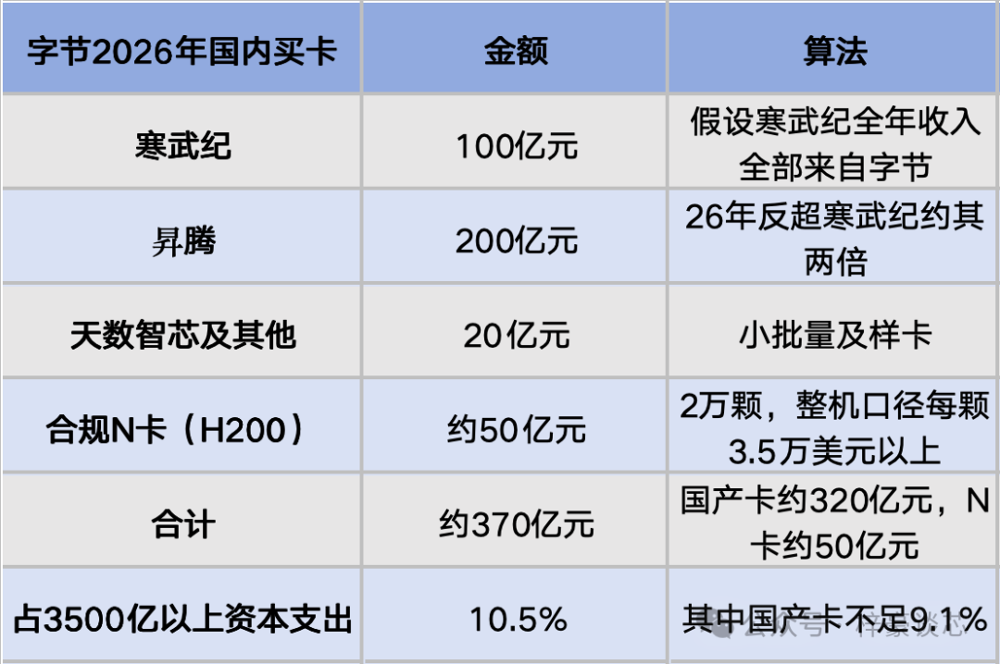
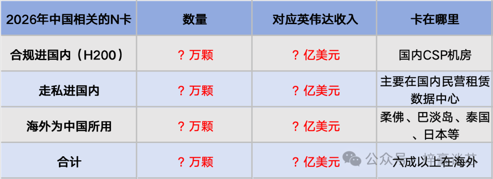
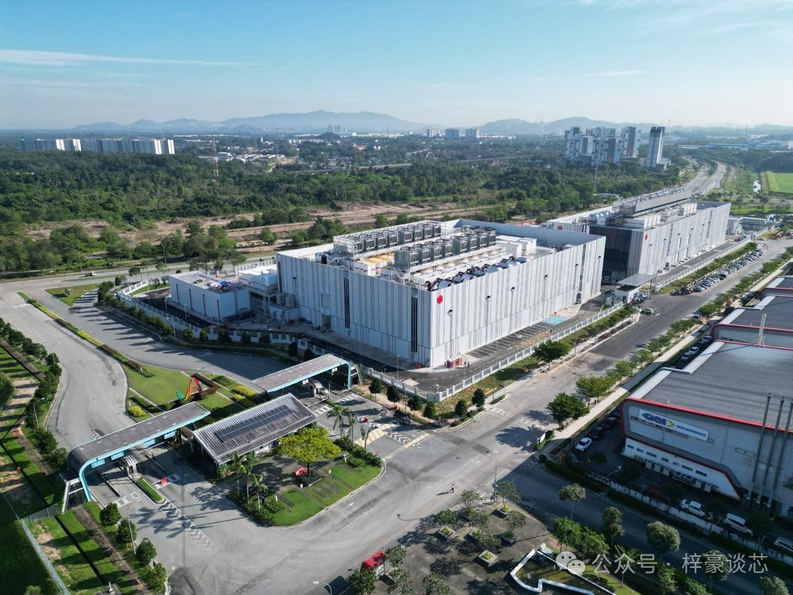
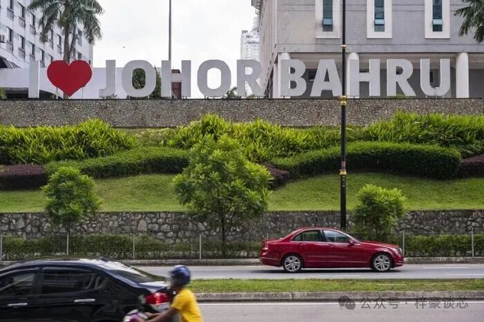
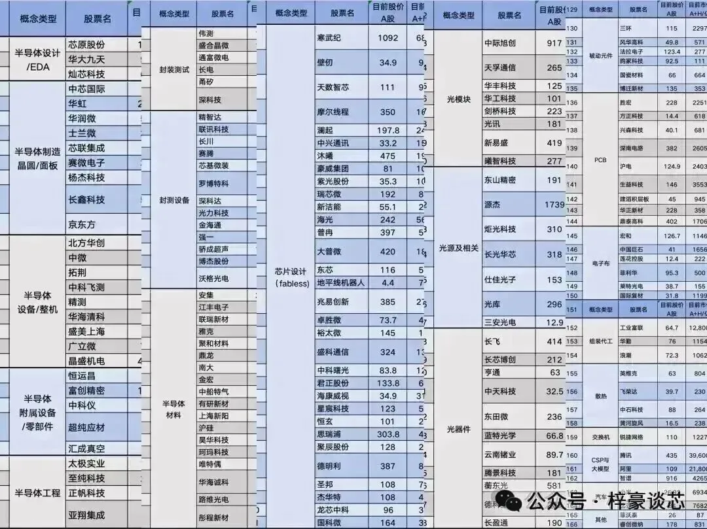
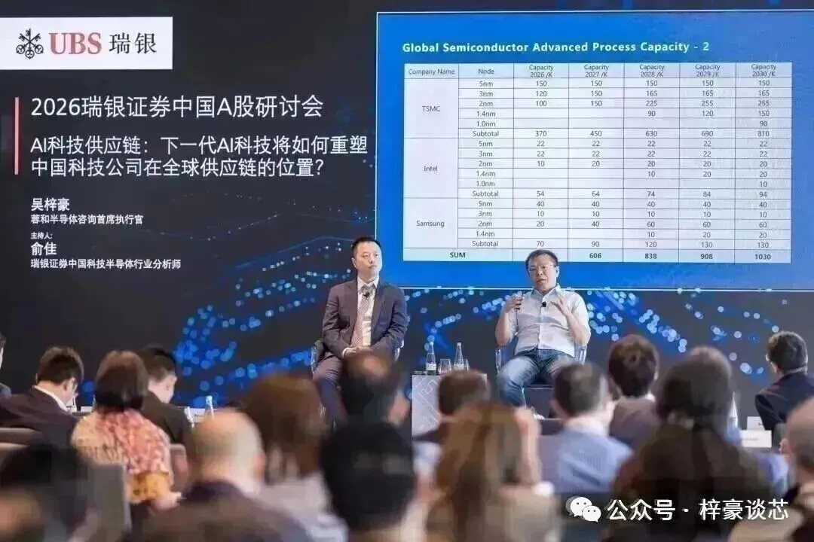
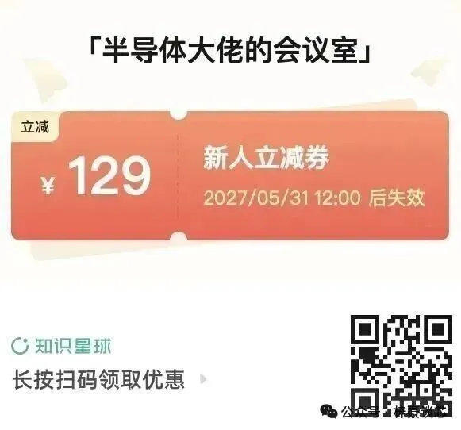

# 英伟达的中国雷要爆了？

> **原文链接**：https://mp.weixin.qq.com/s/A7GfkP-N0by5DC-ZTJ9srA

- **公众号**：梓豪谈芯
- **作者**：Leslie吴梓豪
- **发布时间**：2026-11-13 00:00:00
- **抓取时间**：2026-11-13 21:36:32
- **正文长度**：13121 字 | **图片**：8 张（已本地化）

---

老黄辞职后，市场上出现一个非常吓人的一个说法，英伟达有一大块业绩其实是卖给中国的，只是藏在东南亚，现在美国要动手了，这颗雷要爆。

笔者昨天在知识星球以及腾讯科技发表的那篇分析，阅读量超10万＋，那一篇老黄下台的文章里咱们推演过，接任的人一定会严格按美国法律办事，对中国甚至会矫枉过正。那篇文章讲的是直接卖进中国的N卡，这部分数量很少，也很好算。

但真正的大头不在国内，在海外。昨天写完第一篇文章后，我一直在思考这个部分的问题，这部分影响确实不小，所以这篇文章要把昨天没展开的那一半讲完。

本文核心内容还是发表在知识星球，本公众号文章删除核心内容，有兴趣的欢迎加入知识星球阅读全文。

本文的核心那就是中国到底用了多少N卡，这些N卡放在哪，占英伟达业绩多少，美国这次立法到底卡不卡得死。

这个问题市面上从没有人算清楚过。都是各种从单一面向，添油加醋地夸大，没有把整个上下游全貌还完出来。

所以做空机构喊20%以上，英伟达自己说接近零，中文互联网则是天天吹国产卡已经替代了。各种互相矛盾的说法满天飞，事实上这三种说法都不对，下面我们一步一步算，本篇文章也是全球唯一把这问题说清楚的文章。

### **账面数字为什么不能用**

要搞明白中国用了多少N卡，第一反应是去翻英伟达财报里的中国区收入。这条路走不通。

英伟达最新一个季度，也就是截至2026年7月26日的2027财年第二季度，中国含香港收入是78.8亿美元，占总收入8%。上半年合计124亿美元。

但是这个数字是按客户总部所在地统计的，里面有游戏卡、工作站卡、车用芯片和网络产品。真正的数据中心GPU，也就是获批的H200，英伟达自己说当季出货不到数据中心收入的1%。

也就是说，账面上中国区那8%，绝大部分不是我们要找的AI算力卡。而我们要找的那些卡，买单的是美国、新加坡、中国台湾以及马来西亚的公司，在NV的财报里都不属于中国区业绩。

要搞明白这个问题，我们还得先换一个视角才能一步一步真正搞清楚全貌，那就是先从国内CSP是怎么拿到算力的这个角度去看。

这些问题全部没有直接答案，需要我们有强大的产业理解跟认知，有能力从不同的产业面向去旁敲侧击，并不断地验证数字。

### **为什么非N卡不可**

在算账之前，得先把一个技术问题讲透，如果这个基础逻辑你没搞明白，那你思考的一切都可能是错误的，这个前提就是为什么国内CSP必须要N卡，而国产卡只能承接一部分特定的负载。

很多人的逻辑是，N卡被禁国内买不到，那就只能买国产卡，用这种非黑即白的逻辑去设想国产卡未来将会放大量。

但是已经经过那么多年，但凡我们动动手指去计算一下相关收入，就能明白这个逻辑从来就不成立，现在我们再从芯片、互联、软件、成本四个技术层面来看一次。

这些逻辑笔者这两年在知识星球的深度文章中不断的重复。

先看芯片本身。AI芯片的能力主要由三样东西决定，制程、HBM和先进封装。

制程上，国产卡用的是国内7nm级的工艺，没有EUV，靠DUV多重曝光做出来。而英伟达的Blackwell用的是台积电4nm级，下一代Rubin是3nm。制程差两代，意味着同样面积里的晶体管数量和每瓦性能都差出一大截。

HBM上，决定大模型训练和推理吞吐的其实是显存带宽，也就是每秒能从内存里搬多少数据给计算单元。英伟达用的是HBM3E并且马上切到HBM4，国产卡只能用到上两代的产品，而且还拿不够。寒武纪三季度收入只有35亿元，低于市场预期，公司给的原因就是HBM缺货。

所以落到单卡上，寒武纪的思元590大致对标英伟达的A100，升腾的主力型号也在Hopper之下。跟现在出货的Blackwell Ultra相比，中间差了两到三代，两三代的代差是数百倍的功耗比，有哪个厂家自愿去买落后那么多的芯片？

再看互联，这一层比单卡更要命。大模型训练是把一个任务拆到几万颗卡上同步计算，每一步都要在所有卡之间同步梯度，所以集群的速度是由卡与卡之间的通信决定的。

英伟达的做法分两层。机柜内部用NVLink做scale-up，也就是把72颗GPU连成一个共享内存的整体，当成一台超大的机器来用。机柜之间再用InfiniBand或者以太网做scale-out，把成千上万个机柜连成集群。

国产卡缺的正是scale-up这一层，高速SerDes和交换芯片都跟不上，所以只能靠scale-out去堆数量。阿里说它的新芯片可以堆到50万颗一个集群，这其实就是笨方法。

堆数量的问题在于，卡越多，通信开销占比越高，集群的有效算力并不是线性增加的。而且十万颗卡连续跑几个星期，任何一个节点出故障都要从检查点重启，单卡的可靠性不够，整个任务就跑不完。

然后是软件。英伟达十几年积累下来的CUDA，不只是一个编程接口，而是一整套算子库、编译器和调优工具。研究人员每提出一种新的模型结构，在N卡上基本是当天就能跑。

到了国产卡上，新结构里用到的算子很多没有现成的实现，要工程师一个一个去移植和调优，精度和性能还要重新对齐。对于模型每几个月就迭代一次的CSP来说，这个时间成本是不能接受的。

最后是成本，这才是CSP真正算的账。CSP看的不是一颗卡多少钱，而是每产出一个token的综合成本，也就是把卡的折旧、电费、机房和运维全部摊进去的TCO。

国产卡单卡便宜，但是单卡产出的token少，每瓦产出更低，同样的算力要占更多的机柜和电力，还要搭上更多的工程师。全部摊下来，国产卡每个token的TCO是明显高于N卡的。

所以国产卡现在能承接的，是模型权重已经固定、算子适配一次就能长期运行、对时延不那么敏感的推理负载，比如推荐、搜索排序、内容审核，以及固定版本大模型的推理。这些需求其实也不算少，加上国产AI芯片的出货基数很低，寒武纪也才十多万颗的水平，所以国产AI芯片在这几年的增长率非常高。

但是前沿模型的训练和最新模型的大规模推理，这些真正的算力需求所在还是只能放在N卡上。

这就是我们看到的现象，中文互联网整天吹国产AI芯片多好，国产大模型纷纷完成适配。但适配只是说明能跑，不等于跑得划算，更不等于大量采购，国产AI芯片增长虽然非常高，但出货绝对量很低，出货金额更是不高。

当然，笔者并不是说国产卡没有前途，如果HBM和先进制程的产能有一天真的打通了，局面会不一样，未来几年国产卡的增长还是会一直突飞猛进，因为国产卡也会进步，国内的需求也会越来越多。

但数量级跟占比大家别搞错了，国产卡真心不高，甚至占比低到你想不到。

讲清楚了为什么非N卡不可，下面我们就用最有代表性的字节跳动来算一笔账，把钱到底花在了哪全部摆出来，我们就能一目了然，为何炒作半天的国产卡，量级怎会如此之低，让大家有个直观的比较。

事实上大部分投资者都是东看一篇报导，西看一篇分析，脑子里根本没有横向比较或者向上了解整个行业大局的能力，导致看一篇报导就以为是全部，这是大部分投资者会出现的问题。

### **字节的2000亿花去哪了**

字节是国内算力投入最大的一家。它2026年的资本支出最初计划是1600亿元，5月上调到2000亿元以上，后面甚至有超4000亿以上的说法。

笔者的了解真实数字可能是远高于年中的2000亿，大概率会超3500亿以上。

有了这个总数后，我们就能把它在国内买卡的钱一项一项加起来，看看跟3500亿差多少。

先算合规的N卡。今年二季度到三季度，国内批了一批H200，字节和腾讯各到货约1万颗。我们往高了算，按字节全年最多2万颗。

H200单颗的售价在2.5万美元以上，装进服务器之后，一颗对应的整机成本必然超过3.5万美元。所以2万颗就是7亿美元出头，折合人民币约50亿元。

再算国产卡。寒武纪前三季度收入95亿元，全年大约是135～140亿元。我们假设寒武纪全年收入70%来自字节，那就是100亿元。

升腾改架构后今年在字节的份额反超寒武纪大约能出货200亿的金额，天数智芯跟一些第二梯队有小规模订单或送样，大约算20亿左右。

以上就是字节在国内买卡的全部。也就是说，哪怕假设寒武纪的收入全部来自字节，字节今年买国产卡也就是320亿左右，买N卡50亿，总共370亿左右。

320亿跟字节全年算力高达3500亿以上的资本支出，有天差地别的落差。如果只看国产卡，320亿对3500亿以上，占比不足10%。

所以大家一定得搞明白这一点，整个中文互联网没有人算过这个比例，但这不是很简单的基础逻辑吗？

整个市场都在喊英伟达禁售，国内买不到N卡，那就只能买国产卡，国产卡要卖爆炸，可事实上，都净利多少年了，国产卡也只占CSP资本支出不到一成，他们根本不愿意大量采购。

那剩下的3000亿花到哪去了？答案在下面两节，先看国内算力的市场结构，再看CSP拿算力的六条路。

### **国内算力其实是三个市场**

国内的算力资本支出，不能混在一起看，因为里面是三个逻辑完全不同的市场。

第一个是跟政府有关的市场，包括地方政府主导的智算中心和运营商的数据中心。这个市场的特点是必须用国产卡、国产服务器、国产交换机，这是国产卡的主场。

但是这个市场的算力闲置率非常高，很多是政绩工程，对AI芯片真实性能几乎不在意，商业价值不高。运营商的云部门相对好一些，比地方智算中心很大一部分没用更有商业逻辑。

这个市场以昇腾为绝对主力，昇腾今年出货在百万级别大部分都在这，国内第二梯队的AI芯片企业，大部分的智算中心交钥匙工程大部分也在这。

前两年三大运营商是N卡的最大购买者，去年底才开始减少。

第二个是民营的独立数据中心，建好之后以租赁算力为生。这些数据中心大量扎堆在有政府补贴的地方，比如内蒙古等地。

因为是靠出租算力赚钱，所以这个市场必然要有竞争力的卡才租得出去，不太会用国产卡。这里正是国内走私N卡最大的买家，前两年最大买家是国内运营商的云部门。

彭博去年就报道过，中国西部沙漠里有运营方在建几十个数据中心，规划容纳11.5万颗受限的N卡。美国官员现在的判断是，实际走私进去的数量已经超过了这个数。

第三个才是国内的CSP。CSP是纯纯的商业逻辑，一定要买有竞争力的卡，否则成本就比对手高。但是因为N卡随时会被卡，所以为了供应链安全，一定要培养国产或者自研，开辟不同的供应来源。

所以国产卡在CSP这里的定位，是备胎，不是主力。

弄清楚这三个市场以及他们的不同逻辑后，我们才能往下去探索CSP拿算力的全部渠道。

### **CSP拿算力的六条路**

国内CSP获取算力的渠道，按重要性排下来一共有六种。这也是全网只有笔者可以清楚把这些渠道全排出来，毕竟我定期会跟国内的CSP上课培训，前两年还宽松的时候也帮忙介绍过N卡服务器进入国内，所以我会清楚CSP们的做法。

第一是建海外数据中心。这是最大的投入，占资本支出远超过一半，是绝对的大头。字节2025年的预算里就有大约一半以上是投在海外的，另外还有每年几十亿美元的海外算力租约，这部分很多算经营费用，连资本支出都不进。

第二是合法合规买N卡。很多人以为这条路是被美国卡住的，其实现在卡的是国内。

今年1月，美国把H200对华出口改成了逐案审批，三大厂年初拿到的额度合计超过40万颗，到5月已经有大约10家中国公司获得美国的许可，每家上限接近10万颗。

货也确实发了，2Q拿到第一批，但是目前有大约60万颗H200放在香港的仓库里，等着进内地。既然货都已经出了美国，那卡住它的自然不是美国政府。

卡住它的是国内的进口审批。每一单都要主管部门单独批，到现在几家大厂各自只进来了约1万颗，市场预计到年底全年最终放行的总量不到20万颗，而且要求推理优先用国产芯片。

也就是说，国内的态度是训练可以用一部分N卡，但不能让N卡把国产卡的市场全占了。这60万颗就这样悬在香港，国内CSP的朋友，对这种局面都非常着急，眼睁睁看着AI算力需求大爆发什么都做不了。

第三是非法的N卡，也就是走私。这条路前两年是每年十几万到二三十万颗的水平，今年大幅度减少，下一节会给出大概的具体数字。

第四是租赁算力。大部分走私进来的N卡，其实在上面说的民营数据中心里，CSP是去租这些算力。大型CSP自己很少直接买走私卡，因为风险跟它的体量不相称。

第五是自研ASIC。阿里的平头哥自己公布的是，这两年累计的总出货量在今年年中是47万颗，到9月已经是56万颗，年化就是30万颗以上的水平。2026有机会超50万颗，这个量已经远远高于寒武纪去年全年十几万颗的出货。

这里要特别说一下代工。平头哥以前用台积电，现在用的是三星的产能。不只是平头哥，百度的昆仑芯和字节还没有出片的自研芯片，也全部都在三星。这条路其实是有风险的，文章后面讲出路的时候会展开。

第六才是国产AI芯片。根据刚才字节的账，这一环在CSP的资本支出里是非常小的一环，不到10%，在阿里这个数字会远低于10%，因为他们有很强的自研ASIC。

这也解开了为何CSP这么大的资本开支，N卡又买不到，怎么国产卡的总收入会如此之低的疑问，这才是真正的产业现实，而不是你幻想的禁止N卡，国产卡将卖爆了的简单逻辑。

以上六条路摆在一起，结论就很清楚了。并不是因为中国算力需求大，所以有很多N卡走私进了国内。

应该反过来说，国内CSP买了很多N卡，因为只有N卡有竞争力，用其他卡每个token的综合成本都更高，但这些N卡大部分都在海外。

所以如果用国内总算力需求去倒推国内有多少N卡，將会出现很大的出入。合规进来的和走私进来的，远远撑不起国内的算力需求。

那海外到底有多少？这就是下一节要测算的。

### **中国到底用了多少N卡**

这一节我们把合规、走私、海外三块全部算出来。先说明，这些数字不可能精确，但量级是可以收敛的，不会有大误差。

先算合规进国内的。上面说过，几家大厂各自只进来了约2万颗H200。考虑到下半年还有几家陆续获批，笔者估计2026年全年真正进到内地的会超10万颗，对应英伟达收入25亿美元+。

停在香港的那60万颗我们不算进来，因为它们没有交付，不是中国真正用上的算力。当然这是一个变量，如果国内哪天放行了，我们模型的合规这一块会一下子多出来150亿美元以上。

再算走私进国内本土的的。研究机构Epoch AI的估算是，2024年约17万颗，2025年约28万颗，到2025年底累计约47万颗。以性能或算力输出而不单以卡数，这个累计量大约是国内全部AI算力的20%以上。

但是2026年情况变了。3月超微电脑联合创始人因为涉嫌走私25亿美元的N卡服务器被捕，这条最大的通道被打掉。此后国内一台B300服务器的价格从约400万元涨到了约700万元，后续甚至传出上千万的价格，但有行无市，这接近美国售价的2~3倍。

另一组数据是，经马来西亚和新加坡走私的量，今年上半年比去年上半年下降了约82%。所以笔者估计2026年全年走私量在10到20万颗，对应英伟达收入40到80亿美元。

最后算海外，这是最大的一块，最具决定性，但也是最难算的一块。

我们不用别人的折算口径，笔者认为直接用数据中心的电力来算，因为电是藏不住的，我们算好之后也可以横向对比其他媒体算出来的去验证。

根据Epoch AI的数据中心数据库，东南亚有四个跟中国公司高度相关的园区，分别是万国数据海外平台DayOne在柔佛的两个园区、巴淡岛的一个园区，以及字节作为租户的柔佛MY06。

这四个园区的IT功率，2025年底是326MW，到2026年10月已经是1210MW。也就是说，2026年不到一年新增了约880MW。

后面的计算模型笔者就不在此公开，有兴趣了解模型的详细数字的，欢迎加入笔者知识星球。

三天免费试用，看完数据不满意者，三天内直接退出，不用任何申请，费用100%原路返回。

这个数字我们可以用钱来交叉验证。

以上就是2026年中国相关N卡的全貌。简单说，中国今年用的新增N卡，每10颗里有6到7颗根本不在中国。当然这些都是笔者根据行业逻辑，从不同的多个面向，不断推演，不断验证，不断收敛得出的测算。

至今为止，这么多年下来，笔者的行业测算模型，几乎全部在多年后往回看都是正确的，不是说数字百分百正确，但是我的所有测算模型，在方向跟大体数字上真心没错过，因为我完全遵守产业逻辑更是不断的多面向印证，这种数字不可能会有大偏差。

### **占英伟达业绩多少**

有了上面算出的数字，我们就能算它占英伟达多大的盘子。

英伟达2026自然年的数据中心收入，按已公布的三个季度加上四季度指引推算，大约是3700亿美元。那么中国相关的部分占 ？%。

其中海外为中国所用的这一块，占 ？%。走私占 ？%，合规的H200目前连1%都不到。这就是中国买N卡的真正比例。

想了解具体比例以及数字的请加入知识星球，知识付费，欢迎大家！

当然这里面没有包含中国CSP们向海外租赁的算力，把这一块算上，那整个中国算力对N卡的使用率会提高不少，或许达到 ？%甚至更高也说不定，再加上国产卡的算力，整国中国算力需求占全世界的 ？%，这个数字基本上就符合大家认知逻辑了。

所以全部摊开清楚计算，一切都会明了，而不是自以为的瞎猜。

如果往前看一年，走私比例其实更高。2025年走私是高峰，有 ？万颗，加上海外的部分和禁令前卖掉的 ？亿美元H20，笔者估算中国相关的部分占英伟达2026财年数据中心收入 ？％。

也就是说，今年以来，不论从任何渠道走的N卡对英伟达的收入，中国相关的占比是在下降的，从一成出头降到了 ？%。原因很简单，分母在一年里翻了一倍，而走私这条路今年被打掉了一大半。

做空机构Culper说英伟达2026财年有20%以上的算力收入来自中国，按这个说法是430亿美元左右。

笔者的详细计算过的结论，跟空方报告的20%这个数字相差多少呢？会不会对英伟达有重大影响？想要了解数字的扫文章末尾二维码加入笔者知识星球即可，看完数据不满意者，三天内退出，费用100％原路返回。

这里笔者要多说两句。这份做空报告这几天被翻出来到处传，市场上很多人看了觉得不得了了，好像英伟达20%的收入马上就要没了。但事实上有没有可能数值比想像中得更大？影响更为严重？

做空机构的报告没问题，他的数值肯能偏小也可能偏大，想要弄清楚欢迎加入笔者知识星球阅读原文。

笔者认为核心在于在于看报告的人，你们自己一笔账都没算过，空方发一个负面报告就吓破胆，以为天要塌了，过阵子市场反转，多方发一个看多报告又马上信心十足。

这是对产业没有任何认知的人才会有的可笑行为，我们做投资要恐惧或者贪婪之前，都请好好自己计算一遍，自己压根不去算只会看报告，那还做啥投资。

所以我们必须像上面这样老老实实把账算一遍，算完了才知道做空报告这20%到底是大了还是小了？

算清楚了量和占比，下面要回答大家最关心的问题，美国这次到底会不会动海外这一块。在这之前，先纠正一个流传很广的错误说法。

### **東南亞N卡灰产真有五倍暴利吗**

这两天中文媒体看到一种说法，说N卡渡过太平洋价格就翻五倍，整个东南亚算力是建立在500%利润上的灰产，资金来自影子银行，雷马上要爆。

这个说法结构是存在的，但事实又是怎么一回事？

讲对的部分是结构。因为美国规定，只要最终母公司在中国，哪怕子公司开在新加坡，买先进算力卡也要许可证。所以大厂确实不能自己持卡，需要第三方持卡，大厂再去租。

阿里和Megaspeed就是这个结构。公司注册文件显示，阿里通过子公司给Megaspeed提供了贷款，Megaspeed拿钱买卡，再把算力租给阿里。

讲错的部分是五倍，小作文试图用夸大的数字让市场相信。

我们用公开的合同来算就知道了。腾讯跟甲骨文签的那笔租约，五年70亿美元租10万颗卡，摊下来一颗卡一年1.4万美元，一小时1.6美元，这是再正常不过的长约市场价。

Megaspeed买卡也一样，48亿美元对应十几万颗，一颗3万多美元，跟美国客户的采购价没有区别。

真正有溢价的只有走私进国内的那一小块，而且溢价是接近两倍，不是五倍，还是在今年通道被打掉之后才涨上去的。

所以把海外租赁说成刀口舔血的暴利灰产是不对的。它在美国现行法规下是合法的，价格是市场价，连麦格理这样的大银行都在给这类项目放贷。海外这一块的风险不在于它违法，而在于法律可能要改。

这就带入下一个问题，法律会怎么改。

**美国这次会怎么卡中国**

###  先交代背景。限制实体GPU出口却不限制远程使用，这个漏洞美国两年前就在讨论了。

2024年初商务部提过云服务实名制的规则，没有落地。拜登政府下台前的AI扩散规则里有相关条款，2025年5月被特朗普政府废掉。《远程访问安全法案》2024年在众议院过了一次，卡在参议院。

所以大家印象里相关法律好像一直有，但一直没效果。其实不是被绕开了，而是从来没有真正生效过。

为什么一直没生效？特朗普本人今年5月、8月和11月5日三次同意对芯片走私采取行动，三次都被商务部长卢特尼克拖了下来，理由是会引发对华贸易战。而英伟达在黄仁勋手上，一直是这些法案最大的反对者。

现在这两个阻力同时松动了。黄仁勋走了，卢特尼克自身难保，白宫内部已经在讨论要不要换掉他。而民主党明年1月接管国会两院，正好跟共和党鹰派合流。

具体会落下来的有三样东西。

第一是商务部的新规。据The Information报道，商务部正在敲定一条规则，最快本月公布，把新加坡、马来西亚、泰国、印尼、巴西、挪威、南非七个国家纳入管制。

这条规则的做法是，Blackwell及以上的卡进这七个国家要许可证，进口方要报告卡给了谁、怎么用。美国公司在当地运营的数据中心可以免许可证，前提是屏蔽来自中国的远程访问并上报客户。

大家对照一下文章前面的测算就会发现，这七个国家就是按中国CSP海外算力的地图画出来的，柔佛、巴淡岛、泰国、巴西、挪威一个不落。

第二是立法。《远程访问安全法案》今年1月已经在众议院以369比22通过，现在等参议院。沃伦和班克斯推动的AI OVERWATCH法案已经写进参议院版本的国防授权法，还有要求芯片带位置验证的《芯片安全法》。

之所以要立法，是因为商务部那条规则有一个硬伤，现行法律并没有明确授权商务部去管远程访问，规则出来后很可能被告上法庭。立法就是把这个授权补上。

第三样东西不用等法律，那就是打招呼。11月初甲骨文取消了跟腾讯那笔70亿美元的租约，原因只是美国官员表达了关切。同一时间，广东方面也在劝腾讯多用国产卡。

这一点非常关键。它说明对于美国公司运营的数据中心，根本不需要立法，一个电话就够了。

那么问题来了，规则和法律落地后，技术上能不能绕开？

### **技术上绕得开吗？**

很多人觉得远程访问这种东西根本管不住，挂个代理换个IP就绕过去了。这个理解太表面了。

美国要管的不是中国用户，而是卡。新卡给谁不给谁，是英伟达和美国商务部说了算的。所以监管的抓手不在网络上，而在供应上，这是任何网络技术都绕不开的。

但是话说到这里只对了一半。很多分析认为，只要把违规的算力公司拉进黑名单，不给它下一代卡，这条路就断了。这是太不了解中国资本了。

拉黑一家公司，对中国资本来说根本无所谓。这家被拉黑了，那就再注册一个新马甲，换一个法人，换一个国家，重新去下单。这是中国资本最擅长的应对之策。

老黄小三黄乐的公司Megaspeed就是现成的例子。英伟达说2025年6月就已经停止向它供货，可是它的马来西亚关联马甲公司一直买到了2026年2月。黑名单是事后追认的，换马甲的成本却几乎为零。

所以不能单纯认为不给下一代卡就能防住中国资本。真正的问题是，美国这次的新规有没有针对换马甲这一招。

答案是有的。新规的做法是把这七个国家从黑名单管理改成了许可证管理，也就是从事后拉黑变成了事前审批。任何一家公司要把Blackwell运进这七个国家，都要先拿许可证，并且报告最终用户是谁。

如此一来，新马甲的问题就变了。以前一个刚注册的空壳公司可以直接下几十亿美元的订单，以后一个没有历史、没有本地真实业务的新公司，是拿不到上百MW规模的许可的。

当然中国资本也不会就此收手。可以预见的对策有三种，一是不再新设空壳，而是入股或者借用当地有真实业务的老牌公司。二是换到七国名单之外的国家。三是把一个大集群拆成很多个小集群，分散到不同的主体名下。

这三种对策都能走通一部分，但每一种都有代价。借老牌公司的壳，对方要担风险，自然要加价。换国家，电力和机房要重新找，周期至少一两年。拆小了，就凑不出训练前沿模型需要的几万颗卡的单一集群。

所以笔者的结论是，这会变成一场长期的猫鼠游戏。美国卡不死中国资本，但能把量压下来，把成本和周期抬上去。小规模、分散的使用永远堵不住，大规模、集中的新增集群会越来越难。

而对CSP真正有意义的，恰恰是大规模集中的集群。那么换一种更干净的做法，行不行？

### **换一家纯东南亚公司来租行不行**

有人会问，如果不是中国CSP出的资金，而是一家纯粹的东南亚数据中心，自己买卡，再把算力租给中国CSP，这样不违法吧？

在今天，这确实不违法。美国现行的出口管制管的是卡的出口和转移，不管算力卖给谁，这正是过去两年所有海外租赁的法律基础。

但新规则封的恰恰就是这个口子。它不看资金来自哪里，只看算力最后给谁用。进口方要报告最终用户，运营方要屏蔽中国访问，否则下一批卡的许可证就没有了。

那能不能中间再套一层，让一家新加坡的AI公司出面当客户？小量可以，大量很难。因为上百MW的单一客户是藏不住的，一个园区里这种体量的租户只有一两家，电力申请、预付款、融资文件到处是痕迹，谁在用、用来训练什么模型，运营方自己心里一清二楚。

Culper这样一家只有两个分析师的做空机构，靠翻新加坡和马来西亚的公司注册文件，就把阿里给Megaspeed的贷款翻了出来。美国政府要查，只会更容易。

还有一个问题是已经装好的卡。柔佛那1000多MW里的存量，美国能不能让它停下来？

法律上很难，卡已经在马来西亚，马来西亚方面也表示没有收到违法的证据。但这些园区的运营方都有美国的命门，DayOne正在申请赴美上市，Aolani是英伟达的一级云合作伙伴，谁都不敢为了一个客户赌上自己的未来。

所以笔者的判断是，存量大概率能继续用到合同到期，新增和升级换代会越来越难。对算力这个行业来说，下一代卡拿得少、拿得慢、拿得贵，存量两三年后也就没有竞争力了。

如果海外这条路真的被堵上大半，国内CSP怎么办？

**美国全面围堵之后国内ＣＳＰ还有什么路**

首先要说清楚，国内CSP不可能坐以待毙，也不可能只买国产卡。

你没有办法让一家纯商业公司，去大量采购没有竞争力的配件，然后跟采购得到好配件的对手竞争。真这么干，那是要倒闭的。

有人说中国可以补贴，电费便宜，可以把差距补回来。我们算一下就知道补不回来。

电费在AI算力的总成本里大约占一到两成，大头是卡本身的折旧。就算国内把电费打对折，总成本也只下降5%到10%。

而英伟达每一代卡，按它自己公布的每瓦token产出，上一代到这一代是十倍级别的差距，隔两代就是百倍级别。电费再便宜，降一半都很难，根本不可能去填十倍百倍的坑。

所以CSP一定会去找新的路，下面五条路就是国内CSP应对美国全面封堵的五条可走的路，包含技术规避方案。

五个国内CSP的对应之道，这个核心章节仅在知识星球发布，本文直接删除这一段的相关内容。

有兴趣的扫文章末尾二维码加入星球阅读原文，还可以跟8000位行业专家与会员一起探讨行业发展。

### **对英伟达到底有多大影响**

最后回到开头的问题，东南亚这颗雷到底对英伟达到底有多大。

我们把文章前面的数字串起来。可以得出一个完整的详细数字，相关数据以及影响分析只在知识星球的原文发布，本文直接删除这一段相关内容，知识付费，请大家见谅。

老黄下台，后续延伸的市場格局，真正受伤的還有三类人。一是国内CSP，算力成本上升，前沿训练受限。二是东南亚那些客户高度集中的算力公司和数据中心，有的七成收入来自一家中国客户。三是给这些项目提供融资的机构。

英伟达11月以来股价已经跌了两成，这里面有多少是在给“中国雷”定价。按我们上面的测算，目前的英伟达到底是便宜还是贵？

但是这时候我们更需要一个懂行且全面的计算，让我们心里有个锚，而不是自己吓自己。

### **结语**

这篇文章讲了很多数字，最后笔者把全局串一遍。

中国到底用了多少N卡，不能看财报上的中国区收入，也不能用国内算力需求去倒推。得从CSP拿算力的六条路去看，合规的被国内自己卡在香港，走私的在萎缩，国产卡不到CSP资本支出的一成，真正的大头在海外。

2026年中国相关的N卡是 ？万颗，占英伟达数据中心收入 ？%，六成以上放在东南亚。

做空机构说东南亚这块黑洞占英伟达业绩的20%到底是夸大还是保守？灰产五倍暴利到底是不是真的？笔者知识星球原文均有详细计算，本文不提供相关数据。

老黄事件真正改变的，是美国立法和执法的阻力没有了。监管从事后拉黑变成事前许可，换马甲这一招不再那么好用。但中国资本不会坐以待毙，这会是一场长期的猫鼠游戏，量会被压下来，卡不死。

对英伟达，这是 ？%左右的需求转移，对全球AI供应链到底有多少影响，知识星球原文均有详细说明。

对国内CSP，这才是真正的拦路虎，因为电费、补贴、国产卡都填不上代际的差距，自研ASIC又悬在三星这个早晚要补的漏洞上。

所以看这件事不能只盯着英伟达会不会少卖卡，要看的是全球算力这张地图上，中国CSP最终能站在什么位置。这同样是老黄下台之后，也值得大家跟踪的一条主线。

这些笔者将会在知识星球的原文中给大家一个详细全面的解读！

##

 _**END**_

以下为笔者知识星球刚公布的2026年下半年A股科技投资建议，涉及近200个大A科技股，有兴趣的欢迎加入，看完或下载档案后不满意，三天内可以直接退出，不需要任何审核费用100%原路返回。

美股投资建议，总共90多个票第一版本周已发布在知识星球。

笔者在深圳举办的2026 UBS瑞银投资论坛 - 主题: 中国科技企业在全球AI供应链的位置

知识星球

知识星球开启首次新人优惠，下面二维码就是优惠券，发完为止，先到先得。

2026H2投资建议 - A+H股最终版已在知识星球发布。

从真正的产业视角分析A股20个热点概念，**160多家A股企业** ，企业的市场地位，未来发展趋势，避免小作文夸大的天坑，全方位给大家一个客观没有小作文的产业基本面建议。

2026H2投资建议 - 美股，目前正在撰写中，很快也会在知识星球发布，针对全球AI硬件，芯片技术发展，光互联技术，存储芯片的未来趋势，都会有全面且详细的分析。

**有兴趣的欢迎扫文末二维码加入星球，不满意者三天内可全额退款，超过4千会员，也欢迎白嫖**

失联风险大，烦请顺手关注梓豪谈芯最新公众号Techcoffee
